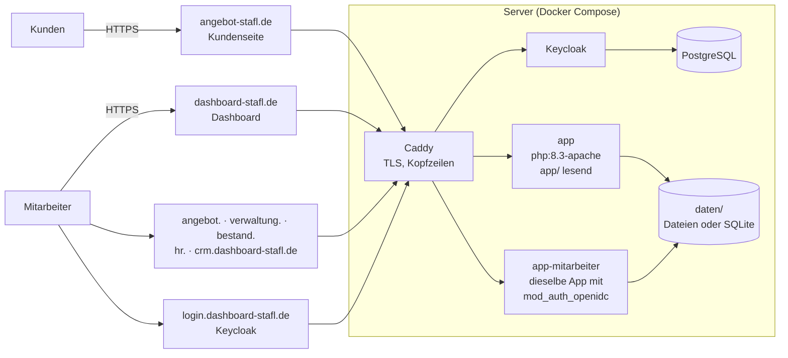
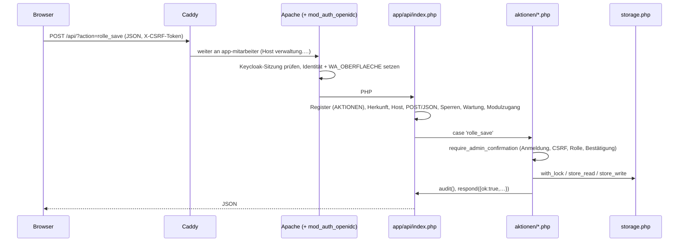

# 2 · Architektur

Das Gesamtbild in einer Seite. Die Begründungen stehen in [`docs/plattform/zielarchitektur.md`](../plattform/zielarchitektur.md)
und den Entscheidungen (ADR) in [`docs/plattform/`](../plattform/README.md); was heute in welcher Datei liegt,
beschreibt [`docs/architektur.md`](../architektur.md) ausführlich.

## Was ist die STAFL-Plattform?

Aus einer Website für das **Wochenangebot** eines Fleischgroßhandels (öffentliche Angebotsliste, Kundenportal mit
eigenen Preisen und Bestellwünschen, Eingabebereich für Mitarbeiter) wird schrittweise eine **modulare
Mitarbeiterplattform**: ein Dashboard mit Kacheln für fachlich unabhängige Module (Angebot, Bestand, CRM, HR,
Verwaltung, Import, später REWE, QS, Einkauf, Marketing, Controlling) auf gemeinsamer technischer Grundlage
(Anmeldung, Rechte, Speicher, Protokoll, Betrieb = Plattformkern).

## Systembild

- **Eine Anwendung, mehrere Hosts.** Kundenseite und alle Mitarbeiter-Hosts laufen aus demselben Code (`app/`). Welche
  Oberfläche ein Host ist, setzt der Webserver (`WA_OBERFLAECHE` in `deploy/anmeldung/apache-oidc.conf`); die
  Anwendung leitet daraus Anmeldung, erlaubte Aktionen und Ansichten ab. Jede Subdomain hat ihre eigene Sitzung
  (`__Host-`-Cookies, GR-108); Aktionen einer Modulseite beantwortet nur ihr eigener Host (GR-109).
- **Mitarbeiter melden sich nur über Keycloak an** (OIDC über das Apache-Modul mod_auth_openidc, GR-110). Der alte
  Eingabebereich mit eigener Anmeldung (`angebot-stafl.de/admin/`) ist stillgelegt; der Notzugang
  (`deploy/notzugang.sh`) öffnet ihn im Notfall. Kunden haben eigene Zugänge, strikt getrennt (GR-003, GR-104).
- **Kein Framework, kein Build.** Server: PHP 8.3 ohne Bibliotheken. Browser: HTML, CSS, JavaScript ohne Framework.
  Werkzeuge: Python-Standardbibliothek.

Hosts und Oberflächen im Einzelnen: [Referenz: Module](referenz/module.md) und `Caddyfile`.

## Module und Plattformkern

Das **Modulregister** [`regeln/module.toml`](../../regeln/module.toml) ist die eine Quelle für Module, ihre
Oberflächen (Adresse, Entwicklungsstand, Freigabe), Code-Pfade, zuständige Agenten und Testgruppen. Daraus entstehen
die Kacheln des Dashboards, die Laufzeitliste `app/api/lib/module-liste.php` und die Prüfungen der CI.

| Ebene | Was | Wo |
| --- | --- | --- |
| Plattformkern | Anmeldung, Sitzungen, Rechte, Sicherheit, Speicher, Protokoll, E-Mail, Betrieb, CI, Regelwerk | `app/api/index.php`, `app/api/storage.php`, `app/api/lib/`, `deploy/`, `werkzeuge/`, `regeln/` |
| Fachmodule | Fachlogik und Oberfläche je Modul | heute teils in gemeinsamen Dateien (`app/api/aktionen/*.php`, `app/assets/admin*.js`), neu unter `app/api/module/<modul>/` und `app/module/<modul>/` |
| Oberflächen | Seiten im Browser | `app/index.html` (Kunden), `app/admin/` (Eingabebereich), `dashboard/`, `app/module/<modul>/` |

Grundsätze, die überall gelten (Details in [`regeln/katalog.toml`](../../regeln/katalog.toml)):

- **Datenverantwortung (GR-101):** Jedes Speicher-Dokument hat genau einen Eigentümer; andere Module nutzen es über
  dessen Funktionen ([05 Daten](05-daten.md), [Referenz: Daten](referenz/daten.md)).
- **Autorisierung immer serverseitig (GR-103):** Was die Oberfläche ausblendet, ist nie die Berechtigung
  ([04 Anmeldung und Rechte](04-anmeldung-rechte.md)).
- **Entwicklung ≠ Freigabe ≠ Wartung (GR-102, GR-107):** Wer eine Oberfläche nutzen darf, entscheidet die Tabelle
  [`regeln/wartung.toml`](../../regeln/wartung.toml) – serverseitig für jede Aktion.
- **Formate nur erweitern (GR-006):** Neuer Code liest alte Daten, alter Code verträgt neue (Rückfall).

## Weg einer Anfrage

Jede Aktion steht im **Aktionsregister** [`regeln/aktionen/<modul>.toml`](../../regeln/aktionen/LIESMICH.md)
(Oberfläche, schreibend, öffentlich, Wartungsverhalten) – der API-Einstieg wendet daraus Schreibschutz,
Host-Bindung und Wartung an, bevor der Code der Aktion läuft. Die Aktion selbst prüft Anmeldung und Recht.
Schritt für Schritt: [03 Server](03-server.md). Alle Aktionen: [Referenz: API](referenz/api.md).

## Daten

Dokumente (JSON-artige PHP-Arrays) über `app/api/storage.php`: als Dateien in `daten/` oder in SQLite
(`daten/.sqlite/store.sqlite`), umschaltbar ohne Codeänderung ([`docs/datenbank.md`](../datenbank.md)). Es gibt kein
ORM und kein festes Schema in der Datenbank – das Format jedes Dokuments bestimmt der Code seines Eigentümers.
PostgreSQL ist als spätere Ausbaustufe geplant (Roadmap), nicht aktiv. [05 Daten](05-daten.md).

## Auslieferung

Pull Request → CI grün → Merge durch den Inhaber → Release-Lauf wartet auf Freigabe (GitHub-Umgebung `produktion`) →
der Server holt den freigegebenen Commit per Timer, setzt Versionsnummern, prüft Gesundheit und fällt bei Fehlern
automatisch zurück. [08 Betrieb](08-betrieb.md), [`docs/release-freigabe.md`](../release-freigabe.md).

## Regelwerk als Leitplanke

Viele Festlegungen sind maschinenlesbar und werden von der CI erzwungen – Agenten und Entwickler müssen sie nicht
auswendig kennen, aber pflegen:

| Datei | Legt fest | Werkzeug |
| --- | --- | --- |
| `regeln/module.toml` | Module, Oberflächen, Pfade, Agenten, Testgruppen, koordinationspflichtige Bereiche | `werkzeuge/regeln.py` |
| `regeln/aktionen/*.toml` | jede API-Aktion | `werkzeuge/regeln.py erzeugen` → `lib/aktionen-liste.php` |
| `regeln/datenverantwortung.toml` | Eigentümer und Querzugriffe je Dokument | `werkzeuge/regeln.py` (liest `store_*`-Aufrufe im Code) |
| `regeln/berechtigungen.toml` | Recht → Modul | `werkzeuge/regeln.py` |
| `regeln/wartung.toml` | Entwicklung/Freigabe/Wartung → Zugang | `werkzeuge/regeln.py`, Vertragstests |
| `regeln/katalog.toml` | Geschäfts- und Architekturregeln GR-xxx mit zugehörigen Tests | `werkzeuge/regeln.py` |
| `docs/entwickler/referenz/` | diese Referenz | `werkzeuge/doku.py` |

Stand: 2026-10-24
