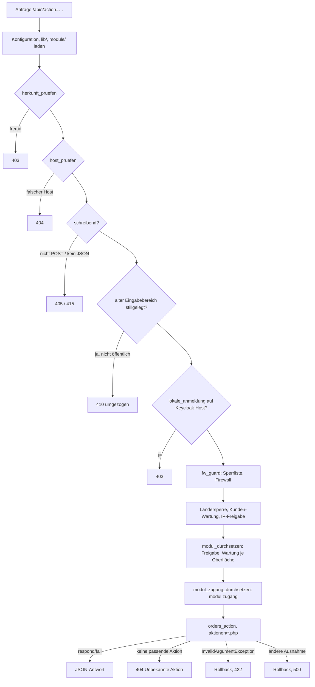

# 3 · Server (PHP-API)

Dieses Kapitel erklärt, wie der Server eine Anfrage verarbeitet, wie eine Aktion aufgebaut ist und welche
Bausteine (Antworten, Speicherschicht, E-Mail, Protokoll, Schutz, Konfiguration) es dafür gibt. Welche Datei was enthält,
steht in [architektur.md](../architektur.md) und [referenz/dateien.md](referenz/dateien.md); jede Aktion mit Recht und
Datei in [referenz/api.md](referenz/api.md). Anmeldung, CSRF und Rechte vertieft
[Kapitel 4](04-anmeldung-rechte.md), die Speicher-Dokumente [Kapitel 5](05-daten.md).

Grundsätze: PHP 8.3, `declare(strict_types=1)`, kein Framework, kein Composer, kein Build-Schritt. Eine einzige
Einstiegsdatei `app/api/index.php`; alle Aktionen heißen `/api/?action=<name>`, Antworten sind JSON.

## 3.1 Ablauf einer Anfrage

`app/api/index.php` arbeitet die Schritte in genau dieser Reihenfolge ab. Jeder Schritt kann die Anfrage mit
`fail()`/`respond()` beenden (beide rufen `exit`).

1. **Grundeinstellungen:** `WA_API` definieren (Bibliotheken prüfen `defined('WA_API')`, sonst 404),
   `display_errors` aus, `X-Powered-By` entfernen, Zeitzone `Europe/Berlin` (gespeichert wird weiter in UTC über
   `now()`/`gmdate`).
2. **Konfiguration und Grunddateien:** `$CFG = require config.php`, dann `geo.php`, `ort.php`, `mail.php`;
   `$DATA` = `data_dir` aus der Konfiguration; danach `storage.php`, `orders.php`, `order_outbox.php`. Konstanten
   `CATEGORIES`, `CONDITIONS`, `PRICE_STATUS`.
3. **Kopfzeilen und Fehlerbehandlung:** `Content-Type: application/json`, `X-Content-Type-Options: nosniff`,
   `Referrer-Policy: same-origin`. Ein `set_exception_handler` ruft `store_rollback()`, schreibt die Meldung ins
   Server-Protokoll (`error_log`) und antwortet 500 mit „Interner Fehler auf dem Server.“ – nie mit Details.
4. **Bibliotheken** aus `lib/` in fester Reihenfolge: `kern`, `nutzer`, `rechte`, `sicherheit`, `sitzung`, `oidc`,
   `passkey`, `protokoll`, `angebote`, `kunden`, `kundenmail`, `fracht`, `einzelangebote`, `benachrichtigung`, `einkauf`,
   `diagnose`, `auswertung`, `preisverlauf`, `bestand`, `firewall`, `integritaet`, `geraete`, dann die erzeugten Listen
   `aktionen-liste.php` und `module-liste.php`, danach `module.php`, `herkunft.php`. Anschließend die Importverträge
   (`module/verwaltung/import.php`, `module/bestand/import.php`, `module/angebot/import.php`,
   `module/verwaltung/importzentrale.php`) und die Fachmodule (`module/hr/*.php`, `module/crm/crm.php`).
5. **Aktion bestimmen:** `$action = $_GET['action']`, `$AKTION = AKTIONEN[$action] ?? null`. Unbekannte Aktionen
   (`null`) gelten als nicht öffentlich und nicht schreibend und enden später mit 404.
6. **`herkunft_pruefen($AKTION, $method)`** (`lib/herkunft.php`, GR-109): `Sec-Fetch-Site` außer `same-origin`/`none`
   → 403; bei Methoden außer GET/HEAD muss ein mitgesendeter `Origin` genau `Schema://Host` sein. Ohne diese
   Kopfzeilen (App, Server-zu-Server) gilt der übrige Schutz. Ausnahme nur mit Registerfeld `fremde_herkunft`
   (heute `abmelden1`). Bewusst vor der Firewall: abgewiesene fremde Anfragen zählen nicht als Treffer.
7. **`host_pruefen($AKTION)`**: Nur auf Keycloak-Hosts (`WA_OIDC=1`) mit gesetztem `WA_OBERFLAECHE`. Aktionen einer
   Oberfläche mit eigener Seite (heute `hr.intern`, `crm.intern`) gibt es nur auf ihrem Host; dort sonst nur
   Plattform-Aktionen mit `wartung_frei`. Sonst 404.
8. **Schreibschutz:** Ist die Aktion schreibend (`schreibend = true`, oder `"post"` bei POST), muss die Methode POST
   sein (sonst 405) und `Content-Type` mit `application/json` beginnen (sonst 415).
9. **Stilllegung des alten Eingabebereichs:** Gilt `eigene_anmeldung_stillgelegt()` (Host ohne `WA_OIDC`, aber
   `WA_EIGENE_ANMELDUNG=aus`), beantwortet der Server alle nicht öffentlichen Aktionen außer `status` und `logout` mit
   410 und `code: "umgezogen"` plus `ziel` (neue Adresse aus `eingabe_adresse()`).
10. **`lokale_anmeldung`:** Aktionen mit eigenem Anmeldeverfahren (Passwort, zweiter Faktor, Passkey,
    Kunden-Anmeldung) sind auf Keycloak-Hosts gesperrt: 403 (GR-110).
11. **`fw_guard($action)`** (`lib/firewall.php`): gesperrte Adresse (Sperrliste, automatische Sperre, Bedrohungsliste)
    → 403 mit `Retry-After`, außer für interne/freigegebene Adressen und angemeldete Mitarbeiter; Angriffsmuster
    (`FW_MUSTER`, `FW_WERKZEUGE`) → 403 bzw. nur protokolliert. Registriert `fw_nachher` (Fehlerbremse, Live-Verkehr) als
    Shutdown-Funktion. Die Falle `waf_probe` wird hier nicht geprüft.
12. **Öffentlich oder Eingabebereich:** `$isPublic` = Registerfeld `oeffentlich`, außer `offer` mit `draft`. Ruft
    eine angemeldete Mitarbeitersitzung ein nicht öffentliches Angebot ab (Kundenangebot oder Wochenangebot ohne
    `std_public()`), gilt die Anfrage als Eingabebereich.
13. **Ländersperre:** Mit `geoEnabled` und (`!$isPublic` oder `geoScope = all`) prüft `geo_blocked(client_ip(), $S)`;
    Treffer werden gezählt (`geo_count`) und mit 403 abgewiesen.
14. **Kunden-Wartung:** Aktionen mit `kunden_wartung` antworten bei aktivem Dokument `wartung` ohne
    Mitarbeitersitzung 503 mit `wartung: true`, `error`, `until` und `Retry-After: 600` (GR-009).
15. **IP-Freigabe des Eingabebereichs:** Nicht öffentlich und `ipEnabled` mit Liste `adminIps`: andere Adressen → 403.
16. **`modul_durchsetzen($AKTION)`** (`lib/module.php`, GR-102/GR-107): Ist die Oberfläche der Aktion für diesen
    Nutzer nicht zugänglich, antwortet der Server 503 (Wartung, `bereich`, `until`, `Retry-After: 600`) oder 404
    („Dieser Bereich ist nicht verfügbar.“). Ausgenommen: öffentliche Aktionen und `wartung_frei`.
17. **`modul_zugang_durchsetzen($AKTION)`** (`lib/rechte.php`, GR-103): Ohne `<modul>.zugang` für das Modul des Hosts
    bzw. der Aktion → 403 mit `code: "kein_modulzugang"`. Ausgenommen: öffentlich, `wartung_frei`, Module `plattform`
    und `dashboard`, gemeinsamer Eingabebereich `angebot.eingabe` ohne eigenen Host.
18. **Aktionen ausführen** in einem `try`: zuerst `orders_action($action)` (Bestell-API), dann der Reihe nach die
    Dateien `aktionen/angebote.php`, `kundenportal`, `mail`, `kundenverwaltung`, `zugang`, `passkey`, `bestand`,
    `einkauf`, `verwaltung`, `entwurf`, `preisverlauf`, `auswertung`, `app`, `kundengruppen`, `einzelangebote`, `schutz`,
    `integritaet`, `module`, `importzentrale`, `hr`, `crm`. Die passende Aktion endet mit `respond()`/`fail()`.
19. **Keine Aktion passte:** `fail('Unbekannte Aktion.', 404)`.
20. **Fehlerbehandlung:** `InvalidArgumentException` → `store_rollback()` und 422 mit der Meldung der Ausnahme. Jede
    andere Ausnahme fängt der Handler aus Schritt 3 (500).



Wichtig: Die Schritte 6–17 sind **Vorprüfungen**. Sie ersetzen nie die Rechteprüfung in der Aktion selbst
(GR-103) – auch nicht `modul_zugang_durchsetzen`.

## 3.2 Aufbau von `app/api/`

| Ort | Inhalt | Regel |
| --- | --- | --- |
| `index.php` | Einstieg, Prüfreihenfolge oben | koordinationspflichtig (API-Einstieg) |
| `lib/*.php` | Bibliotheken nach Fachbereich: nur Funktionen und Konstanten, keine Ausgabe beim Einbinden | beginnen mit `if (!defined('WA_API')) { http_response_code(404); exit; }` |
| `aktionen/*.php` | Aktionen je Fachbereich: `switch ($action) { case '…': { … } }` bzw. `if ($action === '…')` | jede Aktion endet mit `respond()`/`fail()` |
| `module/<modul>/` | Fachcode der Module (z. B. `module/hr/urlaub.php`, `module/crm/crm.php`, Importverträge `module/<modul>/import.php`) | neuer Fachcode gehört hierher (`pfade_geplant` in `regeln/module.toml`), nicht in gemeinsame Dateien |
| `lib/aktionen-liste.php` | Konstante `AKTIONEN`, erzeugt aus `regeln/aktionen/*.toml` | **nie von Hand ändern**: `python3 werkzeuge/regeln.py erzeugen` |
| `lib/module-liste.php` | `MODULE`, `RECHTE_MODUL`, `MODUL_FREIGABE_ERLAUBT`, `MODUL_REGELN`, erzeugt aus `regeln/module.toml`, `regeln/wartung.toml` | **nie von Hand ändern**; bei Rebase-Konflikt neu erzeugen |
| `storage.php` | Speicherschicht (3.5) | koordinationspflichtig |
| `mail.php`, `geo.php`, `ort.php` | SMTP-Client, Länder- und Ortsdatenbank | Schutz über `SCRIPT_FILENAME`-Prüfung statt `WA_API` |
| `orders.php`, `order_outbox.php` | Bestell-API v1 und Versandaufträge (3.9) | |

Aktionsdateien werden im globalen Gültigkeitsbereich eingebunden: `$action`, `$method`, `$CFG`, `$AKTION` stehen zur
Verfügung. Jede Aktion steht in `regeln/aktionen/<modul>.toml` (Felder: [regeln/aktionen/LIESMICH.md](../../regeln/aktionen/LIESMICH.md));
die CI lehnt nicht registrierte oder verwaiste Aktionen ab. Checkliste für eine neue Aktion:
[Kapitel 4.7](04-anmeldung-rechte.md#47-checkliste-neue-aktion-schreiben).

## 3.3 Muster einer Aktion

Beispiel `master_save` (Artikelstammdaten speichern) aus `aktionen/bestand.php` – die Aktion prüft Anmeldung, Recht
und CSRF, liest den Inhalt und übergibt an die Funktion des Daten-Eigentümers (Verwaltung, GR-101):

```php
case 'master_save': {
    $me = require_perm('stammdaten.bearbeiten', true);   // angemeldet + Recht + CSRF (true = schreibend)
    $b = body();                                          // JSON-Inhalt, höchstens 6 MB
    [$m, $d] = stammdaten_speichern($b['articles'] ?? null, (int)($b['rev'] ?? -1), $me);
    if ($d) audit('master', 'Stammdaten bearbeitet', array_slice($d, 0, 2000), null, true);
    respond(['ok' => true, 'rev' => $m['rev'], 'updatedAt' => $m['updatedAt']]);
}
```

Die Funktion des Eigentümers (`module/verwaltung/import.php`) prüft, sperrt, vergleicht die Revision und schreibt:

```php
function stammdaten_speichern($articles, int $rev, array $me): array
{
    $articles = clean_master($articles);                  // Prüfung: wirft InvalidArgumentException → 422
    return with_lock('stammdaten', function () use ($rev, $articles, $me) {
        $cur = store_read('stammdaten') ?: ['rev' => 0, 'articles' => []];
        if ($rev !== (int)$cur['rev']) fail('Die Stammdaten wurden inzwischen an anderer Stelle geändert. Bitte die Seite neu laden.', 409);
        $m = ['rev' => (int)$cur['rev'] + 1, 'updatedAt' => now(), 'updatedBy' => $me['name'], 'articles' => $articles];
        store_write('stammdaten', $m);
        return [$m, master_changes($cur['articles'], $articles)];
    });
}
```

Die Bausteine im Einzelnen:

| Baustein | Funktion | Hinweise |
| --- | --- | --- |
| Anmeldung | `require_auth(bool $write = false, string $role = 'viewer')` | 401 ohne Sitzung; setzt `Cache-Control: private, no-store`; mit `$write = true` Prüfung von `X-CSRF-Token` (403) |
| Recht | `require_perm('<modul>.<recht>', $write)`, `may($me, '…')` | 403 „Dafür fehlt Ihnen die Berechtigung …“ |
| Bestätigung | `require_admin_confirmation('<aktion>')`, `require_perm_confirmed('<recht>', '<aktion>')` | Schlüssel aus `BESTAETIGUNG` (`lib/sicherheit.php`); 403 `confirmation_required`, auf Keycloak-Hosts erneute Anmeldung (`reauth_required`) |
| Kunde | `current_customer()`, `require_customer_csrf()` | getrennt von Mitarbeitern (GR-003, GR-104) |
| Eingabe | `body()`, `s($v, $max, $allowEmpty)`, `clean_price()` und die `clean_*`-Funktionen der Fachbereiche | nie `$_POST`; ungültige Werte → `InvalidArgumentException` oder `fail(…, 422)` |
| Sperre | `with_lock('<dokument>', fn)` | um jedes Lesen-Ändern-Schreiben (3.5) |
| Speichern | `store_read`, `store_write` | nur eigene Dokumente oder erlaubte Querzugriffe (GR-101) |
| Konflikt | Revision `rev` vergleichen | 409 statt stillem Überschreiben |
| Protokoll | `audit($art, $text, $aenderungen, $wer, $zusammenfassen)` | 3.7 |
| Antwort | `respond([...])`, `fail($text, $status)` | 3.4 |

Lesende Aktionen setzen bei Bedarf `header('Cache-Control: no-store')`; `require_auth` setzt bereits
`private, no-store`.

## 3.4 Hilfsfunktionen, Antwortformat, Statuscodes

`lib/kern.php`:

| Funktion | Zweck |
| --- | --- |
| `respond(array $data, int $status = 200)` | `store_commit()`, App-Sitzungskopfzeile (`app_session_header`), Statuscode, JSON (`JSON_UNESCAPED_UNICODE`), `exit` |
| `fail(string $msg, int $status = 400)` | `respond(['ok' => false, 'error' => $msg], $status)` |
| `body()` | `php://input` lesen, über 6 MB → 413, kein JSON-Objekt → 400 „Ungültige Anfrage.“ |
| `s($v, int $max, bool $allowEmpty = true)` | Text, Zahl → bereinigter Text (Leerraum zusammengefasst, getrimmt, auf `$max` Zeichen gekürzt); anderes → `null`; leer und `$allowEmpty = false` → `null` |
| `clean_price($p, $where)` | Preis `{status: value|request|none, value?, raw?, label?}`; Fehler → `InvalidArgumentException` |
| `now()` | Zeitpunkt in UTC, `2026-01-05T08:00:00Z` |
| `utc_monat($versatz, $t)` | Monat `JJJJ-MM` in UTC (Monatsdateien des Protokolls) |
| `testumgebung()` | `WA_TESTUMGEBUNG === '1'` |

Wichtig: `respond()` **bestätigt** eine offene SQLite-Transaktion – auch bei `fail()`. Beabsichtigte Fehler dürfen
vorher geschriebene Zähler (z. B. Fehlversuche) behalten. Wer Änderungen verwerfen will, wirft eine Ausnahme statt
`fail()` aufzurufen (siehe 3.5).

**Antwortformat:** Erfolg `{"ok": true, …}`, Fehler `{"ok": false, "error": "Text für den Nutzer"}`. Einige Fehler
tragen zusätzlich `code` für die Oberfläche:

| `code` | Bedeutung |
| --- | --- |
| `confirmation_required` | Passwortbestätigung nötig (403) |
| `confirmation_invalid` | Passwort bei der Bestätigung falsch |
| `confirmation_locked` | zu viele falsche Bestätigungen (429, `Retry-After`) |
| `reauth_required` | Keycloak-Host: erneute Anmeldung bzw. zweiter Faktor nötig (403, Adresse in `anmelden`) |
| `kein_modulzugang` | kein `<modul>.zugang` (403, mit `modul`, `name`) |
| `umgezogen` | alter Eingabebereich stillgelegt (410, mit `ziel`) |
| `app_totp_required` | Anmeldung in der App ohne eingerichtete Authenticator-App (403) |

Weitere Kennzeichen: `wartung: true` (503), `conflict: true` (409 beim Entwurf, `draft_conflict`). Die Bestell-API
antwortet zusätzlich mit `apiVersion: 1`.

**Verwendete Statuscodes:**

| Status | Verwendung |
| --- | --- |
| 200 | Erfolg |
| 304 | `offer` (öffentliches Wochenangebot) mit passendem `If-None-Match`; die ETag gilt für die aufgelöste Antwort samt Bestand (ausverkaufte Sonderposten) und Frachthinweis |
| 400 | Standard von `fail()`, ungültiger Inhalt |
| 401 | nicht angemeldet („Bitte erneut anmelden.“) |
| 403 | fremde Herkunft, CSRF, fehlendes Recht, Sperren (IP, Land, Firewall), Bestätigung nötig |
| 404 | unbekannte Aktion, Aktion auf falschem Host, nicht freigegebene Oberfläche, Datensatz nicht gefunden |
| 405 / 415 | schreibende Aktion ohne POST / ohne JSON |
| 409 | Revision veraltet (gleichzeitige Änderung) |
| 410 | alter Eingabebereich stillgelegt |
| 413 | Inhalt über 6 MB |
| 422 | Eingabe ungültig (`InvalidArgumentException` oder `fail(…, 422)`) |
| 429 | zu viele Fehlversuche (Anmeldung, Bestätigung, Bestellwünsche je Tag) |
| 500 | unerwarteter Fehler (ohne Details) |
| 502 | externer Dienst gescheitert (E-Mail-Zustellung, Länder-/Orts-/Bedrohungsdaten laden) |
| 503 | Wartung (Kunden-Wartung, Wartung je Oberfläche) |

## 3.5 Speicherschicht (`app/api/storage.php`)

Alle Daten sind **Dokumente**: ein Name (z. B. `kunden`, `protokoll/2026-01`) und ein JSON-Wert (Array). Welche
Dokumente es gibt und wem sie gehören: [Kapitel 5](05-daten.md), [referenz/daten.md](referenz/daten.md).

| Funktion | Verhalten |
| --- | --- |
| `store_read(string $name)` | Dokument als Array oder `null`, wenn es fehlt |
| `store_write(string $name, array $data)` | ganzes Dokument ersetzen (`JSON_THROW_ON_ERROR`) |
| `store_delete(string $name)` | Dokument löschen |
| `store_mtime(string $name)` | Änderungszeit (Unix) oder `null` |
| `store_names(string $prefix)` | Namen unter `prefix/` (z. B. `store_names('versionen')`) |
| `with_lock(string $name, callable $fn)` | `$fn` unter exklusiver Sperre ausführen, Rückgabewert durchreichen |
| `store_commit()`, `store_rollback()` | offene SQLite-Transaktion abschließen bzw. verwerfen; `store_rollback` leert auch vorgemerkte Benachrichtigungen |
| `store_mode()` | `files` oder `sqlite` (einmal je Prozess entschieden) |
| `store_stats()` | Anzahl und Größe für die Übersicht |

Namen müssen `^[a-zA-Z0-9_-]+(?:/[a-zA-Z0-9_-]+)*$` entsprechen, sonst `RuntimeException`.

**Dateien (Standard):** Jedes Dokument ist `$DATA/<name>.php` und beginnt mit der Sperrzeile
`<?php http_response_code(404); exit; ?>` (Konstante `GUARD`), dahinter JSON. Geschrieben wird in eine temporäre Datei
und dann per `rename` ersetzt (kein halb geschriebenes Dokument). Nicht lesbares JSON liefert `null`.

**SQLite:** Liegt die Datei `$DATA/.sqlite-active`, nutzt der Server `$DATA/.sqlite/store.sqlite`, Tabelle
`documents(name, payload, mtime)`, `PRAGMA user_version = 1`, `synchronous=FULL`, 10 Sekunden Wartezeit. Fehlt die
Datenbank oder stimmt das Schema nicht, bricht der Server ab – kein stiller Rückgriff auf Dateien. Umschalten,
Sicherung und Rückfall: [datenbank.md](../datenbank.md).

**Seitendateien:** `STORE_SIDECARS = ['mail-schluessel', 'sicherung', 'deployment']` bleiben auch bei SQLite Dateien
(Postfach-Schlüssel außerhalb der Sicherung, Statusdateien der Skripte).

**Sperren und Transaktionen:**

- Dateien: `with_lock` sperrt `$DATA/.<name>.lock` mit `flock(LOCK_EX)`. Verschachtelt derselbe Name → keine zweite
  Sperre. Verschiedene Namen sperren unabhängig.
- SQLite: Die äußerste `with_lock` startet `BEGIN IMMEDIATE`; verschachtelte Aufrufe (auch andere Namen) laufen in
  derselben Transaktion. Normales Ende → `COMMIT`, Ausnahme → `ROLLBACK` und Ausnahme weiterwerfen.
- `fail()`/`respond()` innerhalb einer Sperre beenden die Anfrage mit `exit`; `respond()` ruft vorher `store_commit()`.
  Für „alles oder nichts“ daher prüfen, **bevor** geschrieben wird (wie `stammdaten_speichern`: erst
  `clean_master`, dann Revision, dann `store_write`).
- Zusätzlich hält jeder Prozess eine geteilte Sperre auf `$DATA/.storage.lock`; die Migration kann so die Speicherart
  nicht mitten in einer Anfrage wechseln.

Regeln für eigenen Code:

```php
// aktionen/entwurf.php (draft_ping): Lesen-Ändern-Schreiben unter der Sperre des Dokuments, Ergebnis zurückgeben
$pres = with_lock('anwesenheit', function () use ($me, $now) {
    $l = store_read('anwesenheit') ?? [];
    foreach ($l as $k => $v) if (!is_array($v) || (int)($v['at'] ?? 0) < $now - 90) unset($l[$k]);
    $l[$me['id']] = ['name' => $me['name'], 'role' => $me['role'], 'at' => $now];
    store_write('anwesenheit', $l);
    return $l;
});
```

- Nie außerhalb der Sperre lesen und darin schreiben.
- Ein Modul sperrt mehrere eigene Dokumente mit **einer** Sperre (CRM: `crm-kunden` für alle drei CRM-Dokumente).
- Neue Dokumente in `regeln/datenverantwortung.toml` eintragen; `werkzeuge/regeln.py` prüft die Aufrufe
  `store_read`/`store_write`/`store_delete`/`with_lock` gegen Eigentümer und erlaubte Querzugriffe (GR-101).

## 3.6 E-Mail

`app/api/mail.php` enthält einen eigenen SMTP-Client (Klasse `Smtp`, STARTTLS oder SSL, eine Verbindung für mehrere
Nachrichten), `mail_build` (Text/HTML, Anhänge als multipart/mixed), `mail_layout`, `mail_button`, `mail_h`.

- **Postfach:** `mail_cfg()` liefert die Einstellungen oder `null` (Versand nicht eingerichtet). Vorrang hat das im
  Eingabebereich gespeicherte Postfach (Dokument `mailkonto`, Passwort `passEnc` mit libsodium verschlüsselt,
  Schlüssel im Dokument `mail-schluessel`, nie in Sicherungen, nie in Antworten); sonst die Umgebungsvariablen
  `MAIL_*` (3.10). In der Testumgebung ohne beides: Pseudo-Postfach `testpostfach`.
- **Versand:** `mail_send_many($cfg, $jobs)` (`lib/kundenmail.php`) verschickt Aufträge `{to, name, subject, text,
  html, headers?, anhaenge?}` und liefert je Auftrag `{ok, error?}`. In der Testumgebung legt `testpost_ablegen` die
  Nachrichten nur im Dokument `testpostfach` ab (die letzten 100); `Smtp` verweigert dort den Aufbau.
- **Links** in E-Mails nur über `mail_base_url()` (`WA_URL` oder `https://` + `DOMAIN`), nie aus dem `Host` der Anfrage.
- **Versandprotokoll:** Dokument `mailversand` (die letzten 3000 Einträge).
- **Bestellwünsche:** dauerhafte Versandaufträge im Bestellwunsch selbst (`order_outbox.php`,
  [bestell-mailversand.md](../bestell-mailversand.md)).

**Benachrichtigungen an Mitarbeiter** (`lib/benachrichtigung.php`): Ereignisse in `NOTIFY_EVENTS` (`bestellung`,
`sicherheit`, `einkauf`, `abmeldung`), Empfänger im Dokument `benachrichtigungen`. `notify($ev, $titel, $fakten)` merkt
nur vor; `audit()` meldet über `NOTIFY_AUDIT` automatisch (`security`, `twofa`, `user`, `wartung`, `setup` →
`sicherheit`). Versendet wird **nach** der Antwort in `notify_flush` (Shutdown-Funktion), gebündelt mit Pause je
Ereignis (`benachrichtigung-stand`). Bei offener Transaktion oder nach `store_rollback()` wird nichts gemeldet.

## 3.7 Protokoll (`audit`)

`audit(string $a, string $s, array $d = [], ?array $who = null, bool $merge = false)` (`lib/protokoll.php`) hängt einen
Eintrag an das Monatsdokument `protokoll/<JJJJ-MM>` (UTC) an:

```json
{"t": "2026-01-05T08:00:00Z", "u": "max-muster", "n": "Max Muster", "r": "editor", "ip": "…",
 "a": "master", "s": "Stammdaten bearbeitet",
 "d": [{"k": "s1001|origin", "code": "1001", "name": "Testartikel", "f": "Herkunft", "from": "DE", "to": "IE"}]}
```

- `$a` = Art des Vorgangs, z. B. `publish`, `draft`, `discard`, `offers`, `master`, `stock`, `history`, `customers`,
  `einzelangebot`, `bestellung`, `mail`, `einkauf`, `user`, `security`, `twofa`, `wartung`, `login`, `login_fail`,
  `logout`, `password`, `reauth`, `reauth_fail`, `setup`, `kunde_login`, `kunde_login_fail`, `kunde_password`,
  `kunde_abmeldung`, `import`, `hr`, `crm`, `modul_freigabe`, `modul_tester`, `oidc_*`, `protokoll_aufbewahrung`.
- `$merge = true` fasst fortlaufende Vorgänge derselben Person und Art innerhalb von 30 Minuten zusammen
  (`changes_merge`).
- Kunden: IP nur bei fehlgeschlagener Anmeldung. Vorgänge mit Kundendaten (`LOG_KUNDENDATEN`) sieht nur, wer
  `kunden.sehen` hat; sonst liefert `log` sie ohne Details.
- Nie Passwörter, Codes, Tokens oder Notizinhalte ins Protokoll schreiben (das CRM protokolliert z. B. nur
  Kundennummer, Feld und Auswahlwerte).
- Fehler beim Protokollieren landen im Server-Protokoll; nur innerhalb einer SQLite-Transaktion wird die Ausnahme
  weitergeworfen.
- **Aufbewahrung:** laufender Monat plus `PROTOKOLL_MONATE` (6) Monate davor (`protokoll_grenze()`). `audit()` löscht
  ältere Monatsdokumente unter derselben Sperre (`protokoll_aufraeumen()`, beide Speicherarten) und vermerkt das als
  Vorgang `protokoll_aufbewahrung` (nur die Monate, keine Inhalte). Die Ansicht `log` bietet ältere Monate nie an
  (`protokoll_monate()`), auch nicht über `?month=`. Sicherungen enthalten ältere Stände, bis sie selbst ablaufen.
  Leser anderer Auswertungen (Fehlversuche der letzten 7 Tage, Diagnose) sind davon nicht betroffen.

Fehlversuche bei der Anmeldung zählt `attempts_record()` im Dokument `logins` (Schlüssel: SHA-256 der IPv4-Adresse
bzw. des IPv6-/64-Netzes, `client_key`); Grenzen aus `config.php` (`max_attempts`, `lock_minutes`).

## 3.8 Sicherheitsfunktionen im Überblick

| Baustein | Ort | Kurz |
| --- | --- | --- |
| Herkunft, Host | `lib/herkunft.php` | GR-109, Schritte 6–7 |
| Firewall, Schutzzentrale | `lib/firewall.php`, `aktionen/schutz.php` | Sperrliste (`sperrliste`), Muster, Fehlerbremse (400/404/405/415 je Adresse in 5 Minuten, `fehlerLimit`), automatische Sperre, Bedrohungsliste Spamhaus DROP (`bedrohungsliste`), Live-Verkehr (`verkehr`, 500 Einträge), Falle `waf_probe` |
| Länder-, IP-Sperre | `lib/sicherheit.php`, `geo.php` | Einstellungen im Dokument `sicherheit` (`geoEnabled`, `geoMode` block/allow, `geoCountries`, `geoScope` admin/all, `ipEnabled`, `adminIps`); Länderdatenbank `geo/laender.dat.php` |
| Besucher-IP | `client_ip()` | `X-Forwarded-For` nur von vertrauten Proxys (`WA_TRUSTED_PROXIES`), letzter Eintrag |
| Sitzung, CSRF, Bestätigung, Keycloak | `lib/sitzung.php`, `lib/oidc.php` | [Kapitel 4](04-anmeldung-rechte.md) |
| Dateiprüfung | `lib/integritaet.php` | Programmdateien gegen die beim Einspielen erzeugte Prüfliste |
| Diagnose | `lib/diagnose.php` | nur lesend, für Administratoren |

Sicherheitseinstellungen liest `sec()` einmal je Anfrage: `array_merge(SEC_DEFAULTS, store_read('sicherheit') ?? [])`.

## 3.9 Bestell-API und App-API

- **Bestell-API v1** (`orders.php`, `order_outbox.php`): Aktionen `bestellungen`, `bestellung`, `bestellung_save`,
  `bestellung_mail_retry` (Mitarbeiter, Rechte `bestellungen.sehen`/`.bearbeiten`) und `kunde_bestellungen`,
  `kunde_bestellung_detail` (Kunde). `orders_action($action)` läuft vor den Aktionsdateien und endet selbst mit
  `respond()`/`fail()`. Den Bestellwunsch selbst (`kunde_bestellung`) nimmt `aktionen/kundenportal.php` an. Preise und
  Summen berechnet nur der Server aus dem veröffentlichten Angebot des Kunden (GR-004). Format:
  [bestell-api-v1.md](../bestell-api-v1.md).
- **App-API:** Die App nutzt dieselben Aktionen. Statt Cookie sendet sie `X-WA-Client: app` und die Sitzungskennung
  in `X-WA-Sitzung`; `respond()` gibt die aktuelle Kennung zurück (`app_session_header`). `app_info` liefert
  Mindestversion, Bestellfunktion, Wartung. Details: [app-api.md](../app-api.md).

## 3.10 Konfiguration

**`app/api/config.php`** (im Repository, ohne Geheimnisse): `company`, `data_dir` (`app/data`, im Container über
`daten/` eingebunden), `session_hours` (wird im Code derzeit nicht gelesen; die Abmeldung nach Inaktivität steuert
`idleMinutes` im Dokument `sicherheit`), `keep_versions` (60), `max_attempts` (5), `lock_minutes` (10).

**Umgebungsvariablen**, die der PHP-Code liest. `env_str()` (`mail.php`) liest `getenv`, dann `$_SERVER`;
`oidc_einstellung()` (`lib/oidc.php`) liest `$_SERVER`, dann `getenv` – nie Kopfzeilen (die heißen `HTTP_…`).

| Variable | Gelesen in | Bedeutung | Standard |
| --- | --- | --- | --- |
| `WA_TESTUMGEBUNG` | `lib/kern.php` | `1` = Testumgebung: E-Mails nur ins Testpostfach | aus |
| `WA_INSTALLED` | `lib/nutzer.php` | `1` = Ersteinrichtung im Browser (`setup`) gesperrt | nicht gesetzt |
| `WA_TRUSTED_PROXIES` | `lib/protokoll.php` | vertraute Proxys für `X-Forwarded-For`: Namen (DNS), IPs, CIDR, getrennt durch Komma/Leerzeichen | leer = jede private Adresse |
| `MAIL_SMTP_HOST` | `mail.php` | SMTP-Server (ohne ihn und `MAIL_FROM` kein Versand über Umgebung) | – |
| `MAIL_SMTP_PORT` | `mail.php` | Port | 465 bei `ssl`, sonst 587 |
| `MAIL_SMTP_SECURE` | `mail.php` | `starttls`, `ssl`, `none` (nur lokal/Tests) | `starttls` |
| `MAIL_SMTP_USER`, `MAIL_SMTP_PASS` | `mail.php` | Zugangsdaten des Postfachs | leer |
| `MAIL_FROM` | `mail.php` | Absenderadresse (muss gültig sein) | – |
| `MAIL_FROM_NAME` | `mail.php` | Absendername | `company` |
| `MAIL_REPLY_TO` | `mail.php` | Antwortadresse | leer |
| `MAIL_SMTP_CAFILE` | `mail.php` | eigene Zertifizierungsstelle (interne Server/Tests) | leer |
| `WA_URL` | `mail.php` | Basisadresse für Links in E-Mails | `https://` + `DOMAIN` |
| `DOMAIN` | `mail.php` | Domain, falls `WA_URL` fehlt | – |
| `WA_PWNED_URL` | `lib/nutzer.php` | nur Tests: Adresse der Datenleck-Prüfung | `PW_LEAK_URL` |
| `WA_ORT_URL` | `ort.php` | nur Tests: Quelle der Ortsdatenbank | `ORT_URL` |
| `WA_OIDC` | `lib/oidc.php` | `1` = Keycloak-Host (vom Webserver gesetzt) | aus |
| `WA_OIDC_ISSUER` | `lib/oidc.php` | erwarteter Aussteller (`iss`) | – (ohne Wert keine Identität) |
| `WA_OIDC_ACR` | `lib/oidc.php` | Anmeldestärke, die als zweiter Faktor zählt | `mfa` |
| `WA_OBERFLAECHE` | `lib/herkunft.php`, `lib/rechte.php`, `lib/sitzung.php` | Oberfläche dieses Hosts, z. B. `hr.intern` | leer |
| `WA_EIGENE_ANMELDUNG` | `lib/oidc.php` | `aus` = alter Eingabebereich stillgelegt | an |
| `WA_EINGABE_ADRESSE` | `lib/oidc.php` | neue Adresse des Eingabebereichs (nur `https://…`) | `https://angebot.dashboard-stafl.de/admin/` |
| `WA_DASHBOARD` | `lib/sitzung.php` | Rückweg zum Dashboard | `https://dashboard-stafl.de/` |

Vom Apache-Modul mod_auth_openidc gesetzt (nur auf Keycloak-Hosts, nie aus Kopfzeilen): `REMOTE_USER`,
`OIDC_CLAIM_sub`, `OIDC_CLAIM_iss`, `OIDC_CLAIM_preferred_username`, `OIDC_CLAIM_auth_time`, `OIDC_CLAIM_sid`,
`OIDC_CLAIM_acr`, `OIDC_CLAIM_amr`.

Gelesene Kopfzeilen (vom Browser bzw. Proxy, also nicht vertrauenswürdig ohne Prüfung): `Host`, `Origin`,
`Sec-Fetch-Site`, `X-CSRF-Token`, `X-WA-Client`, `X-WA-Sitzung`, `X-Forwarded-For` (nur von vertrauten Proxys),
`X-Forwarded-Proto` (in `is_https()`), `If-None-Match`, `User-Agent`.

Geheimnisse gehören in `.env` auf dem Server, nie ins Repository (GR-007). Betrieb und Compose-Dateien:
[architektur.md](../architektur.md), [testumgebung.md](../testumgebung.md).

Stand: 2026-10-24
