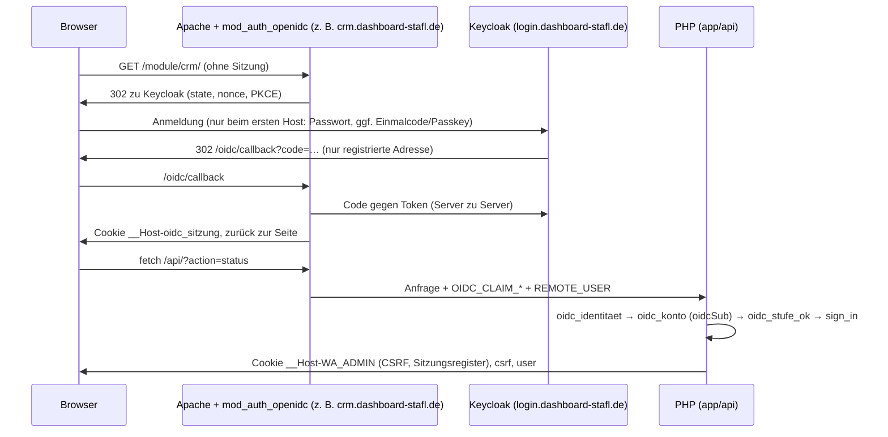

# 4 · Anmeldung, Sitzungen, Rechte

Dieses Kapitel erklärt, wie Mitarbeiter und Kunden angemeldet werden, wie eine Anfrage geprüft wird und wie Rechte
entstehen. Ziel: beim Erweitern keine Sicherheitslücke einbauen. Verbindlich sind `AGENTS.md` und
`regeln/katalog.toml` (GR-xxx); Entscheidungen und Begründungen stehen in
[ADR-003](../plattform/adr-003-domains-anmeldung.md), der Betrieb in
[inbetriebnahme-anmeldung.md](../plattform/inbetriebnahme-anmeldung.md), die Dateiübersicht in
[architektur.md](../architektur.md).

Grundsatz: **Keycloak sagt nur, wer jemand ist. Was er darf, prüft unser Server bei jeder Aktion** (GR-103, GR-110).

## 4.1 Hosts und Oberflächen

Alle Mitarbeiter-Hosts sind dieselbe PHP-Anwendung. Welcher Bereich ein Host ist, setzt der Webserver
(`deploy/anmeldung/apache-oidc.conf`, `SetEnv` je VirtualHost) – nie der Browser. PHP liest diese Werte nur über
`oidc_einstellung()` aus `$_SERVER`/`getenv` (Kopfzeilen landen in `HTTP_*` und werden nicht gelesen).

| Host | Inhalt | `WA_OBERFLAECHE` | Anmeldung |
| --- | --- | --- | --- |
| `angebot-stafl.de` | Kundenseite, Kundenportal; `/admin/` stillgelegt | – (kein `WA_OIDC`) | Kunden: eigene Anmeldung |
| `login.dashboard-stafl.de` | Keycloak; Caddy leitet nur `/realms/mitarbeiter/*` und `/resources/*` weiter, sonst 404 | – | – |
| `dashboard-stafl.de` | Mitarbeiter-Dashboard (`/` → `/dashboard/`) | `dashboard.start` | Keycloak-Client `dashboard` |
| `angebot.dashboard-stafl.de` | Eingabebereich (`/` → `/admin/`) | `angebot.eingabe` | Client `angebot` |
| `verwaltung.dashboard-stafl.de` | derselbe Eingabebereich, nur Verwaltung; `/import/` → Importzentrale | `verwaltung.verwaltung` | Client `verwaltung` |
| `bestand.dashboard-stafl.de` | derselbe Eingabebereich, nur Bestand | `bestand.intern` | Client `bestand` |
| `hr.dashboard-stafl.de` | eigene Seite `/module/hr/` (`/admin` → dorthin) | `hr.intern` | Client `hr` |
| `crm.dashboard-stafl.de` | eigene Seite `/module/crm/` (`/admin` → dorthin) | `crm.intern` | Client `crm` |
| `marketing.dashboard-stafl.de` | eigene Seite `/module/marketing/` (`/admin` → dorthin) | `marketing.intern` | Client `marketing` |
| `rewe.`, `qs.`, `einkauf.`, `test.dashboard-stafl.de` | nur 503-Platzhalter in Caddy (GR-105) | – | – |

Jeder Mitarbeiter-VirtualHost setzt außerdem `WA_OIDC 1`, `WA_OIDC_ISSUER` (Realm `mitarbeiter`) und
`WA_OIDC_ACR mfa`. Caddy leitet die Mitarbeiter-Hosts an `app-mitarbeiter:80`; dieses Ziel gibt es nur mit
`deploy/anmeldung/docker-compose.anmeldung.yml`. Fehlt die Ergänzung, antworten die Hosts mit 502 – nie mit der
Anwendung ohne Keycloak (`Caddyfile`).

`me.bereich` in der Antwort von `status` ist `WA_OBERFLAECHE`; `admin.js` blendet danach Ansichten ein und aus. Das ist
**nur Anzeige**. Gesperrt wird serverseitig (4.3, 4.4).

### Stilllegung des alten Eingabebereichs

Seit 23.10.2026 gilt in der Compose-Ergänzung `WA_EIGENE_ANMELDUNG=aus` (`lib/oidc.php`):

```php
function eigene_anmeldung_stillgelegt(): bool
{
    return !oidc_modus() && alter_zugang_aus();
}
```

Auf Hosts ohne `WA_OIDC` (also `angebot-stafl.de`) liefert `current_user()` dann immer `null`, und der API-Einstieg
(`app/api/index.php`) beantwortet jede nicht öffentliche Aktion außer `status` und `logout` mit 410
`code: umgezogen` und der neuen Adresse (`eingabe_adresse()`, nur `https://…`, Standard
`https://angebot.dashboard-stafl.de/admin/`). Kundenfunktionen sind öffentliche Aktionen und laufen weiter.

Notzugang bei gestörtem Keycloak: `sh deploy/notzugang.sh an|aus|status` im Installationsordner. Das Skript ändert nur
die Zeile `WA_EIGENE_ANMELDUNG` in `.env` und erstellt den App-Container neu. Danach gilt auf `angebot-stafl.de/admin/`
wieder die lokale Anmeldung (4.2). Nur mit Freigabe des Inhabers (Server-Eingriff, `AGENTS.md`).

## 4.2 Mitarbeiteranmeldung

### Über Keycloak (Normalfall)

OpenID Connect spricht **nicht** unsere Anwendung, sondern das Apache-Modul mod_auth_openidc (ADR-003 §2): state,
nonce, PKCE (`OIDCPKCEMethod S256`), Code-Tausch, Token-Prüfung, eigene Sitzung je Host und Back-Channel-Logout. Token
bleiben auf dem Server (`OIDCPassAccessToken Off`, `OIDCPassRefreshToken Off`). Die Claims des ID-Tokens gibt das Modul
als Umgebungsvariablen weiter (`OIDCPassClaimsAs environment`, Präfix `OIDC_CLAIM_`, `REMOTE_USER` = `sub`).

Apache verlangt auf jedem Mitarbeiter-Host `Require valid-user`; unter `/api/` mit `OIDCUnAuthAction 401` statt
Weiterleitung. Ohne Anmeldung erreicht eine API-Anfrage PHP also gar nicht. Frei sind nur
`/dashboard/abgemeldet.html`, `/dashboard/dashboard.css` und `/assets/`.



In PHP (`lib/oidc.php`, aufgerufen aus `current_user()` in `lib/sitzung.php`):

1. **`oidc_identitaet()`** übernimmt die Identität nur, wenn `OIDC_CLAIM_iss` genau `WA_OIDC_ISSUER` ist und
   `REMOTE_USER` gleich `OIDC_CLAIM_sub`:

   ```php
   if ($sub === '' || $erwartet === '' || !hash_equals($erwartet, $iss)) return null;
   if ((string)($_SERVER['REMOTE_USER'] ?? '') !== $sub) return null;
   ```

2. **`oidc_konto()`** sucht das Mitarbeiterkonto (Dokument `nutzer`) über `oidcSub`. Gibt es keins, wird einmalig ein
   noch nicht verknüpftes Konto mit gleichem Benutzernamen (`preferred_username`, ohne Groß/Klein) verknüpft und
   `oidcSub` gespeichert (Protokoll `oidc_verknuepft`). Danach zählt nur `sub` – ein später gleich benannter
   Keycloak-Nutzer erhält kein bereits verknüpftes Konto. Ohne Konto oder bei gesperrtem Konto: **403** (nicht 401,
   sonst meldete sich der Browser endlos neu an). Rolle, Rechte und „aktiv“ werden bei jeder Anfrage frisch gelesen.
3. **Anmeldestärke** (`oidc_stufe_ok`): Ein zweiter Faktor ist Pflicht für Administratoren und für Konten mit
   `twofa_required()` (Sicherheitseinstellung `twofa` = `admins`/`all` oder Nutzerfeld `twofaPflicht`). Als Nachweis
   gilt `acr` = `WA_OIDC_ACR` (Standard `mfa`) **oder** `amr` enthält `otp`, `hwk` oder `swk`. Fehlt er, antwortet die
   Anwendung 403 `code: reauth_required` mit `anmelden` = `/oidc/callback?…auth_request_params=acr_values=mfa…`
   (zweite Stufe bei Keycloak). Schutz vor Schleifen: höchstens drei Anforderungen in zehn Minuten, danach Fehlermeldung.
4. **Hostsitzung:** Passt die PHP-Sitzung nicht mehr (anderer Nutzer, anderes `sub`, andere Keycloak-`sid`, geänderte
   Sitzungsversion `sv`, fehlt im Register), wird sie geleert und mit `sign_in()` neu vergeben. `authAt` und
   `adminConfirmedAt` sind dann der Anmeldezeitpunkt bei Keycloak (`auth_time`), nicht der Sitzungsbeginn hier.

Auf Keycloak-Hosts überspringt `require_auth()` die eigenen Prüfungen `mustChange` und „zweiter Faktor fehlt“ – das
erledigt Keycloak. `me_payload()` meldet dort `zentral: true`, `bereich`, `dashboard` und `modulzugang`.

**Erneute Anmeldung statt Passwortbestätigung:** Ist die Bestätigung abgelaufen, ruft `require_admin_confirmation()`
(und `confirm_password()`) auf Keycloak-Hosts `oidc_neu_anmelden()` auf: 403 `reauth_required` mit einer Adresse mit
`max_age=0`. Die Oberflächen (`admin.js`, `dashboard.js`, `hr.js`, `crm.js`) folgen nur Adressen, die mit `/oidc/`
beginnen, und hängen die aktuelle Seite als `target_link_uri` an; mod_auth_openidc erlaubt Rücksprünge nur auf die
eigenen Hosts (`OIDCRedirectURLsAllowed`). Nach der Rückkehr ist `auth_time` neuer als `authAt`; `oidc_nutzer()` setzt
damit `adminConfirmedAt` neu (Protokoll `reauth`).

**Abmelden:** Aktion `logout` verlangt bei bestehender Sitzung das CSRF-Token (ohne Sitzung geht sie immer), entfernt den Eintrag im Sitzungsregister, zerstört die PHP-Sitzung und liefert auf
Keycloak-Hosts `abmelden` = `/oidc/callback?logout=https://<host>/dashboard/abgemeldet.html`. Der Browser folgt; das
Modul beendet seine Sitzung und die Keycloak-Sitzung, Keycloak meldet alle anderen Clients per Back-Channel-Logout ab
(`backchannel.logout.url` je Client in `deploy/anmeldung/realm-mitarbeiter.json`). Sitzungsdauer im Modul: 4 Std.
Leerlauf, höchstens 10 Std. (`OIDCSessionInactivityTimeout 14400`, `OIDCSessionMaxDuration 36000`).

**Ablauf und Beenden (seit 26.10.2026):** Ohne Vorkehrung entstünde die PHP-Sitzung eines Keycloak-Hosts beim nächsten
Aufruf neu, solange die Sitzung des Moduls gilt. Deshalb merkt sich der Server das Ende: Abmeldung nach Inaktivität
(Sicherheitseinstellung `idleMinutes`; Hintergrundabgleiche zählen nicht) in der geleerten PHP-Sitzung (`oidcEnde`,
`start_session`), „Sitzung beenden“ in Verwaltung → Sitzungen im Dokument `oidc-abmeldungen` – je Keycloak-Sitzung (`sid`,
am Registereintrag als `oidcSid` vermerkt) bzw. ohne bekannte `sid` oder bei „alle Sitzungen“ je Mitarbeiter (nie die eigene),
11 Stunden lang. `oidc_ende_zeit` verlangt dann eine erneute Anmeldung bei Keycloak (`reauth_required` mit `max_age=0`;
weiter erst mit `auth_time` nach dem Ende, Schleifenschutz 3 in 10 Minuten). Die Modul-Sitzung (4 Std. Leerlauf, wie
`ssoSessionIdleTimeout` laut `konten.sh realm-aktualisieren`) bleibt die äußere Grenze. Sofort überall aussperren: Konto
in der Anwendung sperren (`oidc_aktiv`) oder in Keycloak (`deploy/anmeldung/konten.sh sperren`).

### Lokale Anmeldung (nur Notzugang und Testserver)

Die eigenen Verfahren leben weiter, weil der Notzugang und die E2E-Tests sie brauchen:

| Verfahren | Ort |
| --- | --- |
| Benutzername + Passwort, Sperre nach Fehlversuchen, gleiche Laufzeit für unbekannte Namen | `aktionen/zugang.php` (`login`), `lib/nutzer.php` (`login_failure`, `ghost_lock`, `dummy_verify`, `anmeldung_angleichen`) |
| Bremse je Adresse (Dokument `logins`) | `lib/protokoll.php` (`attempts_check`, `attempts_record`): 5 Fehlversuche → 10 Min. Sperre; eine erfolgreiche Anmeldung nimmt nur die Fehlversuche **für denselben Namen** zurück (Feld `wer`, Prüfsummen der Namen), nicht die für andere Namen (sonst Passwort-Spraying mit eigenem Zugang); Fehlversuche verfallen eine Stunde nach dem letzten; Mitarbeiter und Kunden zählen getrennt (`$bereich`) |
| Zweiter Schritt TOTP / Wiederherstellungscodes | `login_2fa`, `twofa_begin|enable|disable`; `lib/sicherheit.php` (`totp_check`: jeder Code nur einmal) |
| Passkeys (eigene WebAuthn-Prüfung, ADR-003 Befund B-3) | `lib/passkey.php`, `aktionen/passkey.php`; Herkunft = aufgerufener Host (`passkey_origin`) |
| Vertraute Geräte | `lib/geraete.php`: Cookie `__Host-WA_GERAET`, gespeichert nur die Prüfsumme. Ein vertrautes Gerät umgeht **nur eine Sperre** durch fremde Fehlversuche – nie Passwort oder zweiten Faktor |
| Passwortbestätigung | Aktion `reauth` → `confirm_password()` (kontoweite Bremse: 5 Fehlversuche → 10 Min.) |

Alle diese Aktionen tragen im Aktionsregister `lokale_anmeldung = true` (`regeln/aktionen/plattform.toml`, für die
Kundenanmeldung `regeln/aktionen/angebot.toml`). Der Einstieg sperrt sie auf Keycloak-Hosts:

```php
if ($AKTION !== null && $AKTION['lokale_anmeldung'] && oidc_modus()) fail('Die Anmeldung erfolgt zentral über die STAFL-Anmeldung.', 403);
```

Neue Mitarbeiter-Oberflächen bauen **keine** eigene Anmeldung (GR-110). Wer ein neues Anmeldeverfahren für Kunden
braucht, setzt `lokale_anmeldung = true`.

## 4.3 Sitzungen und Prüfreihenfolge

### Cookies (GR-108)

| Cookie | Wofür | Gesetzt von |
| --- | --- | --- |
| `__Host-oidc_sitzung`, `__Host-oidc_state_*` | Sitzung bzw. Anmeldezustand von mod_auth_openidc, je Host | `apache-oidc.conf` |
| `__Host-WA_ADMIN` | PHP-Sitzung: Mitarbeiter (`uid`, `csrf`, `sid` …) und auf der Kundenseite Kunden (`kid`, `kcsrf`, `ksid` …) | `start_session()` |
| `__Host-WA_GERAET` | vertrautes Gerät (nur lokale Anmeldung) | `lib/geraete.php` |

`start_session()` setzt `Secure` (über HTTPS), `Path=/`, kein `Domain`, `HttpOnly`, `SameSite=Strict`,
`session.use_strict_mode`. Über einfaches HTTP (lokale Tests) fehlt das Präfix, weil Browser `__Host-` dort verwerfen.
Ein altes `WA_ADMIN` ohne Präfix wird über HTTPS nicht gelesen, sondern gelöscht. **Nie** ein Cookie mit
`Domain=dashboard-stafl.de` setzen. Die App nutzt statt Cookie die Kopfzeile `X-WA-Sitzung` ([app-api.md](../app-api.md)).

### Sitzungsregister

`sign_in()` vergibt eine neue Sitzungskennung (`session_regenerate_id(true)`), ein neues CSRF-Token
(`bin2hex(random_bytes(32))`) und trägt die Sitzung in das Dokument `sitzungen` ein (`sess_register`, Kennung `sid`).
`current_user()` verlangt bei lokaler Anmeldung: Konto aktiv, `sv` des Kontos = `sv` der Sitzung, Eintrag im Register.
Daraus folgt:

- Passwortwechsel, Zurücksetzen des zweiten Faktors oder Sperren erhöhen `sv` → alle anderen Sitzungen enden.
- Administratoren beenden Sitzungen über `session_end` (Registereintrag weg).
- Leerlauf: `idleMinutes` (Standard 480) in `start_session()` und `sess_prune()`. Hintergrundabfragen
  (`bg_request()`: `draft_ping`, `draft&bg=1`) zählen nicht als Aktivität.

### Was der API-Einstieg vor jeder Aktion prüft

Reihenfolge in `app/api/index.php` (Eigenschaften der Aktion aus `lib/aktionen-liste.php`, erzeugt aus
`regeln/aktionen/*.toml`):

1. `herkunft_pruefen()` (`lib/herkunft.php`, GR-109): `Sec-Fetch-Site` muss fehlen, `same-origin` oder `none` sein –
   `same-site` (Nachbar-Subdomain) und `cross-site` → 403. Bei allem außer GET/HEAD muss ein mitgesendeter `Origin`
   genau `Schema://Host` sein. Ausnahme nur `fremde_herkunft` (heute `abmelden1`, RFC 8058). Abweisungen zählen nicht
   für die Firewall.
2. `host_pruefen()` (GR-109, nur auf Keycloak-Hosts): Aktionen einer Oberfläche mit eigener Seite (heute `hr.intern`,
   `crm.intern`, `marketing.intern`) gibt es nur auf ihrem Host; auf einem solchen Host gibt es sonst nur Plattform-Aktionen mit
   `wartung_frei` (Status, Abmelden, Modulübersicht). Sonst 404. Ebenso auf dem Dashboard-Host (`dashboard.start`,
   `host_nur_grundaktionen`): dort nur diese Grundaktionen. Angebot, Verwaltung und Bestand teilen sich die Aktionen von
   `angebot.eingabe`.
3. Schreibende Aktionen (`schreibend`): nur POST (405) mit `Content-Type: application/json` (415).
4. Stilllegung (410 `umgezogen`, 4.1) und Sperre `lokale_anmeldung` auf Keycloak-Hosts (403).
5. `fw_guard()` (Firewall), Ländersperre, Wartungsmodus der Kundenseite (`kunden_wartung`), IP-Freigabe des
   Eingabebereichs.
6. `modul_durchsetzen()` (Freigabe/Wartung, 4.5) und `modul_zugang_durchsetzen()` (Modulzugang, 4.4).
7. Erst dann die Aktion – und **die Aktion selbst** prüft Anmeldung, CSRF und Recht.

Das Register ersetzt keine Rechteprüfung (`regeln/aktionen/LIESMICH.md`).

### CSRF

`require_auth(true)` (bzw. `require_perm($recht, true)`) vergleicht `X-CSRF-Token` mit `$_SESSION['csrf']` per
`hash_equals` → sonst 403. Das Token liefern `status`/`login` an die Oberfläche. Für Aktionen, die bewusst ohne
vollständige Anmeldeprüfung laufen (z. B. `twofa_begin`), gibt es `require_csrf()`; Kunden haben ein eigenes Token
(`require_customer_csrf()`, `kcsrf`). Jede schreibende Aktion prüft CSRF – die JSON-Pflicht im Einstieg allein genügt
nicht.

### Bestätigung vor sensiblen Aktionen

Katalog `BESTAETIGUNG` in `lib/sicherheit.php`: Schlüssel = Aktion, `[Bereich, Bezeichnung, fest]`. „Fest“ (Nutzer,
Rechte, Sitzungen, Sperren, Sicherheit, Postfach, Modulfreigabe/-wartung/-tester) ist immer Pflicht; die übrigen kann
ein Administrator abschalten (`bestaetigungAus`). Unbekannte Schlüssel verlangen immer eine Bestätigung. Gültigkeit:
`bestaetigung_sekunden()` (5, 15, 30 oder 60 Min., Standard 5).

```php
$me = require_admin_confirmation('rechte_save');                          // Administrator + Bestätigung
$me = require_perm_confirmed('kunden.bearbeiten', 'kunde_save');          // Recht + Bestätigung
```

Beide verlangen Anmeldung und CSRF und prüfen `adminConfirmedAt` gegen die Gültigkeit und die Sitzungsversion. Sonst
antworten sie 403 `confirmation_required` (lokal: Passwortdialog → Aktion `reauth`) bzw. auf Keycloak-Hosts – bei
beiden – 403 `reauth_required` mit der Adresse einer frischen Keycloak-Anmeldung (`anmelden`, `max_age=0`; 4.2). Der Test `bestaetigung` prüft, dass jede Stelle ihren
Katalogschlüssel nutzt; neue sensible Aktionen bekommen einen Eintrag in `BESTAETIGUNG`.

## 4.4 Rollen und Rechte

Alles in `lib/rechte.php`; Zuordnung Recht → Modul in `regeln/berechtigungen.toml`.

**Rollen**

- `admin`: fest, hat alle Rechte (`user_perms` liefert den ganzen Katalog) und als einzige die
  Administratoren vorbehaltenen Bereiche (`PERMS_ADMIN_ONLY`: Mitarbeiter und Rechte, Sicherheit und Wartungsmodus,
  E-Mail-Postfach/Signatur/Benachrichtigungen; dazu Modulfreigabe, -wartung und -tester). Diese Aktionen prüfen
  `require_auth(…, 'admin')` bzw. `require_admin_confirmation()`.
- `viewer`, `editor`: Standardrollen; Rechte im Dokument `rechte` (`roles`, `bekannt`), sonst die Standards aus `d`.
- Eigene Rollen `r<8 hex>` im Dokument `rollen` (`eigene`, `namen`), gepflegt über `rolle_save`/`rolle_loeschen`.
- Ein Mitarbeiter hat `role` und optional weitere `rollen`; die Rechte addieren sich (`user_rollen`). `admin` gibt es
  nur als Hauptrolle.

**Wirksame Rechte** (`user_perms`): Rechte aller Rollen + `grant` → Voraussetzungen ergänzen (`rights_close`, Feld `r`:
wer bearbeiten darf, darf auch sehen) → `deny` abziehen → alles entfernen, dessen Voraussetzung jetzt fehlt.
`rights_clean` verwirft unbekannte Schlüssel. Für Administratoren gibt es kein `grant`/`deny`.

**Katalog** (`perms_katalog`): `PERMS` plus `<modul>.zugang` für jedes Modul mit Kachel im Modulregister (Standard:
beide Standardrollen). Neue Rechte, die nach dem letzten Speichern dazukamen, bekommen die Standardrollen mit ihrem
Standardwert (`bekannt`), damit z. B. ein neuer Modulzugang niemandem die Kacheln nimmt.

**Prüfen in einer Aktion**

```php
$me = require_perm('crm.sehen');                 // lesen
$me = require_perm('crm.bearbeiten', true);      // schreiben: zusätzlich CSRF
if (may($me, 'bestand.einkaufspreise')) { … }    // Teilinhalt nur mit Recht (z. B. EK, GR-008)
```

`require_auth($write, $role)` prüft eine Rollenstufe (`ROLES`: viewer 1, editor 2, admin 3; eigene Rollen zählen 1).
Für Fachrechte immer `require_perm` verwenden, nicht die Stufe – heute fragt nur noch `admin` die Stufe ab.

**Modulzugang:** `modul_zugang_durchsetzen()` im Einstieg weist auf dem Host eines Moduls (aus `WA_OBERFLAECHE`, sonst
der Oberfläche der Aktion außer `angebot.eingabe`) jede nicht öffentliche Aktion ohne `<modul>.zugang` mit 403
`kein_modulzugang` ab. Ausgenommen: Aktionen der Module `plattform`/`dashboard`, `oeffentlich`, `wartung_frei`.
`modul_host_frei()` lässt auch den Zugang eines Teilmoduls gelten (`teil_von`, z. B. Import → Verwaltung). Der
Modulzugang ersetzt keine Einzelrechte: ein Recht wie `kunden.sehen` kann in mehreren Modulen genutzt werden.

**Grenze des Modulzugangs:** Er sperrt einen Host (eine Oberfläche), nicht die Daten eines Moduls. Angebot, Bestand und
Verwaltung teilen sich den Eingabebereich – der Editor lädt auf jedem dieser Hosts den Entwurf (`draft`), die
Kundenansicht der Verwaltung nutzt Angebotsaktionen, das Angebot liest Bestand und Stammdaten. Wer z. B. ohne
`angebot.zugang`, aber mit `bestand.zugang` und `bestellungen.sehen` den Bestand-Host öffnet, kann Bestellungen über
die Schnittstelle weiter lesen. Wer Daten eines Moduls nicht sehen soll, dem die **Einzelrechte** entziehen. Der
Dashboard-Host nimmt keine Fachaktionen an (Schritt 2), dort ließe sich der Modulzugang sonst ganz umgehen.

**Namensregel (GR-103):** Neue Rechte heißen `<modul>.<recht>` (z. B. `crm.exportieren`) und brauchen dann keinen
Eintrag in `berechtigungen.toml` (Zuordnung über das Präfix, `recht_modul`). Bestehende Schlüssel nie umbenennen – sie
stehen in gespeicherten Rollen und in `grant`/`deny`.

**Server vs. Oberfläche:** `me.perms`, `me.modulzugang`, `me.bereich`, Kachelstatus und ausgeblendete Knöpfe sind nur
Anzeige. Jede Aktion muss so geschrieben sein, als gäbe es die Oberfläche nicht (GR-103). Beispiel aus
`aktionen/angebote.php`: Einzelangebote sieht ein Mitarbeiter nur mit `require_perm('einzelangebote.sehen')`, auch wenn
die Aktion `offer` öffentlich ist.

## 4.5 Freigabe und Wartung je Oberfläche (GR-102, GR-107)

Die einzige Entscheidungstabelle steht in `regeln/wartung.toml` (Entwicklungsstand × Freigabe × Betrieb × Person,
erste passende Zeile gilt); `werkzeuge/regeln.py erzeugen` überträgt sie nach `lib/module-liste.php`, `lib/module.php`
wertet sie aus (`modul_entscheiden`, `modul_zustand`). `modul_durchsetzen()` im Einstieg weist Aktionen einer
gesperrten Oberfläche ab: Wartung → 503 mit `Retry-After` und `no-store`, sonst 404 („nicht verfügbar“ verrät nichts).
Ausgenommen sind `oeffentlich` und `wartung_frei` (Anmeldung, Abmelden, Status).
Die Wartung gilt zusätzlich (nur Wartung, 503) für die **Oberfläche des Hosts** (`WA_OBERFLAECHE`; Bestand und
Verwaltung haben keine eigenen Aktionen, ihre Hosts nutzen die des Eingabebereichs) und für **schreibende Aktionen
eines Fachmoduls**, die im Eingabebereich liegen, wenn die Oberfläche des Moduls (Kachel-Ziel) in Wartung ist (z. B.
HR-Einstellungen in der Verwaltung bei HR-Wartung; lesen bleibt) – `modul_wartung_weitere`.

- **Person** (`modul_person`): Bei Testfreigabe gilt nur, wer in `tester` eingetragen ist; Administratoren werden
  nicht automatisch Tester. Sonst `administrator` oder `normal`. Administratoren erreichen produktive Oberflächen auch in
  Wartung (Regel 5), aber nie deaktivierte oder nicht freigegebene.
- Das Beenden einer Wartung macht nichts produktiv. Freigabe ändern (`modul_freigabe_save`, `modul_tester_save`,
  `modul_wartung_save`) nur Administratoren mit Bestätigung. Notfall: `deploy/wartung-aus.sh`.
- Der ältere Wartungsmodus der Kundenseite (Dokument `wartung`, `kunden_wartung`) pausiert nur Kundenfunktionen (GR-009).

Wichtig: `zugang = true` heißt nur „Oberfläche erreichbar“. Die Rechte prüft trotzdem jede Aktion.

## 4.6 Kunden (GR-003, GR-104)

Kunden sind eine eigene, externe Nutzergruppe (Dokument `kunden`, Zugang im Feld `login`). Sie melden sich nur auf
`angebot-stafl.de` an; auf Keycloak-Hosts sind `kunde_login`, `kunde_passwort`, `kunde_token_check` und
`kunde_token_set` als `lokale_anmeldung` gesperrt.

- **Anmeldung:** `kunde_login` (`aktionen/kundenportal.php`) mit Sperre nach Fehlversuchen, vertrauten Geräten und
  optionaler Datenleck-Prüfung; Passwort festlegen über Einmal-Link (`kunde_token_*`).
- **Sitzung:** `kunde_sign_in()` (`lib/kundenmail.php`) vergibt eine neue Sitzungskennung und setzt nur Kundenschlüssel
  (`kid`, `ksv`, `kseen`, `kcsrf`, `ksid`) plus Eintrag im Register `kundensitzungen`. `current_customer()`
  (`lib/kunden.php`) liest Kunde und Zugang bei jeder Anfrage frisch und prüft aktiv, `sv`, Leerlauf und Register.
- **Trennung:** Mitarbeiteraktionen kennen nur `current_user()`/`require_auth()` (`$_SESSION['uid']`); ein Kunde hat
  nie `uid` und damit nie Zugriff auf Aktionen des Eingabebereichs oder auf Mitarbeiter-Hosts. Kundenaktionen prüfen
  `current_customer()` und `require_customer_csrf()`.
- **Freigeschaltete Angebote:** `customer_offers()` = direkt beim Kunden (`customer_offers_direct`, nur bekannte
  Angebote) + über die Kundengruppe (`customer_offers_gruppe`; ohne zugeordnetes Angebot das Wochenangebot). Die Aktion
  `offer` liefert ein nicht öffentliches Angebot nur, wenn es darin steht, und Einzelangebote nur dem eigenen Kunden
  (`$e['kid'] === $k['id']`). Preise löst nur der Server auf (`offer_resolve`, GR-002, GR-005); Bestellpreise rechnet
  nur der Server (GR-004).

## 4.7 Checkliste: neue Aktion schreiben

1. **Register:** Eintrag in `regeln/aktionen/<modul>.toml` mit der richtigen `oberflaeche`; `schreibend = true` für
   alles, was ändert. `oeffentlich`, `wartung_frei`, `fremde_herkunft` nur mit Begründung (letzteres nur über
   `FREMDE_HERKUNFT` in `werkzeuge/regeln.py`). Danach `python3 werkzeuge/regeln.py erzeugen`.
2. **Erste Zeile der Aktion** prüft Anmeldung und Recht: `require_perm('<modul>.<recht>', $schreibend)`. Kein
   `current_user()` mit eigener Logik, keine Prüfung über Rolle oder Kachel.
3. **Schreiben = CSRF:** zweiter Parameter `true`. Nie Daten per GET ändern.
4. **Sensibel?** (Versand an Kunden, Löschen, Zugänge, Sicherheit) → Eintrag in `BESTAETIGUNG` und
   `require_perm_confirmed()` bzw. `require_admin_confirmation()` mit diesem Schlüssel.
5. **Neues Recht** heißt `<modul>.<recht>`, steht in `PERMS` mit Standardrollen `d` und Voraussetzungen `r`
   (z. B. `bearbeiten` setzt `sehen` voraus). Nichts umbenennen.
6. **Antwort nur mit Nötigem:** keine Hashes, Token, Passwörter, Geheimnisse; Teilinhalte mit `may()` filtern (EK nur mit
   `bestand.einkaufspreise`). Daten nach Anmeldung kommen mit `Cache-Control: private, no-store` (setzt `require_auth`).
7. **Kundendaten** nur über `current_customer()` und `customer_offers()`; nie eine Mitarbeitersitzung voraussetzen,
   nie Mitarbeiterdaten an Kunden.
8. **Eigene Modulseite:** Aktionen gehören zur eigenen Oberfläche (z. B. `crm.intern`); `host_pruefen` sperrt sie dann
   auf anderen Hosts. Keine `Access-Control-Allow-*`-Kopfzeilen, keine eigene Anmeldung, keine eigenen Cookies.
9. **Fremde Daten** nur über Funktionen des Eigentümers lesen (GR-101, `regeln/datenverantwortung.toml`).
10. **Protokoll:** `audit()` ohne Passwörter und ohne unnötige personenbezogene Inhalte.
11. **Tests:** ohne Anmeldung (401), ohne Recht (403), ohne CSRF (403), fremder Host bzw. fremde Herkunft, Wartung
    der Oberfläche; passende Gruppen z. B. `rechte`, `rollen_host`, `herkunft`, `oidc_kern`, `bestaetigung`,
    `modul_wartung`, `kunden` (`tests/README.md`; Keycloak-Ablauf in `tests/oidc/`).

## 4.8 Offene Punkte

- GR-108, GR-109 und GR-110 stehen in `regeln/katalog.toml` noch auf `geplant`, obwohl Hosts, Keycloak und
  Aktion ↔ Host für HR und CRM produktiv sind; Angebot, Verwaltung und Bestand teilen sich weiter die Aktionen von
  `angebot.eingabe` (der Modulzugang sperrt dort nur den Host, siehe 4.4). Eine echte Trennung braucht eigene
  Oberflächen je Modul im Aktionsregister und einen Eingabebereich, der auf jedem Host nur die Daten seines Moduls lädt.
- Die App kennt nur die lokale Anmeldung (Kopfzeile `X-WA-Sitzung`, Basisadresse z. B. `https://angebot-stafl.de`);
  dort ist die Mitarbeiteranmeldung stillgelegt (410). Die Anmeldung über OIDC für Apps ist geplant (ADR-003 §2).

Stand: 2026-10-24
