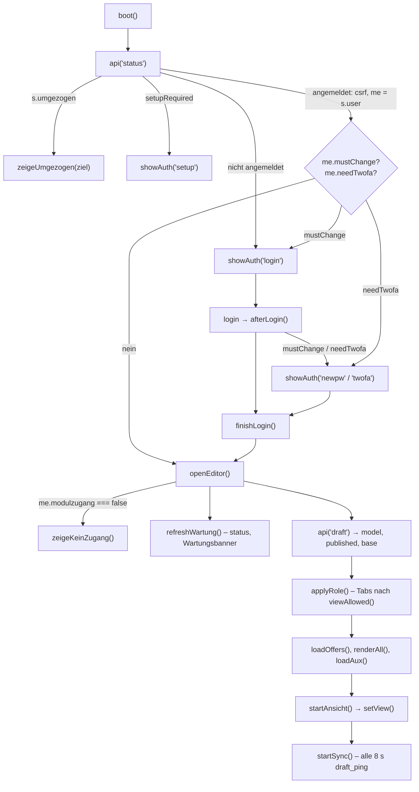

# 6 · Oberflächen (Browser)

Wie der Frontend-Code aufgebaut ist und wie man eine neue Ansicht, einen Dialog oder eine Modulseite im gleichen Stil
baut. Alle Oberflächen sind reines HTML/CSS/JavaScript ohne Framework und ohne Build-Schritt: Was im Repository liegt,
lädt der Browser so.

Voraussetzungen und Abgrenzung:

- Dateiübersicht und Design-Zusammenfassung: [Architektur → Browser](../architektur.md#browser-appassets) und
  [Architektur → Dashboard](../architektur.md#dashboard-dashboard). Dieses Kapitel wiederholt sie nicht, sondern erklärt
  Abläufe und Muster.
- Arbeitsregeln, Sicherheitsgrenzen, Definition of Done: [AGENTS.md](../../AGENTS.md).
- Hosts, Anmeldung, Rechte und CSRF aus Serversicht: [Kapitel 4](04-anmeldung-rechte.md),
  [ADR-003](../plattform/adr-003-domains-anmeldung.md). Testen der Oberflächen: [Kapitel 7](07-tests.md).
- Zuständigkeit je Datei: `python3 werkzeuge/regeln.py modul <id>` (Feld `pfade` in `regeln/module.toml`).
  `app/assets/admin.js` gehört dem Modul `angebot` und ist laut Register ein „Hotspot“ – nur kleine, klar abgegrenzte
  Änderungen; `admin.css` und `theme.js` gehören dem Plattformkern.

## 6.1 Seiten, Dateien und Hosts

| Seite | HTML | Skripte (Ladereihenfolge) | Stylesheets |
| --- | --- | --- | --- |
| Kundenseite (Wochenangebot) | `app/index.html` | `theme.js` (im `<head>`), `offer-core.js`, `frontend.js`, `webapp.js` | `app.css` |
| Web-App | `app/manifest.json`, `app/sw.js` | `webapp.js` registriert `sw.js` (nur im sicheren Kontext) | – |
| Rechtsseiten | `app/kontakt/`, `app/impressum/`, `app/datenschutz/` (je `index.html`) | `/assets/theme.js` | `legal.css` (ohne `app.css`, Systemschrift) |
| Eingabebereich | `app/admin/index.html` | `theme.js`, dann am Ende: `offer-core.js`, `vendor/qrcode.js`, `stock-core.js`, `admin.js`, `admin-verwaltung.js`, `admin-rollen-vorschau.js`, `admin-rollen.js`, `admin-import.js`, `../module/hr/verwaltung-hr.js`, `admin-artikelwahl.js`, `admin-werbung.js`, `admin-einzel.js`, `admin-auswertung.js` | `app.css`, `admin.css`, `admin-import.css`, `../module/hr/verwaltung-hr.css`, `../module/bestand/bestandsliste.css` (Summenzeile der Bestandsliste: Gesamt verfügbar, eingelagert, unterwegs, MHD bis 4 Tage) |
| Dashboard | `dashboard/index.html`, `dashboard/abgemeldet.html` | `../assets/theme.js`, `../assets/format.js`, `../assets/rahmen.js`, `dashboard.js` | `../assets/app.css`, `../assets/rahmen.css`, `dashboard.css` |
| HR · Urlaub | `app/module/hr/index.html` | `../../assets/theme.js`, `hr.js` | `../../assets/app.css`, `hr.css` |
| CRM · Vertrieb | `app/module/crm/index.html` | `../../assets/theme.js`, `mhd-ware.js` (Reiter MHD-Ware, `window.STAFL_CRM_MHD`, von `crm.js` mit dessen Hilfsfunktionen aufgerufen), `cockpit.js` (Mein Cockpit, Master-Cockpit und Reiter „Übersicht“ im Kunden-Pop-up, `window.STAFL_CRM_COCKPIT`, ebenso von `crm.js` aufgerufen), `einzelangebot.js` (Reiter „Angebote“ im Kunden-Pop-up: Einzelangebote des Kunden, `window.STAFL_CRM_EINZEL`, von `crm.js` aufgerufen), `crm.js` | `../../assets/app.css`, `crm.css` |
| Marketing · Redaktionsplan | `app/module/marketing/index.html` | `../../assets/theme.js`, `marketing.js` | `../../assets/app.css`, `marketing.css` |
| Controlling | `app/module/controlling/index.html` | `../../assets/theme.js`, `controlling.js` (Grundgerüst), je Bereich ein Skript (`umsatz.js`), das sich mit `STAFL_CONTROLLING.bereich(id, { anzeigen })` anmeldet; Reiter Auswertung der Umsatzstatistik: `umsatz-auswertung.js` (`STAFL_CONTROLLING.umsatzAuswertung`, Formate `STAFL_CONTROLLING.umsatzFormat`), Pop-ups der Auswertung `umsatz-details.js` (`STAFL_CONTROLLING.umsatzDetails`, natives `<dialog>`, am Handy von unten). Leser der Importart `umsatzdaten` für die Importzentrale: `umsatz-import.js`, geladen vom Eingabebereich (`app/admin/index.html`) | `../../assets/app.css`, `controlling.css` |
| Leergut | `app/module/leergut/index.html` | `../../assets/theme.js`, `../../assets/stock-core.js` (WinAB-Bericht .XLS lesen; die .CSV liest `leergut.js` selbst), `leergut.js` | `../../assets/app.css`, `leergut.css` |
| REWE · Vordisposition | `app/module/rewe/index.html` | `../../assets/theme.js`, `rewe.js` | `../../assets/app.css`, `rewe.css` (Gestaltung wie Leergut, Präfix `rw-`) |
| Qualitätssicherung · QM-System | `app/module/qs/index.html` | `../../assets/theme.js`, `qs.js`, `verfahren.js` (Reiter „Verfahrensdoku“, nutzt `window.STAFL_QS` aus `qs.js`) | `../../assets/app.css`, `qs.css` (Gestaltung „Liquid Glass“ nach dem Designvorschlag, Präfix `qm-`; Dokument-Seitenleiste unter 1100 px als Blatt von unten, Prüfplan unter 760 px als Liste) |
| Versand | `app/module/versand/index.html` | `../../assets/theme.js`, `versand.js` | `../../assets/app.css`, `versand.css` (Gestaltung „C2“ im gemeinsamen Rahmen, Präfix `vs-`) |

Jede dieser Seiten (außer Web-App und Rechtsseiten) lädt im `<head>` nach `theme.js` zusätzlich `format.js` (Zahlen und
Einheiten, `window.STAFL_FORMAT`) und `suche.js` (Suchregel aller Suchfelder, `window.STAFL_SUCHE`,
[10 Konventionen](10-konventionen.md#suche)).

Alle Pfade sind relativ zur Seite (Rechtsseiten: absolut ab `/`). Damit funktionieren dieselben Dateien auf dem
Testserver (`tests/run_e2e.py`), in der Testumgebung und auf jedem Produktions-Host.

**Welche Seite auf welchem Host** (Quelle: `Caddyfile`, `deploy/anmeldung/apache-oidc.conf`):

| Host | Inhalt | Bemerkung |
| --- | --- | --- |
| `angebot-stafl.de` (`{$DOMAIN}`) | Kundenseite, Rechtsseiten, `/api/`; `/admin/` = alter Eingabebereich | Mit `WA_EIGENE_ANMELDUNG=aus` (Standard in `docker-compose.anmeldung.yml`) meldet `status` das Feld `umgezogen`, die Seite leitet weiter; übrige Aktionen 410 ([4.1](04-anmeldung-rechte.md#stilllegung-des-alten-eingabebereichs)) |
| `dashboard-stafl.de` | `/` → `/dashboard/` | `WA_OBERFLAECHE=dashboard.start` |
| `angebot.dashboard-stafl.de` | `/` → `/admin/` | Eingabebereich, Bereich `angebot.eingabe` |
| `verwaltung.dashboard-stafl.de` | `/` → `/admin/`, `/import/` → `/admin/?ansicht=importe&nur=import` | Bereich `verwaltung.verwaltung` (bzw. `verwaltung.import`) |
| `bestand.dashboard-stafl.de` | `/` → `/admin/` | Bereich `bestand.intern` |
| `hr.dashboard-stafl.de` | `/` und `/admin/…` → `/module/hr/` | nur Aktionen von `hr.intern` (GR-109) |
| `crm.dashboard-stafl.de` | `/` und `/admin/…` → `/module/crm/` | nur Aktionen von `crm.intern` (GR-109) |

Alle `*.dashboard-stafl.de`-Hosts sind dieselbe Anwendung im Container `app-mitarbeiter` (Caddy → `app-mitarbeiter`, getrennt
von der Kundenseite, ADR-007) mit je eigenem Keycloak-Client
und eigener Sitzung. Apache setzt je Host `WA_OBERFLAECHE`; daraus macht der Server `me.bereich`
(`app/api/lib/sitzung.php`).

**Das Dashboard liegt außerhalb von `app/`.** Der Container bindet `./dashboard` nur über die Ergänzungsdatei
`deploy/anmeldung/docker-compose.anmeldung.yml` nach `/var/www/dashboard` ein; `apache-oidc.conf` macht es mit
`Alias /dashboard /var/www/dashboard` **nur auf den Keycloak-Hosts** erreichbar. Unter `angebot-stafl.de` gibt es kein
Dashboard. `abgemeldet.html`, `dashboard.css` und `/assets/` sind ohne Anmeldung abrufbar (Abmeldeseite). Im Testlauf
blendet `tests/run_e2e.py` den Ordner nur für die Gruppen `dashboard` und `rollen` unter `/dashboard/` ein (`ZUSATZ`).
`deploy/bereitstellen.py` versieht auch die Dashboard-Seiten mit Versionsnummern (wie die Seiten unter `app/`; das
Dashboard steht nicht in der Prüfliste der Dateiprüfung). Im Testlauf stempelt `run_e2e.py` die eingeblendete Kopie
genauso (`zusatz_verzeichnis`). Einbindungen deshalb immer ohne `?v=` und relativ zur Seite bzw. ab `/` schreiben.

## 6.2 Eingabebereich (`app/admin/`)

Eine Seite für vier Bereiche: Angebot, Verwaltung, Import und Bestand. Welche Ansichten erscheinen, hängt vom Host
(`me.bereich`) und von den Rechten ab. `admin.js` ist eine einzige IIFE; alles Gemeinsame exportiert sie über
`window.WA`, die Teilskripte hängen sich daran.

### Startablauf



- `boot()` (Ende von `admin.js`) fängt jeden Fehler ab und ersetzt die Seite durch „Eingabebereich nicht erreichbar“.
- `status` liefert u. a. `loggedIn`, `csrf`, `user`, `company`, `testumgebung` (setzt `body.is-test`),
  `setupRequired`/`setupLocked` und `umgezogen`.
- `applyRole()` blendet Tabs, Trennüberschriften (`#side-stamm`, `#side-admin`)
  und den Dashboard-Knopf `#btn-dashboard` (nur `me.zentral`, Adresse aus `me.dashboard`, nur `https:`) ein und aus und
  setzt die Klassen `ro`, `is-admin`, `bereich-verwaltung`, `bereich-bestand`, `bereich-import` am `<body>`.
- Startansicht: `?ansicht=<id>` oder `#<id>` (`startAnsicht()`), nur wenn `viewAllowed()` zustimmt; `hashchange`
  schaltet später ebenfalls um.

### Globaler Namensraum `window.WA`

`admin.js` setzt am Ende (gekürzt):

```js
window.WA = {
  importLeser: IMPORT_LESER,
  $, $$, api, esc, icon, toast, confirmBox, dateTime, timeOnly, plural, fold, fmtNum, fmtInt, csvCell, ROLE_LABEL, offerName, offerShort,
  loadOffers, pendingCount, setView, renderWartungBanner, wartungBis, OSTD, may,
  get me() { return me; }, get offers() { return offers; }, get stdPublic() { return stdPublic; },
  /* … Getter/Setter für wartungSt, wartungEingabe … */
  views: {},
};
```

Zustand gibt es nur über Getter (`W.me`, `W.offers`) – nie eine Kopie halten, sonst ist sie nach einer neuen Anmeldung
veraltet. Teilskripte folgen alle demselben Muster:

```js
(function () {
  'use strict';
  const W = window.WA;
  const { $, api, esc, icon, toast, confirmBox } = W;
  /* … */
  W.views.beispiel = laden;        // Ansicht „beispiel“ (eigene Datei admin-beispiel.js)
})();
```

Weitere Anknüpfungspunkte: `W.importLeser.<art>` (Leser für die Importzentrale, z. B. `zeiterfassung` in
`verwaltung-hr.js`), `W.importSichtbar` (`admin-import.js`), `W.hr` (`verwaltung-hr.js`, von
`admin-verwaltung.js` genutzt), `W.csvZeilen`/`W.csvText` (`admin-verwaltung.js`).

**Achtung Reihenfolge:** `admin-verwaltung.js` **ersetzt** `W.views` (`W.views = { users: …, orders: …, … }`), alle
späteren Skripte **ergänzen** einzelne Schlüssel. Ein neues Teilskript muss deshalb nach `admin-verwaltung.js`
eingebunden werden und darf `W.views` nur ergänzen. `setView` ruft Ansichten nur auf, wenn sie existieren
(`if (v === 'x' && window.WA.views.x) …`).

### Ansichten, Rechte und Bereiche

| Name | Ort | Zweck |
| --- | --- | --- |
| `VIEWS` | `admin.js`, vor `setView` | alle Ansichten in Tab-Reihenfolge; zu jedem Eintrag gehören `#vt-<id>` und `#view-<id>` |
| `ADMIN_VIEWS` | ebenda | nur Administratoren (`mail`, `users`, `rollen`, `sec`, `schutz`) |
| `VIEW_PERM` | `admin.js`, Abschnitt „Anmeldung“ | Ansicht → Recht, das sie sichtbar macht (`''` bzw. ohne Eintrag: Sonderregel oder alle) |
| `BEREICH_VIEWS` | ebenda | je `me.bereich` die erlaubten Ansichten; ohne Bereich (alter Zugang) alle |
| `BEREICH_KOPF` | ebenda | Überschrift statt „Eingabebereich“; schaltet `body.bereich-verwaltung` (keine Angebotsaktionen im Kopf) |

```js
const BEREICH_VIEWS = {
  'verwaltung.verwaltung': ['master', 'vkgruppen', 'kategorien', 'kunden', 'gruppen', 'vertreter', 'versandarten', 'lieferanten', 'abteilungen', 'importe', 'auswertung', 'mail', 'users', 'rollen', 'urlaub', 'log'],
  'angebot.eingabe': ['orders', 'edit', 'einzel', 'hist', 'einkauf', 'angebote'],
  'bestand.intern': ['stock'],
  'verwaltung.import': ['importe'],
};
```

`bereich()` macht aus `verwaltung.verwaltung` den Bereich `verwaltung.import`, wenn die Adresse `?nur=import` trägt
oder die Rolle nur `import.zugang` (ohne `verwaltung.zugang`) hat – die Adresse kann den Bereich nur einschränken.
`viewAllowed(v)` prüft in dieser Reihenfolge: Bereich → Administrator-Ansichten (`can('admin')`) → Sonderfälle
(`users`: auch `hr.verwalten`; `gruppen`/`vertreter`/`versandarten`: `stammdaten.sehen` oder `kunden.sehen`; `importe`:
`W.importSichtbar()`) → `VIEW_PERM`.

- `can(role)` vergleicht die Rolle (`viewer` < `editor` < `admin`), `may(perm)` ein Einzelrecht (Administrator: alle).
- **Beides ist nur Anzeige.** Die verbindliche Prüfung macht der Server bei jeder Aktion (GR-103, `require_perm`,
  Modulzugang je Host). Eine neue Ansicht ohne serverseitige Rechteprüfung ihrer Aktionen ist ein Fehler, auch wenn
  der Tab ausgeblendet ist.

### `api()` – die Hilfsfunktion für alle Aufrufe

`api(action, { body, query, confirmationRetry })` in `admin.js`: GET ohne `body`, sonst POST mit JSON; immer
`X-CSRF-Token`, `credentials: 'same-origin'`, `cache: 'no-store'`. Gibt bei Erfolg die JSON-Antwort zurück (`ok: true`),
sonst wirft sie einen `Error` mit `status`. Zentral behandelt werden:

| Antwort | Verhalten |
| --- | --- |
| 401 (außer bei Anmeldeaktionen) | `showAuth('expired')` – Anmeldemaske als Überlagerung, Entwurf bleibt erhalten |
| 403 `kein_modulzugang` | `zeigeKeinZugang(name)` – Seite wird verdeckt, nicht ersetzt |
| 410 `umgezogen` | `zeigeUmgezogen(ziel)` – Hinweis, nach 1,5 s Weiterleitung |
| 503 mit `wartung` und `bereich` | `showEingabeWartung()` – Wartungsseite für Nicht-Administratoren |
| 403 `reauth_required` mit `anmelden` (`/oidc/…`) | **schreibende Anfrage** (mit `body`): Dialog `#dlg-reauth-kc` „Kurz bestätigen“, Anmeldung bei Keycloak in einem **eigenen Fenster** (`bestaetigenPerFenster`), Rücksprung auf `admin/bestaetigt.html` meldet sich per BroadcastChannel/postMessage/`storage` (nur gleicher Ursprung) – ersatzweise genügt, dass sich das Fenster schließt –, danach dieselbe Anfrage noch einmal (höchstens drei Runden) – offene Dialoge und Eingaben bleiben erhalten. Blockiertes Fenster: „Hier anmelden“ wie bisher. **Sonst** (Seitenaufbau, Abfragen): ungespeicherten Entwurf sichern, erneute Anmeldung bei Keycloak im selben Fenster, zurück auf dieselbe Adresse |
| 403 `confirmation_required` | Dialog `#dlg-reauth` (Passwort), danach **ein** automatischer Wiederholungsversuch |
| sonst nicht `ok` | `Error(data.error)` bzw. „Serverfehler (…)“ |

Eigener Code fängt also nur fachliche Fehler (`catch (e) { toast(e.message) }`); Sitzung, Wartung und Bestätigungen
nicht selbst behandeln. Ausnahme: Datei-Downloads (z. B. PDF) laufen mit eigenem `fetch` und dem CSRF-Kopf.

### Hintergrundabgleich und gemeinsames Bearbeiten

`startSync()` ruft alle 8 s (und beim Zurückkehren in den Tab) `draft_ping` auf: Liste der anderen Bearbeiter
(„Auch hier: …“ in `#save-state`), Revision der Angebote (`offersRev`) und des Entwurfs. Hat jemand anderes
gespeichert, holt `pullRemote()` den Entwurf (`draft&bg=1`) und führt ihn mit `OfferCore.mergeModels(base, model, theirs)`
je Feld zusammen; Konflikte meldet ein Toast („Ihre Eingabe gilt“). Neu gezeichnet wird erst, wenn keine Eingabe
läuft und kein Dialog offen ist (`editingNow()`); betroffene Zeilen blinken (`.remote-hit`). Speichern geschieht
automatisch 700 ms nach einer Änderung (`changed()` → `saveNow()`). Für Tests: siehe
[AGENTS.md → Schnell arbeiten](../../AGENTS.md#schnell-arbeiten-ohne-qualität-zu-verlieren) – der Abgleich kann jederzeit
die Anmeldemaske zeigen.

### Angebote im Editor: eigene Artikelliste je Angebot

Alle Angebote teilen sich die Artikel eines Entwurfs; welche ein Angebot enthält, sagt `inOffer(it, angebot)` (dieselbe
Regel wie `offer_resolve` auf dem Server): Wochenangebot = alle ohne `variants.std` „hidden“, eigene Artikelliste
(`fallback: 'hidden'`) = nur mit eigenem Eintrag, „folgt dem Wochenangebot“ (`standard`) = alle außer dort ausgeblendet.
Geändert wird die Zugehörigkeit nur über `aufnehmen()`, `nurIn()` (neuer Artikel nur in diesem Angebot) und
`entfernen()` (löscht den Artikel, wenn er in keinem Angebot mehr steht) – so beeinflussen sich die Angebote nie.
„Artikel hinzufügen“ nutzt das gemeinsame Fenster `admin-artikelwahl.js` (`WA.artikelwahl.oeffnen(cfg)`, auch für
Einzelangebote) mit Daten aus `angebot_artikel` (Recht `angebot.bearbeiten`, Bestand nur mit `bestand.sehen`);
die Zielgruppe bestimmt `zielGruppe()` aus der VK-Gruppe. Einen Excel-Import im Editor gibt es seit 04.11.2026 nicht mehr;
Artikelpreise kommen über die Importzentrale (Importart `angebot_preise`, Server `module/angebot/import.php`); ihre
Vorschau zeigt die eigene Darstellung `app/module/angebot/preisimport.js` (bisher → neu je Angebot, „Bitte prüfen“ ab
10 %, Kundengruppen ohne Angebot einzeln anhaken – Option `gruppen`), Vertrag in `docs/plattform/schnittstellen/import.md`.

### Sonderangebote

Reiter „Sonderangebote“ (`#vt-sonder`, `#view-sonder`, direkt unter „Einzelangebote“; Skript und Stile
`app/module/angebot/sonderangebote.js`/`.css`, meldet sich als `WA.views.sonder`). Karten nach Stand (läuft, geplant,
abgelaufen/beendet zugeklappt), Fenster `#dlg-sonder` mit Name, Kippschalter Zeitraum ↔ Kalenderwoche (`role="switch"`,
beim Umschalten wird die KW des Beginns bzw. Montag–Sonntag der KW übernommen) und Kundengruppen. Den Stand zeigt der
Browser nur an; ob ein Kunde etwas sieht, entscheidet der Server. Die Artikel bearbeitet der gewohnte Editor: `admin.js`
führt Sonderangebote in `offers` (Angebotsleiste: eigener Abschnitt ohne abgelaufene, Kopf mit Gültigkeit und Knopf
„Gültigkeit und Gruppen“), lässt sie aber aus Stammdaten → Angebote und aus `WA.offers` (Freischaltung beim Kunden) weg.
Schnittstelle `WA.angebot.sonder` (`uebernehmen`, `oeffnen`, `bearbeiten`, `stand`, `text`). „Aus anderem Angebot“
(`openCopy`) zeigt die Artikel des Quellangebots zum Anhaken (für Sonderangebote zunächst keiner, sonst alle).

### Export für WinAB

Knopf „Export für WinAB“ (`#btn-winab`) in der Werkzeugleiste: sichtbar nur mit dem Recht `angebot.winab_export` und nur
beim Wochenangebot (eine Zeile in `renderWerbungBtn()`, `admin.js`); den Klick behandelt `app/module/angebot/winab-export.js`.
Die Datei erzeugt der Server (Aktion `angebot_winab_export`, POST mit CSRF, `module/angebot/winab-export.php`) aus dem
**veröffentlichten** Wochenangebot über `offer_resolve()` – also mit Sonderpreisen und ohne ausgeblendete oder ausverkaufte
Artikel – und gibt `{datei, csv, anzahl, doppelt, ohnePreis, woche}` zurück; der Browser speichert `csv` als Datei.
Je Artikelnummer (`code_key`) eine Zeile mit dem höchsten Preis aus Preis und Zusatzpreisen; Format `Artikelnummer;Preis`
mit Kopfzeile, Dezimalkomma, CRLF, ohne BOM. Jeder Export steht im Protokoll (Bereich „Angebote“).

### Werbung schalten

Knopf „Werbung“ in der Werkzeugleiste (Zahl = beworbene Artikel des gewählten Angebots): `openWerbung()` (`admin.js`)
übergibt die Artikel des Angebots an das Fenster `admin-werbung.js` (`WA.werbung.oeffnen(cfg)`: bis zu zwei Werbungen –
„Weitere Werbung“ legt die zweite an, Reiter `.wb-tab` wechseln, „Werbung 2 entfernen“ nimmt eine heraus, eine zweite ohne
Artikel lässt sich nicht übernehmen –, je Werbung Überschrift, Werbetext, bis zu 12 Artikel mit Reihenfolge und Hinweis;
Leser nur ansehen). „Artikel auswählen …“ öffnet über den Rückruf
`auswaehlen` die gemeinsame Artikelauswahl (`werbungAuswahl()`: `WA.artikelwahl.oeffnen` mit Filter „nur in diesem
Angebot“, alle Gruppen, Bestand ohne Filter, beworbene vorausgewählt, höchstens 12; Artikel außerhalb des Angebots
nimmt `artikelAufnehmen()` – dieselbe Funktion wie „Artikel hinzufügen“ – mit Preis auf; Positionen ohne Artikelnummer
erscheinen mit eigenem Schlüssel ohne Nummer). Die Artikelauswahl kennt dafür `preis.fest(a)` (Preis als Text statt
Eingabefeld) und `a.nr` (angezeigte Nummer); `spannen()` passt die colspan der Gruppen-/Detailzeilen an die sichtbaren
Spalten an (Handy). Gespeichert wird in `model.meta.werbung[<Angebot>]` (zweite Werbung in `weitere`; Hilfen `werbBloecke()`/`werbEintrag()`)
(Entwurf, sichtbar nach dem Veröffentlichen im Modul Versand; Rücknahme je Angebot in der Liste der Änderungen, siehe „Unveröffentlichte Änderungen“). `werbungBereinigen()` nimmt
bei jeder Änderung Artikel heraus, die nicht mehr im Angebot stehen; `mergeModels` gleicht die Werbung je Angebot ab. Beworbene Zeilen
tragen `tr.e-werb` und das Kennzeichen „Werbung“. Auf der Angebotsseite (`frontend.js`, `werbungHTML()`) steht oben ein
eigener Abschnitt im Aufbau der Liste (`.werb-sec`: Band `.werb-st` in der Akzentfarbe mit Überschrift und Text, darunter
die Artikel mit `plBlockHTML(…, 'werb')` als normale Zeilen in den Spalten der Liste; Bestell- und Kachelansicht: in eigener
Karte; nur ohne Suche/Filter in „Alle Artikel“). Eine zweite Werbung steht in `.werb-duo` rechts neben der ersten (je die
Hälfte der Spalten der Liste; bei nur einer Spalte `.werb-stapel` untereinander). Beworbene Zeilen/Kacheln der Liste und
Empfehlungen ohne Preisänderung (`it.empfehlung`) tragen `.werb-an` (dezent hinterlegt) und den Hinweis (sonst
„Empfehlung“) als Kennzeichen.

### Aufbau des Angebots (Knopf „Editor“)

Hellblauer Knopf „Editor“ (`#btn-aufbau`) rechts neben „Werbung“ (Wunsch des Inhabers 11.11.2026, Artikel 12.11.2026):
sichtbar nur mit `angebot.bearbeiten` (`aufbauKnopf()` aus `renderWerbungBtn()`, `admin.js`); Farben `--abf*` in
`app/module/angebot/aufbau.css` aus dem Blauton von `--c-frozen` (Kennzeichen „eigene“), hell und dunkel. Das Fenster
`#dlg-aufbau` baut `app/module/angebot/aufbau.js` aus `WA.angebot.aufbau.daten()`: Gruppen des gewählten Angebots
(`sichtbareGruppen()`) mit ihren Artikeln dieses Angebots (`inOffer`, Bezeichnung `nameIn`); aufeinanderfolgende Gruppen mit
gleichem `section` bilden einen Block (wie die Überschriften im Editor), Gruppen ohne Bereich den Block „ohne Bereich“.
Ein Klick auf die Gruppe (`[data-ab="g-auf"]`, `aria-expanded`) klappt ihre Artikel auf, „Alle Artikel zeigen“ alle.
Pfeile verschieben Blöcke, Gruppen im Block und Artikel in der Gruppe; Ziehen am Griff (Pointer Events über `window`, Maus
und Touch, `touch-action: none`, Rollen am Rand) auch Gruppen in einen anderen Block – sie bekommen dessen Bereich („Bereich
neu“) – und Artikel in eine andere Gruppe: auf eine aufgeklappte an die Stelle, auf eine zugeklappte (`.abf-ziel`) ans Ende.
Für Handy und Tastatur verschiebt die Auswahl „In Gruppe …“ (`[data-zu]`) einen Artikel ans Ende der gewählten Gruppe
(„verschoben“, Meldung unten links). Leere Blöcke fallen weg, gleiche Nachbarn werden zusammengefasst. Mit Änderungen setzt
das Fenster `data-geaendert` (erstes Escape warnt, `theme.js`).

Woher Gruppe und Reihenfolge eines Artikels kommen: aus dem Entwurf selbst – `it.groupId` und die Stelle in `model.items`
(je Gruppe zählt nur die Reihenfolge, `OfferCore.enrichOffer`), nicht aus den Stammdaten. Beides ist für alle Angebote
gemeinsam, wie „Angebotsgruppe“ und „Nach oben/unten“ im Artikelfenster (`openItem`), das dieselben Felder ändert.

„Übernehmen“ ruft `WA.angebot.aufbau.uebernehmen(neu, stand)` (`aufbauUebernehmen()`, `neu` = `[{id, bereich, artikel}]`):
eigene Speicherungen abwarten, `draft_ping`, bei neuer Revision `pullRemote()`; weichen danach Reihenfolge/Bereiche der
Gruppen oder die Artikel je Gruppe vom Stand beim Öffnen ab (`stand`), wird nichts übernommen (`{konflikt, grund, wer,
daten}` – das Fenster zeigt den neuen Stand). Sonst ordnet `gruppenOrdnen(anker, reihe)` `model.groups` neu – Gruppen, die
im gewählten Angebot nicht vorkommen, bleiben hinter ihrer Vorgängergruppe –, `artikelOrdnen(ziel)` setzt `groupId` der
Artikel des Angebots und ihre Reihenfolge (Artikel anderer Angebote bleiben in ihrer Gruppe hinter dem Artikel davor; nur
die Plätze der betroffenen Gruppen in `model.items` ändern sich), dazu `section`, Rückgängig, `saveNote = {type: 'aufbau'}`
(Protokoll „Aufbau des Angebots geändert …“ mit Zahl der Gruppen mit neuem Bereich und der Artikel mit neuer Gruppe in
`save_draft`) und sofortiges Speichern (`saveNow()`). Kein eigener Speicherweg, kein neues Datenfeld. Wirkung überall, wo
`model.groups`/`model.items` die Reihenfolge bestimmen (`OfferCore.enrichOffer`: Angebotsseite, Liste, Tabelle, Druck/PDF,
Vorschau; `offer_resolve`; App). `aufbauSperre()`: Kundenangebot „folgt dem Wochenangebot“ nur ansehen; mit aktiven
Angebotskategorien sind Bereiche und Gruppen fest (die Stammdaten ordnen), Artikel bleiben änderbar.
`aufbauGeaendert()` vergleicht Reihenfolge und Bereiche der gemeinsamen Gruppen und Gruppe/Reihenfolge der gemeinsamen
Artikel mit der veröffentlichten Fassung: zählt in der Statuszeile als eine Änderung, Abschnitt „Aufbau“ in der Liste der
Änderungen mit Rücknahme (`revertChange('aufbau')`). Tests: Gruppe `aufbau`.

### Frühere Wochen

Wunsch des Inhabers 13.11.2026: frühere Wochenangebote ansehen und die KW wechseln wie in der REWE-Liste – nur Mitarbeiter
mit Modulzugang Angebot, nur lesend. Einstieg: Menü ⋯ → „Frühere Wochen“ (`[data-act="wochen"]`, sichtbar nur mit
`angebot.zugang`; ein- und ausgeblendet beim Öffnen des Menüs wie „Fußzeile im Druck“) oder die Adresse
`…/admin/#woche/JJJJ-WW` (öffnet das Fenster, sobald der Eingabebereich angemeldet zu sehen ist). Das Fenster
`#dlg-wochen` (`app/module/angebot/fruehere-wochen.js` + `.css`, Klassen `pv`/`pv-*` des Fensters „Vorschau“ für Größe und
Ladeanzeige) zeigt oben ‹ Titel › (`<Angebot> · KW 43/2026`, darunter Zeitraum, Quelle und Stand, Artikelzahl), „Diese
Woche“ und die Auswahl des Angebots (gemerkt in `localStorage`, ohne Speicher Wochenangebot). Jede Woche fragt
`angebot_woche` (Kopf, Hinweise, vorige/nächste gespeicherte Woche) und lädt dann die Angebotsseite im Rahmen mit
`?vorschau=1&eingebettet=1&woche=JJJJ-WW[&angebot=…]` – `frontend.js` holt in diesem Fall `angebot_woche` statt
`offer&draft=1`, sonst bleibt die Seite unverändert. Quelle je KW: Wochenablage `angebot-woche/<JJJJ-WW>` (mit den
damaligen Angebotsdefinitionen), aktuelles Angebot oder `versionen/*` – der späteste Stand –, sonst der Preisverlauf.
Ohne gespeicherten Stand: Fläche „Für KW … ist kein Angebot gespeichert“ mit Sprung zur letzten gespeicherten Woche; gab es
das gewählte Kundenangebot in der Woche nicht (`fehlt`): „… gab es in KW … noch nicht“. Hinweisleiste: nur Preisstand
(Preisverlauf, ohne Werbung, Bereiche, eigene Bezeichnungen, Empfehlungen) bzw. bei Kundenangeboten ohne gespeicherte
Definition (`einstellung: heute`) „Artikel nach der heutigen Einstellung“. Die Adresse
folgt der KW (`history.replaceState`), Schließen entfernt `#woche/…`. Server: `app/api/module/angebot/wochen.php`.
Tests: Gruppe `hist` (`fruehere_wochen_pruefen`).

### Empfehlung (früher „Sonderpreis“)

Etikett in der Preiszelle (`saleBtnHTML`/`saleTagHTML`) und Leiste „Kurzes MHD“ öffnen `openSale()` (`#dlg-sale`):
Empfehlungspreis optional (leer = `mark: true`, nur hervorheben), je Angebot „wie oben“, „eigener Preis“, „ohne
Preisänderung“ (`{status: 'mark'}`) oder „keine Empfehlung“ (`{status: 'none'}`). Neu gesetzt steht nur das gewählte
Angebot auf „wie oben“, alle anderen auf „keine Empfehlung“; `empfehlungNichtUebernehmen()` setzt ein Angebot, in das der
Artikel später kommt („Artikel hinzufügen“, „Aus anderem Angebot“), ebenfalls auf „keine“. Auswertung je Angebot:
`C.empfehlungFor(it, oid)` (`offer-core.js`; `null` oder `{preis}`), Server `empfehlung_fuer()`.

### Angebotsauswahl in der Seitenleiste

`offerBarPlatzieren()` hängt `#offer-bar` ab 901 px (`matchMedia`) in die `.side-nav` unter die Bereiche, schmaler zurück
in `.ed-layout` (Auswahl über dem Angebot); `body.ob-links` steuert das Layout, `body.in-other` blendet die Liste in
anderen Bereichen aus. Inhalt und Ereignisse bleiben dieselben (`renderOfferBar`).

### Unveröffentlichte Änderungen, Verweis zum Versand

Veröffentlicht und gesendet wird seit 13.11.2026 im Modul Versand (`app/module/versand/`, Abschnitt 6.4) – im Eingabebereich
gibt es die Knöpfe `#btn-publish` und `#btn-send`, den Hinweis `#send-hint` und die Fenster `#dlg-rund`/`#dlg-rest` nicht mehr;
an der Stelle der Knöpfe steht `#btn-drucken` (`app/module/angebot/druck.js`). Geblieben ist die Statuszeile `#save-state`:
`offenHTML()` zeigt „n Änderungen nicht veröffentlicht“ (`#offen-zahl`, Zählung `pendingCount()`, Aufstellung aus
`renderChanges()` als `title`) und – nur mit `versand.zugang` – den Verweis `a.zum-versand` (`zumVersand()`; unter
`*.dashboard-stafl.de` die Adresse des Versand-Hosts, sonst `../module/versand/`). Derselbe Verweis steht im Fuß der Vorschau
(`#pv-versand`), „Sonderposten senden“ im Kopf eines Angebots und „Wochenangebot versenden“ unter Verwaltung → Kunden sind
ebenfalls nur noch Verweise. Solange ein Preis nicht lesbar ist (`invalid`), hält der Verweis mit einem Toast an: Im
gespeicherten Entwurf steht dann noch der bisherige Preis, und der Versand veröffentlicht den gespeicherten Entwurf.
Ein offener Eingabebereich übernimmt eine Veröffentlichung über den Abgleich (`pullOnce`: `published` neu, Preisverlauf
`hist` verworfen, sobald sich `publishedAt` ändert).

Die frühere Liste der Änderungen mit „Rückgängig“ je Zeile (`openPublish()`, `revertChange()`, Fenster `#dlg-publish` –
ohne „Jetzt veröffentlichen“) ist weiter vorhanden, aber über `AENDERUNGSLISTE_IM_ANGEBOT = false` ausgeschaltet
(Entscheidung des Inhabers 13.11.2026 offen). Eingeschaltet wird die Zahl zum Knopf `#offen-liste`. Die Testgruppen `revert`,
`angebote`, `aufbau` und `sys` schalten den Schalter in ihrer App-Kopie ein (`LISTE_IM_ANGEBOT` in `tests/run_e2e.py`) und
halten die Liste damit lauffähig; den ausgelieferten Stand prüft die Gruppe `versand`.

### Vorschau

`openVorschau(angebot)` (`admin.js`) zeigt in `#dlg-vorschau` die Angebotsseite als iframe derselben Adresse
(`index.html?vorschau=1&eingebettet=1[&angebot=…]`, erlaubt durch `frame-ancestors 'self'`). `frontend.js` blendet im
eingebetteten Modus (`EINGEBETTET`) den eigenen Vorschau-Hinweis aus. Vor dem Laden wird ein ungespeicherter Entwurf
gespeichert (die Seite liest `offer&draft=1`); beim Schließen wird die Seite im iframe entladen.

### Leistung des Angebotseditors

Der Editor hat bei ~280 Artikeln rund 12 000 Elemente. Deshalb zeichnet `renderGroups()` (ganzer Editor per
`innerHTML`) nur, wenn sich Gruppen oder Artikel ändern; häufige Bedienschritte ändern nur, was sich wirklich ändert:

- **Suche und „Nur Änderungen“:** `filterAnwenden()` setzt `hidden-row` an Zeilen und `hidden` an Gruppen
  (gleiche Regel `matchesFilter` wie `renderGroups`), `bereicheZeigen()` blendet Bereichsüberschriften ohne sichtbare
  Gruppe aus.
- **Wechsel des Angebots (Liste links):** `setOffer()` zeichnet die Gruppen neu, weil jedes Angebot eine eigene Artikelliste hat
  (`inOffer()`); gezeichnet werden nur Artikel und Gruppen des gewählten Angebots.
- **Zurück in den Editor:** `loadAux()` frischt Vorwoche und Bestand nur auf, wenn sie sich seit dem letzten Zeichnen
  geändert haben (`auxStand`).
- **CSS:** `#groups > .gcard { content-visibility: auto; contain-intrinsic-size: auto 640px }` – Gruppen außerhalb des
  Bildschirms werden nicht gestylt, gesetzt und gezeichnet (beim Drucken aus).

Neue Funktionen im Editor halten das bei: Ausgabe einer Zeile nur über `rowHTML`/`stdCellHTML`/`variantCellHTML`, damit
Teilaktualisierungen dasselbe Ergebnis liefern wie ein Neuzeichnen. Messen mit Playwright: Zeit vom Klick bis zwei
`requestAnimationFrame` später, Aufteilung über CDP `Performance.getMetrics`.

### Dialoge, Bestätigung, Toast

- Alle Fenster sind native `<dialog class="modal">` (breit: `modal wide`) **in `admin/index.html`**, Inhalt als
  `<div class="dlg">` bzw. `<form class="dlg">` mit `.dlg-head`, `.dlg-body`, `.dlg-foot` (Formen in `app.css`).
  Geöffnet mit `showModal()`.
- **Regel für alle Seiten (Inhaber, 02.11.2026):** Ein Klick neben ein Fenster schließt es **nie** – geschlossen wird mit
  Escape, dem Schließen-Knopf (`data-close`) oder den Knöpfen des Fensters. Das setzt `theme.js` für jede Seite zentral durch
  (Erfassungsphase am `window`, auch für später erzeugte Fenster); Seiten schreiben dafür keinen eigenen Code. Geprüft von der
  Testgruppe `einheit` für jedes `<dialog>` jeder Seite (Klick daneben, Escape). Rückfragen nie mit `confirm()`/`alert()`
  des Browsers, sondern im eigenen Fenster (Eingabebereich `confirmBox`, Kundenseite `frage()`, Module ihr `frage()`).
- **Einheitliche Bedienung (Durchsicht 03.11.2026), gilt für alle Seiten und Module:**
  - Jedes Fenster hat oben rechts ein × mit `aria-label` „…schließen“ (Testgruppe `einheit` prüft jedes fest im HTML
    stehende Fenster). Ausnahmen: reine Rückfragen (`dlg-frage`, `dlg-confirm`: nur Abbrechen/Ja) und Pflichtfenster mit
    `data-pflicht` (Passwort über den Link aus der E-Mail).
  - Knopfreihe: Nebenaktionen links, „Abbrechen“/„Schließen“, die Hauptaktion (`btn primary`) ganz rechts. „Schließen“ ist
    nie ein Hauptknopf. Die Knopfreihe am Ende eines Formularfensters bleibt beim Scrollen sichtbar (`position: sticky`).
  - Hauptknopf überall in der gemeinsamen Farbe aus `app.css` (hell Bordeaux, dunkel Rosa mit dunkler Schrift); Initialen
    im Kopf immer auf Bordeaux (`#8c1d2c`).
  - Am Handy (≤ 560 px) öffnen Fenster als Blatt von unten (volle Breite, oben gerundet).
  - Folgenreiche Schritte (Löschen, Zurückziehen, Verwerfen) fragen im eigenen Fenster nach; der Fokus liegt auf „Abbrechen“,
    Escape heißt „nein“.
  - Aufklappmenüs aus `<details>` bekommen `data-menue`: `theme.js` schließt sie mit Escape (Fokus zurück auf den Titel)
    und bei einem Klick außerhalb und hält die aufgeklappte Liste ganz im Bild. Menüs aus Knöpfen bleiben ebenfalls im
    Bild (Kundenseite: `menuImBild`); `aria-expanded` folgt dem Zustand.
  - Knöpfe überall als Kapsel (`border-radius: 999px`); Fokus nach dem Öffnen im Fenster, auch wenn der Inhalt erst
    nachgeladen wird (theme.js).
  - Gekürzte Texte (`text-overflow: ellipsis`) tragen den vollen Text im `title`; Platzhalter langer Felder enden mit „…“
    (`app.css`, gilt für alle Seiten).
  - Einzahl/Mehrzahl immer passend („1 Markt“, „3 Märkte“).
- Eine Schleife in `admin.js` verdrahtet beim Laden **jeden** `<dialog>` der Seite: Escape oder ein Element mit
  `data-close` schließt, nicht während `data-busy` (Speichern läuft). **Auf allen Seiten** (theme.js) schützt jedes Fenster
  getippte Eingaben in einem `<form>` (ohne Formular: Textfelder und Felder mit `data-mit-warnung`) vor einem versehentlichen
  Escape: das erste Escape zeigt den gemeinsamen Hinweis `#stafl-hinweis` „Die Eingaben sind noch nicht gespeichert – erneut
  Escape verwirft sie.“, erst das zweite schließt. Der Schutz endet beim Schließen, beim Zurücksetzen des Formulars, wenn
  die getippten Felder durch neuen Inhalt ersetzt sind, oder wenn die Seite nach erfolgreichem Speichern
  `STAFL_FENSTER.gespeichert(dialog)` aufruft (Fenster, die danach offen bleiben) – Abschicken allein zählt nicht. Neue
  Fehlermeldungen (`role="alert"`) im Fenster scrollt theme.js ins Bild.
  Ausgenommen: Anmelde-/Passwortformulare, Suchfelder (`type=search`) und alles mit `data-ohne-warnung` (Fenster, die jede
  Änderung sofort speichern wie „Artikel bearbeiten“, oder mit eigener Rückfrage wie das CRM-Kundenfenster). „Abbrechen“ und Kreuz
  schließen sofort (bewusste Entscheidung). Nach dem Speichern `delete d.dataset.geaendert` setzen. Dialoge, die ein Skript erst später erzeugt, erhalten die Verdrahtung
  nicht – deshalb neue Dialoge als leeres Gerüst ins HTML schreiben.
- `confirmBox(title, html, okLabel, danger)` → `Promise<boolean>` über `#dlg-confirm`. Der Text wird als HTML
  eingesetzt: Werte vorher mit `esc()` maskieren.
- `toast(msg, ms = 3200)` → `#toast` (`role="status"`, `aria-live="polite"`). Jeder Toast einer Seite (`[role=status]`
  mit Klasse `toast` bzw. `…-toast`) liegt als Popover in der obersten Ebene; `theme.js` holt ihn beim Öffnen eines Fensters
  erneut nach oben, damit er nicht hinter dem unscharfen Hintergrund verschwindet (Prüfung in `einheit`). Neue Toasts
  deshalb mit `role="status"` und einer Klasse auf `-toast`, unsichtbar über `opacity: 0; pointer-events: none`.
- `aria-labelledby` jedes Dialogs zeigt auf die `<h2>` im Kopf.

### Seitenleiste

`<nav class="side-nav">` mit `.view-tabs.side-tabs` (`role="tablist"`, `aria-orientation="vertical"`); jeder Tab ist
ein `<button role="tab" id="vt-<id>" aria-controls="view-<id>">` mit Symbol und Text (Zusätze für breite Bildschirme in
`<span class="m-hide">`). Gruppen trennen `.side-sep` (`#side-stamm`, `#side-admin`). `setView` setzt
`aria-selected` und `hidden` und hält den aktiven Eintrag mit `navSichtbar()` sichtbar – am Computer scrollt die
Leiste senkrecht, schmal ist sie eine waagerechte Spur. Mit `body.bereich-import` entfällt die Seitenleiste ganz.

## 6.3 Kundenseite (`app/index.html`, `frontend.js`)

- **Laden:** `boot()` → `kundeStart()` (`kunde_status`: Kunde, CSRF, Wartung, `staff`, Bestellfunktion) → `loadData()`
  (`offer`, optional `&angebot=<id>`, Vorschau `?vorschau` mit `&draft=1`). `OfferCore.enrichOffer` und `prepare()`
  bereiten die Daten auf; danach `renderStatic()`, `bind()`, `render()`. Zum Schluss setzt die Seite
  `document.documentElement.dataset.bereit = '1'` – darauf warten die Tests.
- **Darstellung:** Angebotsansicht (Aufbau wie die gedruckte Liste) und Bestellansicht (Tabelle mit Mengen), Umschalter
  `#modebar`; Schnellauswahl `#quicknav`, Filter `#filters`, Suche, Zustand in der Adresse (Abschnitt „URL-Zustand“).
- **Kunden-Login:** `kundeApi()` (eigene, schlanke Hilfsfunktion mit `KCSRF`), Dialoge `#dlg-kunde-login`,
  `#dlg-kunde-pw`, `#dlg-kunde-link` (Passwort per E-Mail-Link). Kundenangebote (`?angebot=…`) nur nach Anmeldung –
  ohne Anmeldung antwortet der Server 401 und die Seite öffnet die Anmeldung.
- **Merkliste:** `localStorage` `wochenangebot.merkliste`; angemeldete Kunden zusätzlich am Konto
  (`kunde_merkliste`, `kunde_merkliste_save`). Die Schlüssel kommen aus `offer-core.js` und sind mit der App identisch.
- **Bestellwunsch:** Mengen je Kunde und Angebot im Browser, Leiste `#orderbar`, Dialog `#dlg-order`, Senden mit
  `kunde_bestellung` und `requestId` (Wiederholung ohne Doppelbestellung). Angezeigte Summen sind „ca.“ – Preise und
  Summen rechnet nur der Server (GR-004). „Meine Bestellwünsche“: `#dlg-customer-orders`.
- **Druck/PDF:** `openPrint()` → `#dlg-print` (Umfang: alles, gefiltert, Merkliste) → Inhalt in `#print-root`. `?drucken=1`
  öffnet den Dialog sofort (aus den Einzelangeboten), `?drucken=liste` druckt ohne Auswahl die Angebotsansicht (Knopf
  „Drucken“ im Eingabebereich, `app/module/angebot/druck.js`); der Parameter wird danach entfernt. Strg+P ohne Dialog
  druckt ebenfalls die Angebotsansicht (`beforeprint`).
  - **Angebotsansicht, A4 quer** (Vorgabe; Wochenangebot, Kundenangebote, Einzelangebote – ein Weg): `buildPrintListe()`
    übergibt fertige HTML-Bausteine (Kopf, Werbung, Balken je Bereich, Block je Gruppe) an `AngebotDruck.liste()` in
    `assets/angebot-druck.js`; Regeln in `assets/angebot-druck.css`. Der Satz misst die Bausteine unsichtbar in
    Druckgröße und verteilt sie rechnerisch auf Seiten fester Höhe (`.pl-page`, 279 × 193 mm):
    immer drei Spalten; ein Block wird nie geteilt; jede Seite nimmt so viele Blöcke auf wie möglich; ein Bereich beginnt
    auf der laufenden Seite, sobald sein Balken und ein ganzer Block Platz haben, und wird nur zwischen Blöcken umbrochen
    (Balken auf der nächsten Seite mit „Forts.“); kleine Bereiche stehen nebeneinander. Ausnahmen: eine Gruppe, die allein
    höher ist als eine Seite, und ein einzelner Block (Einzelangebot ab 9 Positionen, sortierte Liste ohne Gruppen) werden
    in gleich hohe Teile zerlegt (Gruppenkopf mit „Forts.“). Ein Bereich ohne Namen trägt eine Linie statt des Balkens.
  - **Dichte:** drei Stufen (`STUFEN`: normal 8,3 pt, kompakt 7,9 pt, eng 7,5 pt; Zeilenhöhe und Abstände je Stufe als
    Variablen `--zeile`, `--ab-…` an `.pl-doc` in `angebot-druck.css` – nur dort). Der Satz rechnet alle Stufen und nimmt
    die größte Schrift, mit der es nicht mehr Seiten werden als mit der kleinsten. `?stufe=normal|kompakt|eng` legt die
    Stufe zum Vergleich fest. Am Satz stehen `data-stufe`, `data-seiten`, je Seite `data-fuell` (genutzte Höhe in %).
  - **Kopf:** jede Seite mit Logo (Folgeseiten kleiner), Überschrift und „Seite x von y“; darunter nur beim Druck einer
    Auswahl bzw. eines Einzelangebots diese Angabe – Angebotswoche, Stand und „Preise in € je kg“ stehen nicht im Kopf.
    `doPrint()` druckt erst, wenn Logo und Siegel geladen sind (`bilderBereit`, höchstens 3 s).
  - **Werbung:** in einer Spalte (zwei Werbungen nebeneinander, schmale Ansicht) sitzt der Balken direkt auf den Zeilen
    wie der Kopf einer Artikelgruppe – „€/kg“ im Balken, keine leere Tabellenkopfzeile (`.werb-ein`, auch am Bildschirm).
  - **Fußzeile:** Hinweis (Mengen, Fracht) und Fußzeile des Briefbogens (`fracht.fuss` aus `module/angebot/druck.php`) am
    Fuß der letzten Seite (Vorgabe) oder jeder Seite (Einstellung „Fußzeile im Druck“, zum Vergleich `?fuss=jede|letzte`).
    Aufbau: Siegel links, Textspalten gleich breit und oben bündig, darunter die Registerzeilen kleiner und grau; „ * “
    erscheint als „ · “, ohne Leerzeichen vor Doppelpunkt und in Klammern (nur Anzeige, `ordnen()` bzw.
    `druck_fuss_ordnen()` – gespeicherte Texte bleiben). Dasselbe im PDF des Einzelangebots (`druck_fuss_pdf`).
  - **Vorsicht beim Ändern:** die Satzfläche wird per `transform` verkleinert; `.pl-page` braucht `contain: size`, sonst
    verschiebt der Seitenumbruch von Chromium Blöcke aus dem unteren Teil der Seite aufs nächste Blatt, wo sie fehlen – am
    Bildschirm sieht man das nicht. `tests/e2e/test_druck.py` liest deshalb den Text aus dem gedruckten PDF.
  - **Hochformat** („Kompakt“, „Tabelle“): Regeln in `app.css`, Fußzeile einmal am Ende (`AngebotDruck.fussHTML`).
- **Wartung:** Kunden und Besucher sehen nur `renderWartung()`; angemeldete Mitarbeiter (`staff`) sehen das Angebot mit
  Banner (GR-009).
- **Web-App:** `sw.js` speichert nur Startseite, `/assets/`, `manifest.json` und das öffentliche Wochenangebot, immer
  zuerst Netz; offline trägt die Antwort `X-WA-Offline`, die Seite zeigt „Preise ohne Gewähr“.
- **Nie ausgeliefert** (Server, nicht Oberfläche): Mengen, Chargen, MHD, Einkaufspreise (GR-001, GR-008), Kundenpreise im
  öffentlichen Angebot (GR-002). Die Oberfläche darf solche Felder auch nicht „vorsorglich“ anfordern. Einzige Ausnahme
  (GR-001 Version 2, Inhaber 13.11.2026): im eigenen, freigegebenen Einzelangebot liefert `einzel_model` je ausdrücklich
  angebotener Partie `it.partie = {lot, mhd, kg}` (Schnappschuss, `kg` = angebotene Menge); `frontend.js` zeigt sie als
  „Charge · MHD · Menge“ unter der Bezeichnung (`partieHTML`: Angebotsansicht und Druck, Bestellansicht, Karten, Details,
  Hochformat-Druck, CSV-Spalten) – nie EK oder weitere Partien.

## 6.4 Dashboard und Modulseiten (HR, CRM)

Alle drei Seiten haben denselben Aufbau – eine eigenständige IIFE ohne `window.WA`:

1. **Rahmen und Kopf:** alle Seiten im gemeinsamen Rahmen „C2“ (Seitenleiste links, siehe
   [6.5 Rahmen „C2“](#rahmen-c2-seitenleiste)). Dashboard: Seitenkopf mit Begrüßung. HR und CRM (wie alle Modulseiten):
   Kopf `hr-kopf` bzw. `crm-kopf` mit „Start“, Modulname und Knöpfen der Seite (Hell/Dunkel `#…-theme`); Logo und
   Nutzer-Chip stehen noch im HTML, werden im Rahmen aber ausgeblendet (Name und Abmelden in der Seitenleiste).
2. **Eigene `api()`**, die nicht wirft, sondern `{ status, data, json }` liefert:
   ```js
   async function api(action, body, query = '') {
     const res = await fetch(API + '?action=' + action + query, {
       method: body ? 'POST' : 'GET', credentials: 'same-origin', cache: 'no-store',
       headers: body ? { 'Content-Type': 'application/json', 'X-CSRF-Token': csrf } : {}, body: body ? JSON.stringify(body) : undefined,
     });
     let data = null;
     try { data = await res.json(); } catch { /* keine JSON-Antwort */ }
     return { status: res.status, data: data || {}, json: data !== null };
   }
   ```
3. **Status-Abruf** in `laden()`: 401 ohne JSON = zentrale Sitzung abgelaufen (Webserver) → Anmeldehinweis, „Anmelden“
   lädt die Seite neu; 403 `reauth_required` mit `/oidc/…` → `location.assign(anmelden + Rückkehradresse)`; 403 mit
   `error` → Hinweis (Keycloak-Konto ohne aktives Mitarbeiterkonto); dann `csrf` übernehmen, Nutzer-Chip füllen und die
   Startaktion des Moduls rufen (`module_status`, `hr_start` über `ladeStart()`, `crm_start`). Das CRM übersetzt
   404/503/403 der Startaktion in eigene Hinweise („noch nicht freigegeben“, Wartung, fehlendes Recht).
4. **Reiter** über `location.hash` (`#kalender`, `#cockpit` …), nur wenn der Knopf existiert und sichtbar ist.
5. **Zurück zur Startseite:** gemeinsamer Knopf `.stafl-zurueck` (`app.css`) links im Kopf – `#btn-dashboard` im
   Eingabebereich, `#hr-zurueck`, `#crm-zurueck` auf den Modulseiten (`../../dashboard/`, auf `*.dashboard-stafl.de`
   `https://dashboard-stafl.de/`). Pfeil `#i-back` + „Start“ (seit 06.11.2026, wie der Eintrag der Seitenleiste), 36 px, rund; ≤ 560 px oder mit Klasse `kompakt` nur
   der Pfeil; im Eingabebereich mit Angebotsaktionen bis 1600 px nur der Pfeil (Platz in der Kopfzeile).

Kacheln und Seitenleiste des Dashboards kommen ausschließlich aus `module_status` (Modulregister), Ziele über
`STAFL_RAHMEN.ziel()` (`rahmen.js`, für die Tests weiter als `window.STAFL_KACHEL_ZIEL`); Stand und Klebeband „Bald“
sind nur Anzeige (GR-102, GR-103).

**Startseite des Dashboards** (`dashboard.js`): parallel zu `module_status` holt sie `start_heute` (nur Dashboard-Host,
GR-109) und zeichnet daraus Favoriten (bis dahin Platzhalter, kein Springen von der Standardauswahl), „Heute für Sie“,
Schnellaktionen, „Zuletzt bearbeitet“, die Unterzeile und die Zahlen der Seitenleiste (`STAFL_RAHMEN.zahlen`). Antwort:
`punkte` (je `modul`, `art` = `ueberfaellig` | `heute` | `demnaechst`, `titel`, `detail`, `datum`, `ziel` = Reiter des
Moduls, `anzahl`), `zahlen` je Modul (`offen`, `ueberfaellig`), `gesamt`, `aktionen`, `zuletzt`, `favoriten` (`null` =
Standard), `fehler` (Module, deren Punkte gerade nicht abrufbar waren). **Neues Modul anschließen:** im eigenen Code eine
Funktion `<präfix>_startseite(array $me): array` mit eigener Rechteprüfung (`may`) und in `STARTSEITE_ANBIETER`
(`app/api/lib/startseite.php`) eintragen; Tage und Gruppe über `startseite_tage()`/`startseite_art()`. Nur Texte liefern,
die der Mitarbeiter im Modul ohnehin sieht – Personal- und Gesundheitsdaten höchstens als Anzahl (Beispiel `hr_startseite`).

**Dashboard als Startseite in Firefox** (Inhaber 11.11.2026, `startseiteFragen()` in `dashboard.js`, Dialog `#db-sp` in
`index.html`): einmal nach der Anmeldung, nur in Firefox am Computer (Erkennung über den User-Agent). Eine Webseite darf die
Startseite nicht selbst setzen; das Fenster hat deshalb einen Knopf: „Adresse kopieren“ (Zwischenablage, sonst markiert),
danach eine Zeile, wo sie in Firefox hingehört, und der Knopf heißt „Fertig“. Gemerkt nur im Browser (`localStorage`
„stafl.startseite“: `{erledigt}` oder `{spaeter: Zeitstempel}`; Kreuz/Esc = 7 Tage); ohne Speicher fragt die Seite nicht. Kein Serverzugriff.
Favoriten speichert `start_favoriten_save {favoriten: [Modul-IDs] | null}` (höchstens acht, nur Module mit Kachel).
Schnellaktionen (`STARTSEITE_AKTIONEN`) führen auf `#<reiter>` oder `#<reiter>/neu`; wer „Anlegen“ anbietet, wertet im Modul
beim Start den zweiten Teil aus, öffnet nur mit passendem Recht das vorhandene Fenster und lässt die Adresse von seiner
Reiterwahl auf `#<reiter>` kürzen (Beispiele: CRM `#kunden/neu`, Marketing `#kalender/neu`). Eigene Anbieter haben heute
Angebot (`angebot_startseite`, Bestellwünsche), Bestand (`bestand_startseite`, MHD-Liste), HR, QS, Leergut, REWE, Marketing, CRM und
Versand (`versand_startseite`: unveröffentlichte Änderungen, noch nicht versendetes Wochenangebot – nur für den, der es erledigen darf).

**Versand** (`app/module/versand/versand.js`, seit 13.11.2026): eine Seite ohne Reiter. `laden()` holt `versand_start` (nur Zahlen
und Namen) und zeichnet zwei Schritte – `#vs-s1` „Veröffentlichen“ (`#vs-pub`) und `#vs-s2` „An Kunden senden“ (`#vs-send`) –,
die Liste „Angebote dieser Woche“ (`#vs-angebote`, je Angebot Änderungen, Kunden, letzter Versand, „Sonderposten“, Vorschau und
Drucken über die Angebotsseite des Angebot-Hosts in neuem Tab) und den Verlauf (`versand_verlauf`). Fenster: `#dlg-pub`
(Liste aus `versand_aenderungen` nach Art und mit Filter je Angebot; `#pub-jetzt` schickt die Revision der gezeigten Liste –
bei 409 wird die Liste neu geladen und erst dann erneut bestätigt), `#dlg-fertig` („KW … ist online“, mit Senden-Recht
„Senden …“) und `#dlg-send` (Wochenangebot oder Sonderposten eines Angebots: Empfänger mit Filter, Zusatztext, Vorschau der
E-Mail, Versand in Teilen zu zehn mit Ergebnis je Zeile). Bestätigung beim Senden wie überall: unter der zentralen Anmeldung
`reauth_required` (Rücksprung, Auswahl in `sessionStorage`), sonst Passwortfeld im Fenster (`confirmation_required`).
Knöpfe ohne Recht sind gesperrt und sagen im `title`, was fehlt – Anzeige, nie Prüfung (GR-103). Tests: Gruppe `versand`.

**Hell/Dunkel:** `app/assets/theme.js` setzt vor dem ersten Zeichnen `data-theme` aus `localStorage`
`wochenangebot.theme` (ohne Inline-Skript). Weil jeder Host eigenen Browser-Speicher hat (GR-108), steht die Wahl am
**Konto**: `window.STAFL_THEME = { konto(user, csrf, api), setzen(wert) }`. Jede Seite ruft nach dem Status
`STAFL_THEME.konto(st.data.user, csrf, API)` (Eingabebereich am Anfang von `openEditor`) – das übernimmt `user.theme`
(`'light'` | `'dark'` | `''` = wie das Gerät). Ein `MutationObserver` auf `data-theme` speichert jeden Wechsel über den
Knopf der Seite mit (Aktion `theme_save`, Feld `theme` am Mitarbeiter); die Knöpfe ändern nur `data-theme`.

**Gemeinsame Bausteine** (alle in `app.css`, geprüft von der Testgruppe `einheit`):

- Logo im dunklen Design: eine Regel für jedes `img[src*="logo-standard-fleisch"]` (`filter: brightness(0) invert(1)`,
  keine helle Fläche); Rechtsseiten (`.legal-logo`) immer weiß auf dem dunklen Kopf; Anmeldeseite (Keycloak-Design)
  ebenso; Druck bleibt farbig. Auf Modulseiten am Handy (≤ 480 px) nur das Bildzeichen.
- `.stafl-streifen` für waagerecht scrollende Leisten (Seitenleiste schmal, `#quicknav`, HR-/CRM-Reiter): `theme.js`
  setzt `mehr-l`/`mehr-r` beim Scrollen, `app.css` blendet den Rand weich aus (ohne Animation).

## 6.5 Gestaltung

### Stylesheets und Zuständigkeit

| Datei | Gilt für | Inhalt |
| --- | --- | --- |
| `app/assets/app.css` | alle Seiten außer Rechtsseiten | Schriften (`@font-face` Geist, Geist Mono), Design-Tokens, Grundbausteine (`.btn`, `.fld`, Menü, `dialog.modal`, `.dlg-*`, `.sr-only`, Fokus), Kundenseite „Klar“ mit dem Abschnitt „Liquid Glass“ am Ende (nur `@media screen`, alles unter `body.kseite` – nur `app/index.html` trägt die Klasse), Druck der Angebotsseite (`#print-root`) |
| `app/assets/admin.css` | nur Eingabebereich | ergänzt `app.css`; Abschnitt „Liquid Glass“ am Ende, nur `@media screen`, alles unter `body.adm`; Druck der geöffneten Ansicht/des offenen Fensters |
| `app/assets/admin-import.css` | Eingabebereich | nur die Importzentrale |
| `app/module/hr/verwaltung-hr.css` | Eingabebereich | HR-Teile der Verwaltung (Farben aus `admin.css`) |
| `app/assets/rahmen.css` | Seiten im Rahmen „C2“ (bisher Dashboard und Abmeldeseite) | Farben `--r-*` auf `:root` (hell, dunkel), Seitenleiste, Kopfzeile am Handy, Bausteine `.r-seite`, `.r-seitenkopf`, `.r-rund`, `.r-karte` |
| `dashboard/dashboard.css` | Dashboard, Abmeldeseite | nur Startseite: Anmeldehinweis, Begrüßung, kompakte Kacheln; Farben aus `rahmen.css` |
| `app/module/hr/hr.css`, `app/module/crm/crm.css` | Modulseiten | eigene Tokens `--hr-*` bzw. `--crm-*` (CRM mit den Grundwerten von HR) |
| `app/assets/legal.css` | Rechtsseiten | eigenständig, ohne `app.css`, hell/dunkel nach Systemeinstellung |

Darstellungskorrekturen der Kundenseite am Ende von `app.css` greifen nur unter `body:not(.adm):not(.db)` – neue Seiten
mit eigener `body`-Klasse prüfen, ob sie davon betroffen sind (HR/CRM tragen `body.hr`/`body.crm`).

### Design-Tokens, hell und dunkel

Farben stehen als Variablen auf `:root` (`--bg`, `--surface`, `--line`, `--text`, `--text-2`, `--muted`, `--accent`
Bordeaux `#8c1d2c`, `--focus`, Fleischarten `--cat-*`, Zustände `--c-*`, Radien `--r-sm`/`--r`/`--r-lg`) bzw. auf der
Body-Klasse der Seite. Dunkel wird **immer doppelt** definiert und nur für den Bildschirm:

```css
@media screen and (prefers-color-scheme: dark) { :root:not([data-theme="light"]) body.hr { --hr-bg: #121011; /* … */ } }
@media screen { :root[data-theme="dark"] body.hr { --hr-bg: #121011; /* … */ } }
```

Damit folgt die Seite dem Gerät, bis jemand umschaltet; der Druck bleibt hell. Neue Farben nie direkt in Regeln
schreiben, sondern als Token mit hellem und dunklem Wert.

### Rahmen „C2“ (Seitenleiste)

Gestaltung aller Mitarbeiterseiten (Entwurf vom Inhaber freigegeben 06.11.2026): Dashboard, Abmeldeseite, Eingabebereich und
alle Modulseiten (HR, CRM, Leergut, REWE, Qualitätssicherung, Marketing, Controlling, Sicherheit) – Aufbau, Reiter und Abläufe
der Module unverändert. Feste Seitenleiste mit allen Anwendungen, ruhige Flächen mit feinen Linien, wenig Schatten, kein
Glas; Modulfarben nur an den Symbolen.

- **`app/assets/rahmen.js`** (`window.STAFL_RAHMEN`): `zeichnen({ module, aktiv, nutzer, start, csrf, abmelden })`
  baut die Leiste aus der Liste von `module_status` – Start, „Anwendungen“, „In Entwicklung“ (nicht freigegeben, ohne
  Verweis, Klebeband „Bald“), „Verwaltung & Daten“ (`dashboard_gruppe`), unten Name, Rolle (`rollenName`) und Abmelden.
  Module mit `kachel.recht === false` fehlen. Die Seite lädt `status` und `module_status` selbst und übergibt die
  Daten (keine doppelte Abfrage). Weitere Funktionen: `ziel()` (Ziel eines Eintrags, wie bisher `kachelZiel`),
  `sichtbar()`, `art()` (`frei`/`aus`/`bald`), `initialen()`, `symbol()` (Symbole je Registersymbol), `entfernen()`,
  `zahlen({modul: {offen, ueberfaellig}})` (Zahl am Eintrag, rot bei Überfälligem, auch in `aria-label`; schmale Leiste:
  Punkt am Symbol), `suche([{titel, href, symbol, gruppe}])` (weitere Ziele der Suche) und `sucheOeffnen()`.
- **Suche:** Feld `#r-suche` oben in der Leiste öffnet den Dialog `#r-palette` (`<dialog>` mit `showModal`, Eingabe als
  `combobox` mit `aria-activedescendant`, Treffer als `listbox`; ↑ ↓ Enter; Escape oder Kreuz schließen, ein Klick daneben
  nicht – wie alle Fenster der Plattform); Strg K bzw. ⌘ K von
  jeder Seite mit Leiste. Ziele: freie Anwendungen der Leiste plus `suche()`; Umlaute und ß werden beim Vergleich
  vereinheitlicht. Nur Sprünge – Rechte prüft das Ziel.
- **Aufbau einer Seite:** `<body class="… r">`, darin `<div class="r-app"><nav class="r-leiste" id="r-leiste"
  aria-label="Hauptnavigation" hidden></nav><div class="r-inhalt">…</div></div>`; Inhalt in `.r-seite` (max. 1120 px),
  Kopf als `.r-seitenkopf` mit `h1`, `.r-unterzeile` und `.r-aktionen` (runde Knöpfe `.r-rund`).
- **Modulseiten ohne eigenes Skript:** `<body class="<präfix> r" data-rahmen="<modul-id>">` – `rahmen.js` holt dann `status`
  und `module_status` selbst (beide auf jedem Modul-Host erlaubt, GR-109: `wartung_frei` des Plattformkerns), zeichnet die
  Leiste mit dem eigenen Modul als aktiv, Start = `user.dashboard` (nur `https:`) bzw. `/dashboard/` außerhalb von
  `dashboard-stafl.de`, Abmelden wie auf dem Dashboard (danach lädt die Seite neu). Ohne Anmeldung oder bei einem Fehler
  bleibt die Seite ohne Leiste. Eingabebereich: `data-rahmen="auto"` (Modul des Hosts aus `user.bereich`, z. B.
  `bestand.intern` → Bestand) und `data-rahmen-nach="#screen-editor"` (erst zeichnen, wenn der Editor
  sichtbar ist – Anmeldung ohne Neuladen; die Leiste liegt in `#screen-editor`, damit Anmelde- und Wartungsseite ohne Rahmen
  bleiben).
- **Anpassung je Modul** im eigenen Stylesheet (Abschnitt „Rahmen „C2““ am Ende von `hr.css`, `crm.css`, …, `admin.css`):
  Glas-Werte des Moduls (`--hr-glass`, `--lg-card` …) auf die `--r-*` des Rahmens, `:root body.<präfix>.r` (Gewichtung über
  den dunklen Angaben), Farbflächen und Unschärfe aus, Kopf flach (Logo und Nutzer stehen in der Leiste; „Start“,
  Modulname und Knöpfe der Seite bleiben). QS-Druck: `.r-app` wie zuvor `.qm-seite` freigeben. Eingabebereich ohne Glas:
  Scrollbereiche (`.gcard`, `.st-card` …) bekommen `position: relative`, sonst ragten unsichtbare Beschriftungen
  (`.sr-only`) über den Rand (früher bildete `backdrop-filter` diesen Bezugsrahmen).
- **Breite der Leiste** (10.11.2026, auf jeder Seite gleich, ab 901 px): schmal (Spalte `--r-breite` 60 px, nur Symbole,
  Namen als `aria-label`/Tooltip). Mauszeiger (150 ms verzögert) oder Tastaturfokus (`:focus-visible`) setzen `r-auf` an
  `.r-app`: die Leiste wird 208 px (`--r-breite-offen`) breit und liegt über dem Inhalt (Spalte bleibt 60 px, nichts
  springt); Verlassen (300 ms), Escape oder Fokus außerhalb klappen sie ein. Der Pin `#r-pin` (`aria-pressed`) setzt
  `r-fest`: Spalte 208 px, Inhalt rückt daneben. Gespeichert am Konto (`leiste: 'fest' | ''`, Aktion `theme_save`, im
  Status `user.leiste`), damit die Wahl auf jedem Host gilt (eigener Browserspeicher je Subdomain, GR-108); ohne `csrf`
  gilt sie nur auf der Seite. Im Menü am Handy entfällt der Pin. `schmal`/`data-rahmen-schmal` sind seitdem ohne
  Wirkung (werden übergangen).
- **„Start“** (gemeinsamer Knopf `.stafl-zurueck`, Beschriftung „Start“) bleibt im Kopf jeder Modulseite; im Rahmen ruhig mit
  feiner Linie (36 px).
- **Unter 900 px** setzt `rahmen.js` eine Kopfzeile mit Menüknopf (`#r-menue`, `aria-expanded`) vor den Inhalt; die
  Leiste wird zum Menü (unsichtbar und nicht per Tab erreichbar, solange zu). Escape, Klick daneben oder Tab aus dem
  Menü schließt es; bewegt wird sie nur beim Öffnen/Schließen (`r-bewegung`), nicht beim Wechsel der Fensterbreite.
- **Farben** nur als `--r-*` auf `:root` (Grund, Leiste, Flächen, Text, Linien, Akzent, Zustände, Klebeband, Modulfarben
  `--r-m-<symbol>`), hell und dunkel doppelt definiert wie oben. Diese Werte sind die Grundlage für spätere Farbkonzepte
  je Nutzer (Stufe 2): ein Farbkonzept überschreibt nur sie.

### „Liquid Glass“

Bis 06.11.2026 nutzten die Mitarbeiterseiten (Eingabebereich, HR, CRM und die übrigen Modulseiten) dieses Muster; im Rahmen „C2“
überschreibt der Abschnitt am Ende jedes Stylesheets die Glas-Werte (siehe oben). Die Regeln bleiben für Seiten ohne Rahmen
(Kundenseite, Anmeldemaske) und als Rückfall erhalten: ruhiger warmer Grund, drei weiche
Farbflächen fest dahinter (`body.adm::before` bzw. `.db-bg`/`.hr-bg`/`.crm-bg`), Glasflächen mit
`backdrop-filter: blur(…) saturate(…)` und einem deckenden Ersatzwert:

```css
.hr-glas { background: var(--hr-glass); /* … */ backdrop-filter: blur(28px) saturate(180%); }
@supports not ((backdrop-filter: blur(1px)) or (-webkit-backdrop-filter: blur(1px))) { .hr-glas { background: var(--hr-deckend); } }
@media (prefers-reduced-transparency: reduce) { .hr-glas { background: var(--hr-deckend); backdrop-filter: none; } .hr-bg { display: none; } }
```

Die Angebotsseite (`app/index.html`, `body.kseite`) nutzt dasselbe Muster im Abschnitt „Liquid Glass“ am Ende von
`app.css` (Inhalt und Aufbau wie im Design „Klar“): Tokens `--glas-kopf`, `--glas`, `--glas-leicht`, `--glas-karte`,
`--glas-stark`, `--glas-fenster`, `--aus`, `--feld`, `--zebra`, `--regel`; Grund über `body.kseite::before` mit den Farbflächen des Dashboards (Blaugrau, Bernstein, Salbei – kein Rot); Kopfzeile als
schwebende Kapsel (`.topbar` mit `top: 10px` – klebende Tabellenköpfe daher `--header-h + 18px`), Umschalter als Segment
in einer Glaskapsel, Fleischarten/Filter/Sortierung als Kapseln, Angebotsliste `.al` als Glaskarte (30 px) mit abgerundeten
Zeilen ohne Spaltenlinien, Fenster und Menüs als Glasfenster. Andere Seiten mit `app.css` (Eingabebereich, Dashboard,
Module) tragen die Klasse nicht und bleiben unverändert. Einzelheiten zum Eingabebereich (Kapsel, Karten 28 px, klebende
Leisten fast deckend): [Architektur → Browser](../architektur.md#browser-appassets).

### Symbole

Jede Seite enthält am Ende von `<body>` ein eigenes SVG-Sprite (`<svg width="0" height="0" style="position:absolute"
aria-hidden="true">` mit `<symbol id="i-…" viewBox="0 0 24 24">`). Verwendet wird es über `icon()`:

```js
const icon = (n, cls = '') => `<svg class="i ${cls}" aria-hidden="true"><use href="#i-${n}"/></svg>`;
```

Ein neues Symbol muss **in jeder Seite** ergänzt werden, die es nutzt – es gibt keine gemeinsame Sprite-Datei. Symbole
sind Linien (`stroke: currentColor`), Füllung nur ausdrücklich (`<g fill="currentColor">`). Das Dashboard bildet
Registersymbole (`icon` in `regeln/module.toml`) über `ICON` in `dashboard.js` auf eigene Symbole ab; unbekannte werden
`grid`.

### Schrift, Breakpoints, Barrierefreiheit

- Schrift Geist / Geist Mono lokal aus `app/assets/fonts/` (`--font`, `--mono`); keine fremden Server.
- Mobil wird mit **390 px** geprüft (Definition of Done), Dashboard und Kundenseite zusätzlich bis 360 px. Häufigste
  Grenzen in den Stylesheets: 560, 640 und 860 px; im Eingabebereich zusätzlich 900 px (Fingerbedienung,
  `pointer: coarse`: Bedienelemente ≥ 36 px) und 1600 px (Kopfzeile). Bei Fingerbedienung gilt überall (`app.css`):
  Kästchen `.check`/`.opt` 20 px in einer mindestens 36 px hohen Zeile. Nie waagerechtes Scrollen der Seite – breite
  Tabellen scrollen in ihrer Karte; Auswahlfelder, deren Text sonst abgeschnitten würde, bekommen auf schmalen
  Bildschirmen eine eigene Zeile (Sortierung der Kundenseite ≤ 480 px).
- **Fingerbedienung auf allen Seiten im Rahmen** (`rahmen.css`, Prüfung am Handy 10.11.2026): Eingabefelder, Auswahlen
  und Textfelder haben bei `pointer: coarse` mindestens 16 px Schrift (sonst zoomt iOS beim Antippen hinein; Kundenseite
  ebenso in `app.css`), `.btn.sm` ist 36 px hoch. Module ergänzen eigene kleine Knöpfe (Chips, Segmente, Sortierköpfe,
  Namen-Links, Telefonnummern, `summary`) in ihrem Stylesheet auf ≥ 32–36 px. Kennzahlen-Beschriftungen am Handy ≥ 11 px,
  Fußnoten ≥ 11,5 px. In Karten-Tabellen (`tr` als Raster) laufen Hinweiszeilen mit `colspan` über die ganze Breite
  (`td[colspan] { grid-column: 1 / -1 }`).
  Texte nennen keine Richtung („links“, „rechts“), die am Handy nicht stimmt – stattdessen „aus der Liste“.
- Kontrast ≥ 4,5:1 hell und dunkel (u. a. Gruppen `design`, `sidenav`, `dashboard` messen das).
- Fokus: `:focus-visible { outline: none; box-shadow: var(--focus); }` aus `app.css`; Modulseiten mit eigenem
  `--…-fokus`. Fokus nie ersatzlos entfernen.
- `aria`: Symbole `aria-hidden="true"`, reine Symbolknöpfe mit `aria-label` (und `title`), Tabs mit `role="tab"`,
  `aria-selected`, `aria-controls`; Statusmeldungen `role="status"`/`aria-live`, Fehler `role="alert"`; versteckte
  Beschriftungen mit `.sr-only`. Kundenseite mit Sprunglink `.skip`.
- `prefers-reduced-motion`: keine Übergänge (Dashboard); `prefers-reduced-transparency`: deckend (siehe oben).

### Content-Security-Policy und Einbindung

Caddy setzt auf allen Hosts `script-src 'self'` (ohne `'unsafe-inline'`), `connect-src 'self'`, `font-src 'self' data:`,
`img-src 'self' data: blob:`; Stile dürfen inline sein (`style-src 'self' 'unsafe-inline'`). Daraus folgt:

- **Keine Inline-Skripte**, keine `onclick="…"`-Attribute, kein `javascript:`-Link. Ereignisse mit `addEventListener`,
  bevorzugt als Delegation über `data-*` (`data-act`, `data-close`, `data-v`).
- Keine Skripte, Schriften oder Daten von fremden Servern; Bibliotheken liegen unter `app/assets/vendor/`.
- **Karten:** `app/assets/detailkarte.js` (`window.STAFLKarte`) – `verfuegbar()` prüft WebGL und `/karte/karte.pmtiles`
  (Range-Anfrage, 206 mit Kopf „PMTiles“), `erstellen(element, { punkte, farbe, beiKlick, beiBewegung, beiLeerklick })` lädt
  MapLibre als ES-Modul (`vendor/maplibre/maplibre-gl.js`, Worker per `setWorkerUrl` vom eigenen Host – passt zu
  `script-src 'self'`, kein `blob:`), pmtiles, Stil und Schriften aus `app/assets/karte/`. Punkte `{ id, lon, lat, n, aus }`
  werden zusammengefasst; Hinweisfelder zeichnet die Seite selbst (Position über `position(lon, lat)`). Gibt es keine
  Kartendatei (E2E mit `php -S`: kein HTTP-Range) oder kein WebGL, bleibt die eigene SVG-Zeichnung. Der Zustand hängt für
  Tests am Element (`element.staflKarte`, `data-karte="laedt"|"bereit"`). Tests warten mit
  `wait_for_selector('#km-detail[data-karte="bereit"]')`, nicht mit `wait_for_function`: die Content-Security-Policy erlaubt
  kein `eval`, mit dem Playwright Bedingungen wiederholt prüft (nur der erste Versuch läuft über die Entwicklerschnittstelle).
  Stil neu erzeugen: `node werkzeuge/karte_stil.mjs <@protomaps/basemaps>`.
  Lage der Kunden in der CRM-Karte: `crm_karte` liefert je Kunde bzw. Interessent `[Breite, Länge, 'h'|'s']` aus dem
  Adressverzeichnis (`lib/adressen.php`); Kunden an derselben Lage bilden einen Punkt (`id` „a<Breite>,<Länge>“), ohne Eintrag
  gilt der PLZ-Mittelpunkt (`plz.json`). Der Hinweis `#km-fuss` nennt die Genauigkeit.
  Nielsen-Gebiete: `nielsen.json` (8 Flächen mit `beschriftung` und `rahmen`), Zuordnung `gebietVon(lon, lat)` im Browser;
  Detailkarte zeigt sie mit `setzeGebiete(sammlung)` (Flächen unter den Beschriftungen der Grundkarte), die eigene Zeichnung als
  SVG-Pfade (`#km-flaechen`). Kartensuche `#km-suche` mit Trefferliste `#km-treffer` (Pfeiltasten, Enter, Escape).
- `fetch` nur zur eigenen `api/` desselben Hosts (GR-109).
- Skripte und Stylesheets **ohne** `?v=` einbinden. Die Nummern setzt der Server beim Einspielen
  (`deploy/bereitstellen.py`); `python3 werkzeuge/asset_versionen.py` prüft Einbindungen, `--zeigen` zeigt das Ergebnis.
- HTML aus Daten immer mit `esc()` bauen (Template-Strings + `innerHTML`); Adressen vom Server vor Verwendung prüfen
  (Muster in `applyRole`: nur `https://…`).

## 6.6 Rezept: neue Ansicht im Eingabebereich

Beispiel: Ansicht `lager` im Bereich Verwaltung, sichtbar mit Recht `lager.sehen`.

1. **Zuständigkeit klären:** `python3 werkzeuge/regeln.py modul <id>`. Neuer Code gehört in ein **eigenes Teilskript**
   des Fachmoduls (bei Modulen mit eigener Seite unter `app/module/<id>/`, Vorbild `verwaltung-hr.js`) – in `admin.js` und
   `admin/index.html` nur die wenigen Zeilen aus Schritt 2–4.
2. **HTML** (`app/admin/index.html`): Tab in die passende Gruppe der Seitenleiste und Container zu den übrigen:
   ```html
   <button role="tab" type="button" id="vt-lager" aria-selected="false" aria-controls="view-lager" hidden><svg class="i" aria-hidden="true"><use href="#i-box"/></svg><span>Lager</span></button>
   …
   <div id="view-lager" hidden></div>
   ```
   Neue Dialoge als Gerüst (`<dialog class="modal" id="dlg-lager" aria-labelledby="lg-title"><div class="dlg" id="lager-body"></div></dialog>`),
   fehlende Symbole ins Sprite, das Skript nach `admin-verwaltung.js` einbinden (ohne `?v=`).
3. **`admin.js`:**
   - `'lager'` in `VIEWS` aufnehmen (Position = Reihenfolge der Tabs; `applyRole` und `setView` erwarten zu jedem
     Eintrag `#vt-lager` **und** `#view-lager`, sonst bricht der Start ab);
   - `VIEW_PERM.lager = 'lager.sehen'` (oder Sonderfall in `viewAllowed`);
   - in `BEREICH_VIEWS['verwaltung.verwaltung']` eintragen – ohne Eintrag erscheint die Ansicht auf keinem Bereichs-Host;
   - gehört sie zur Gruppe „Verwaltung“/„Stammdaten“, in die Liste für `#side-admin` bzw. `#side-stamm` in `applyRole`;
   - in `setView` den Aufruf ergänzen: `if (v === 'lager' && window.WA.views.lager) window.WA.views.lager();`
4. **Teilskript** (`…/admin-lager.js` o. ä.):
   ```js
   (function () {
     'use strict';
     const W = window.WA;
     if (!W) return;
     const { $, api, esc, icon, toast, confirmBox, may } = W;
     async function render() {
       const host = $('#view-lager');
       try {
         const d = await api('lager_liste');
         host.innerHTML = `…${esc(d.titel)}…`;
       } catch (e) { host.innerHTML = `<div class="err-box">${esc(e.message)}</div>`; }
     }
     W.views.lager = render;
   })();
   ```
   Schreibende Knöpfe mit `may('lager.bearbeiten')` ausblenden – die Aktion prüft das Recht trotzdem selbst.
   Die neue Datei braucht einen Kopfkommentar, dessen erster Satz sagt, was sie tut (`python3 werkzeuge/doku.py pruefen`);
   danach `python3 werkzeuge/doku.py erzeugen`.
5. **Server und Register** (im selben PR, sonst lehnt die CI ab): Aktionen in `regeln/aktionen/<modul>.toml` und
   `python3 werkzeuge/regeln.py erzeugen`; neues Recht in `regeln/berechtigungen.toml` (Name `<modul>.<recht>`); neue
   Dateien und Testgruppen in `regeln/module.toml`. Änderungen an Rechten sind koordinationspflichtig
   ([multi-agent.md](../plattform/multi-agent.md)).
6. **Tests:** E2E-Gruppe des Moduls um die Ansicht ergänzen (sichtbar/unsichtbar je Rolle und je Bereichs-Host, Aktion
   ohne Recht → 403, 1280 px und 390 px, keine `pageerror`); Vorbild `tests/e2e/test_sidenav.py`
   (`a.on('pageerror', …)`), Muster in [7.3](07-tests.md#73-einen-neuen-test-schreiben). `tests/README.md` nennt neue Gruppen. Danach
   `python3 werkzeuge/regeln.py betroffen --basis origin/main` und die genannten Gruppen in beiden Speicherarten.

### Kurz: neue Modulseite nach dem Muster HR/CRM

1. Modul in `regeln/module.toml` (Oberfläche `intern`, `pfade` u. a. `app/module/<id>/**`, Testgruppe); Aktionen in
   `regeln/aktionen/<id>.toml` mit dieser Oberfläche.
2. `app/module/<id>/index.html`, `<id>.js`, `<id>.css`: `theme.js` im `<head>`, dann `../../assets/app.css` und das eigene
   Stylesheet; `<body class="<id>">`, Hintergrund `<div class="<id>-bg">`, Glas-Kopf, Hinweisbox „Bitte anmelden“,
   Fehlerzeile `role="alert"`, App-Bereich `hidden`, eigenes Sprite, `<script src="<id>.js">` am Ende.
3. `<id>.js` als IIFE mit eigener `api()` und `laden()` wie in 6.4 (Status-Abruf, `reauth_required`, Startaktion),
   Rückweg zum Dashboard wie HR/CRM.
4. `<id>.css` mit eigenen Tokens `--<id>-*` (hell, `prefers-color-scheme`, `data-theme`), Glas mit deckendem Ersatz,
   Prüfung bei 390 px.
5. Eigener Host (Apache-Host mit `WA_OBERFLAECHE=<id>.intern` in `deploy/anmeldung/apache-oidc.conf`, Keycloak-Client,
   Caddy, DNS) ist Betrieb, koordinationspflichtig und braucht die Freigabe des Inhabers; bis dahin bleibt die Adresse
   503-Platzhalter (GR-105). Register, Kachel und Freigabestufen: [09 → Ein neues Modul](09-anleitungen.md#ein-neues-modul-mit-kachel).

Stand: 2026-10-24
