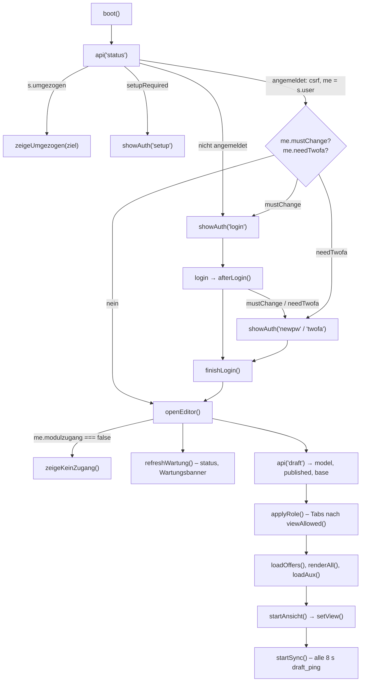

# 6 · Oberflächen (Browser)

Wie der Frontend-Code aufgebaut ist und wie man eine neue Ansicht, einen Dialog oder eine Modulseite im gleichen Stil
baut. Alle Oberflächen sind reines HTML/CSS/JavaScript ohne Framework und ohne Build-Schritt: Was im Repository liegt,
lädt der Browser so.

Voraussetzungen und Abgrenzung:

- Dateiübersicht und Design-Zusammenfassung: [Architektur → Browser](../architektur.md#browser-appassets) und
  [Architektur → Dashboard](../architektur.md#dashboard-dashboard). Dieses Kapitel wiederholt sie nicht, sondern erklärt
  Abläufe und Muster.
- Arbeitsregeln, Sicherheitsgrenzen, Definition of Done: [AGENTS.md](../../AGENTS.md).
- Hosts, Anmeldung, Rechte und CSRF aus Serversicht: [Kapitel 4](04-anmeldung-rechte.md),
  [ADR-003](../plattform/adr-003-domains-anmeldung.md). Testen der Oberflächen: [Kapitel 7](07-tests.md).
- Zuständigkeit je Datei: `python3 werkzeuge/regeln.py modul <id>` (Feld `pfade` in `regeln/module.toml`).
  `app/assets/admin.js` gehört dem Modul `angebot` und ist laut Register ein „Hotspot“ – nur kleine, klar abgegrenzte
  Änderungen; `admin.css` und `theme.js` gehören dem Plattformkern.

## 6.1 Seiten, Dateien und Hosts

| Seite | HTML | Skripte (Ladereihenfolge) | Stylesheets |
| --- | --- | --- | --- |
| Kundenseite (Wochenangebot) | `app/index.html` | `theme.js` (im `<head>`), `offer-core.js`, `frontend.js`, `webapp.js` | `app.css` |
| Web-App | `app/manifest.json`, `app/sw.js` | `webapp.js` registriert `sw.js` (nur im sicheren Kontext) | – |
| Rechtsseiten | `app/kontakt/`, `app/impressum/`, `app/datenschutz/` (je `index.html`) | `/assets/theme.js` | `legal.css` (ohne `app.css`, Systemschrift) |
| Eingabebereich | `app/admin/index.html` | `theme.js`, dann am Ende: `offer-core.js`, `vendor/qrcode.js`, `stock-core.js`, `admin.js`, `admin-verwaltung.js`, `admin-rollen.js`, `admin-import.js`, `../module/hr/verwaltung-hr.js`, `admin-artikelwahl.js`, `admin-werbung.js`, `admin-einzel.js`, `admin-auswertung.js`, `admin-schutz.js` | `app.css`, `admin.css`, `admin-import.css`, `../module/hr/verwaltung-hr.css` |
| Dashboard | `dashboard/index.html`, `dashboard/abgemeldet.html` | `../assets/theme.js`, `dashboard.js` | `../assets/app.css`, `dashboard.css` |
| HR · Urlaub | `app/module/hr/index.html` | `../../assets/theme.js`, `hr.js` | `../../assets/app.css`, `hr.css` |
| CRM · Vertrieb | `app/module/crm/index.html` | `../../assets/theme.js`, `crm.js` | `../../assets/app.css`, `crm.css` |
| Marketing · Redaktionsplan | `app/module/marketing/index.html` | `../../assets/theme.js`, `marketing.js` | `../../assets/app.css`, `marketing.css` |

Alle Pfade sind relativ zur Seite (Rechtsseiten: absolut ab `/`). Damit funktionieren dieselben Dateien auf dem
Testserver (`tests/run_e2e.py`), in der Testumgebung und auf jedem Produktions-Host.

**Welche Seite auf welchem Host** (Quelle: `Caddyfile`, `deploy/anmeldung/apache-oidc.conf`):

| Host | Inhalt | Bemerkung |
| --- | --- | --- |
| `angebot-stafl.de` (`{$DOMAIN}`) | Kundenseite, Rechtsseiten, `/api/`; `/admin/` = alter Eingabebereich | Mit `WA_EIGENE_ANMELDUNG=aus` (Standard in `docker-compose.anmeldung.yml`) meldet `status` das Feld `umgezogen`, die Seite leitet weiter; übrige Aktionen 410 ([4.1](04-anmeldung-rechte.md#stilllegung-des-alten-eingabebereichs)) |
| `dashboard-stafl.de` | `/` → `/dashboard/` | `WA_OBERFLAECHE=dashboard.start` |
| `angebot.dashboard-stafl.de` | `/` → `/admin/` | Eingabebereich, Bereich `angebot.eingabe` |
| `verwaltung.dashboard-stafl.de` | `/` → `/admin/`, `/import/` → `/admin/?ansicht=importe&nur=import` | Bereich `verwaltung.verwaltung` (bzw. `verwaltung.import`) |
| `bestand.dashboard-stafl.de` | `/` → `/admin/` | Bereich `bestand.intern` |
| `hr.dashboard-stafl.de` | `/` und `/admin/…` → `/module/hr/` | nur Aktionen von `hr.intern` (GR-109) |
| `crm.dashboard-stafl.de` | `/` und `/admin/…` → `/module/crm/` | nur Aktionen von `crm.intern` (GR-109) |

Alle `*.dashboard-stafl.de`-Hosts sind dieselbe Anwendung (Caddy → `app-mitarbeiter`) mit je eigenem Keycloak-Client
und eigener Sitzung. Apache setzt je Host `WA_OBERFLAECHE`; daraus macht der Server `me.bereich`
(`app/api/lib/sitzung.php`).

**Das Dashboard liegt außerhalb von `app/`.** Der Container bindet `./dashboard` nur über die Ergänzungsdatei
`deploy/anmeldung/docker-compose.anmeldung.yml` nach `/var/www/dashboard` ein; `apache-oidc.conf` macht es mit
`Alias /dashboard /var/www/dashboard` **nur auf den Keycloak-Hosts** erreichbar. Unter `angebot-stafl.de` gibt es kein
Dashboard. `abgemeldet.html`, `dashboard.css` und `/assets/` sind ohne Anmeldung abrufbar (Abmeldeseite). Im Testlauf
blendet `tests/run_e2e.py` den Ordner nur für die Gruppen `dashboard` und `rollen` unter `/dashboard/` ein (`ZUSATZ`).
`deploy/bereitstellen.py` versieht nur Seiten unter `app/` mit Versionsnummern – die Dashboard-Dateien laden ohne
`?v=` (der Caddy-Block der Plattform-Hosts setzt `no-cache`).

## 6.2 Eingabebereich (`app/admin/`)

Eine Seite für vier Bereiche: Angebot, Verwaltung, Import und Bestand. Welche Ansichten erscheinen, hängt vom Host
(`me.bereich`) und von den Rechten ab. `admin.js` ist eine einzige IIFE; alles Gemeinsame exportiert sie über
`window.WA`, die Teilskripte hängen sich daran.

### Startablauf



- `boot()` (Ende von `admin.js`) fängt jeden Fehler ab und ersetzt die Seite durch „Eingabebereich nicht erreichbar“.
- `status` liefert u. a. `loggedIn`, `csrf`, `user`, `company`, `testumgebung` (setzt `body.is-test`),
  `setupRequired`/`setupLocked` und `umgezogen`.
- `applyRole()` blendet Tabs, Trennüberschriften (`#side-stamm`, `#side-admin`), Knöpfe (`#btn-publish`, `#btn-send`)
  und den Dashboard-Knopf `#btn-dashboard` (nur `me.zentral`, Adresse aus `me.dashboard`, nur `https:`) ein und aus und
  setzt die Klassen `ro`, `is-admin`, `bereich-verwaltung`, `bereich-bestand`, `bereich-import` am `<body>`.
- Startansicht: `?ansicht=<id>` oder `#<id>` (`startAnsicht()`), nur wenn `viewAllowed()` zustimmt; `hashchange`
  schaltet später ebenfalls um.

### Globaler Namensraum `window.WA`

`admin.js` setzt am Ende (gekürzt):

```js
window.WA = {
  importLeser: IMPORT_LESER,
  $, $$, api, esc, icon, toast, confirmBox, dateTime, timeOnly, plural, fold, fmtNum, fmtInt, csvCell, ROLE_LABEL, offerName, offerShort,
  loadOffers, pendingCount, setView, renderWartungBanner, wartungBis, OSTD, may,
  get me() { return me; }, get offers() { return offers; }, get stdPublic() { return stdPublic; },
  /* … Getter/Setter für wartungSt, wartungEingabe … */
  views: {},
};
```

Zustand gibt es nur über Getter (`W.me`, `W.offers`) – nie eine Kopie halten, sonst ist sie nach einer neuen Anmeldung
veraltet. Teilskripte folgen alle demselben Muster:

```js
(function () {
  'use strict';
  const W = window.WA;
  const { $, api, esc, icon, toast, confirmBox } = W;
  /* … */
  W.views.schutz = laden;          // Ansicht „schutz“ (admin-schutz.js)
})();
```

Weitere Anknüpfungspunkte: `W.importLeser.<art>` (Leser für die Importzentrale, z. B. `urlaubsplanung` in
`verwaltung-hr.js`), `W.importSichtbar` (`admin-import.js`), `W.hr` (`verwaltung-hr.js`, von
`admin-verwaltung.js` genutzt), `W.csvZeilen`/`W.csvText` (`admin-verwaltung.js`).

**Achtung Reihenfolge:** `admin-verwaltung.js` **ersetzt** `W.views` (`W.views = { users: …, orders: …, … }`), alle
späteren Skripte **ergänzen** einzelne Schlüssel. Ein neues Teilskript muss deshalb nach `admin-verwaltung.js`
eingebunden werden und darf `W.views` nur ergänzen. `setView` ruft Ansichten nur auf, wenn sie existieren
(`if (v === 'x' && window.WA.views.x) …`).

### Ansichten, Rechte und Bereiche

| Name | Ort | Zweck |
| --- | --- | --- |
| `VIEWS` | `admin.js`, vor `setView` | alle Ansichten in Tab-Reihenfolge; zu jedem Eintrag gehören `#vt-<id>` und `#view-<id>` |
| `ADMIN_VIEWS` | ebenda | nur Administratoren (`mail`, `users`, `rollen`, `sec`, `schutz`) |
| `VIEW_PERM` | `admin.js`, Abschnitt „Anmeldung“ | Ansicht → Recht, das sie sichtbar macht (`''` bzw. ohne Eintrag: Sonderregel oder alle) |
| `BEREICH_VIEWS` | ebenda | je `me.bereich` die erlaubten Ansichten; ohne Bereich (alter Zugang) alle |
| `BEREICH_KOPF` | ebenda | Überschrift statt „Eingabebereich“; schaltet `body.bereich-verwaltung` (keine Angebotsaktionen im Kopf) |

```js
const BEREICH_VIEWS = {
  'verwaltung.verwaltung': ['master', 'vkgruppen', 'kunden', 'gruppen', 'vertreter', 'importe', 'auswertung', 'mail', 'users', 'rollen', 'urlaub', 'log', 'sec', 'schutz'],
  'angebot.eingabe': ['orders', 'edit', 'einzel', 'hist', 'einkauf', 'angebote'],
  'bestand.intern': ['stock'],
  'verwaltung.import': ['importe'],
};
```

`bereich()` macht aus `verwaltung.verwaltung` den Bereich `verwaltung.import`, wenn die Adresse `?nur=import` trägt
oder die Rolle nur `import.zugang` (ohne `verwaltung.zugang`) hat – die Adresse kann den Bereich nur einschränken.
`viewAllowed(v)` prüft in dieser Reihenfolge: Bereich → Administrator-Ansichten (`can('admin')`) → Sonderfälle
(`users`: auch `hr.verwalten`; `gruppen`/`vertreter`: `stammdaten.sehen` oder `kunden.sehen`; `importe`:
`W.importSichtbar()`) → `VIEW_PERM`.

- `can(role)` vergleicht die Rolle (`viewer` < `editor` < `admin`), `may(perm)` ein Einzelrecht (Administrator: alle).
- **Beides ist nur Anzeige.** Die verbindliche Prüfung macht der Server bei jeder Aktion (GR-103, `require_perm`,
  Modulzugang je Host). Eine neue Ansicht ohne serverseitige Rechteprüfung ihrer Aktionen ist ein Fehler, auch wenn
  der Tab ausgeblendet ist.

### `api()` – die Hilfsfunktion für alle Aufrufe

`api(action, { body, query, confirmationRetry })` in `admin.js`: GET ohne `body`, sonst POST mit JSON; immer
`X-CSRF-Token`, `credentials: 'same-origin'`, `cache: 'no-store'`. Gibt bei Erfolg die JSON-Antwort zurück (`ok: true`),
sonst wirft sie einen `Error` mit `status`. Zentral behandelt werden:

| Antwort | Verhalten |
| --- | --- |
| 401 (außer bei Anmeldeaktionen) | `showAuth('expired')` – Anmeldemaske als Überlagerung, Entwurf bleibt erhalten |
| 403 `kein_modulzugang` | `zeigeKeinZugang(name)` – Seite wird verdeckt, nicht ersetzt |
| 410 `umgezogen` | `zeigeUmgezogen(ziel)` – Hinweis, nach 1,5 s Weiterleitung |
| 503 mit `wartung` und `bereich` | `showEingabeWartung()` – Wartungsseite für Nicht-Administratoren |
| 403 `reauth_required` mit `anmelden` (`/oidc/…`) | **schreibende Anfrage** (mit `body`): Dialog `#dlg-reauth-kc` „Kurz bestätigen“, Anmeldung bei Keycloak in einem **eigenen Fenster** (`bestaetigenPerFenster`), Rücksprung auf `admin/bestaetigt.html` meldet sich per BroadcastChannel/postMessage/`storage` (nur gleicher Ursprung), danach dieselbe Anfrage noch einmal (höchstens drei Runden) – offene Dialoge und Eingaben bleiben erhalten. Blockiertes Fenster: „Hier anmelden“ wie bisher. **Sonst** (Seitenaufbau, Abfragen): ungespeicherten Entwurf sichern, erneute Anmeldung bei Keycloak im selben Fenster, zurück auf dieselbe Adresse |
| 403 `confirmation_required` | Dialog `#dlg-reauth` (Passwort), danach **ein** automatischer Wiederholungsversuch |
| sonst nicht `ok` | `Error(data.error)` bzw. „Serverfehler (…)“ |

Eigener Code fängt also nur fachliche Fehler (`catch (e) { toast(e.message) }`); Sitzung, Wartung und Bestätigungen
nicht selbst behandeln. Ausnahme: Datei-Downloads (z. B. PDF) laufen mit eigenem `fetch` und dem CSRF-Kopf.

### Hintergrundabgleich und gemeinsames Bearbeiten

`startSync()` ruft alle 8 s (und beim Zurückkehren in den Tab) `draft_ping` auf: Liste der anderen Bearbeiter
(„Auch hier: …“ in `#save-state`), Revision der Angebote (`offersRev`) und des Entwurfs. Hat jemand anderes
gespeichert, holt `pullRemote()` den Entwurf (`draft&bg=1`) und führt ihn mit `OfferCore.mergeModels(base, model, theirs)`
je Feld zusammen; Konflikte meldet ein Toast („Ihre Eingabe gilt“). Neu gezeichnet wird erst, wenn keine Eingabe
läuft und kein Dialog offen ist (`editingNow()`); betroffene Zeilen blinken (`.remote-hit`). Speichern geschieht
automatisch 700 ms nach einer Änderung (`changed()` → `saveNow()`). Für Tests: siehe
[AGENTS.md → Schnell arbeiten](../../AGENTS.md#schnell-arbeiten-ohne-qualität-zu-verlieren) – der Abgleich kann jederzeit
die Anmeldemaske zeigen.

### Angebote im Editor: eigene Artikelliste je Angebot

Alle Angebote teilen sich die Artikel eines Entwurfs; welche ein Angebot enthält, sagt `inOffer(it, angebot)` (dieselbe
Regel wie `offer_resolve` auf dem Server): Wochenangebot = alle ohne `variants.std` „hidden“, eigene Artikelliste
(`fallback: 'hidden'`) = nur mit eigenem Eintrag, „folgt dem Wochenangebot“ (`standard`) = alle außer dort ausgeblendet.
Geändert wird die Zugehörigkeit nur über `aufnehmen()`, `nurIn()` (neuer Artikel nur in diesem Angebot) und
`entfernen()` (löscht den Artikel, wenn er in keinem Angebot mehr steht) – so beeinflussen sich die Angebote nie.
„Artikel hinzufügen“ nutzt das gemeinsame Fenster `admin-artikelwahl.js` (`WA.artikelwahl.oeffnen(cfg)`, auch für
Einzelangebote) mit Daten aus `angebot_artikel` (Recht `angebot.bearbeiten`, Bestand nur mit `bestand.sehen`);
die Zielgruppe bestimmt `zielGruppe()` aus der VK-Gruppe. Der Excel-Import ersetzt nur das Wochenangebot
(`importKundenangebote()` übernimmt Kundeneinträge auf gleiche Artikelnummern bzw. behält Artikel nur in Kundenangeboten).

### Werbung schalten

Knopf „Werbung“ in der Werkzeugleiste (Zahl = beworbene Artikel des gewählten Angebots): `openWerbung()` (`admin.js`)
übergibt die Artikel des Angebots an das Fenster `admin-werbung.js` (`WA.werbung.oeffnen(cfg)`: Überschrift, Werbetext,
bis zu 12 Artikel mit Reihenfolge und Hinweis; Leser nur ansehen). „Artikel auswählen …“ öffnet über den Rückruf
`auswaehlen` die gemeinsame Artikelauswahl (`werbungAuswahl()`: `WA.artikelwahl.oeffnen` mit Filter „nur in diesem
Angebot“, alle Gruppen, Bestand ohne Filter, beworbene vorausgewählt, höchstens 12; Artikel außerhalb des Angebots
nimmt `artikelAufnehmen()` – dieselbe Funktion wie „Artikel hinzufügen“ – mit Preis auf; Positionen ohne Artikelnummer
erscheinen mit eigenem Schlüssel ohne Nummer). Die Artikelauswahl kennt dafür `preis.fest(a)` (Preis als Text statt
Eingabefeld) und `a.nr` (angezeigte Nummer); `spannen()` passt die colspan der Gruppen-/Detailzeilen an die sichtbaren
Spalten an (Handy). Gespeichert wird in `model.meta.werbung[<Angebot>]`
(Entwurf, sichtbar nach „Veröffentlichen“; Rücknahme je Angebot im Veröffentlichen-Dialog). `werbungBereinigen()` nimmt
bei jeder Änderung Artikel heraus, die nicht mehr im Angebot stehen; der Excel-Import überträgt die Werbung auf die
Artikel mit derselben Nummer (`werbungUebernehmen()`); `mergeModels` gleicht die Werbung je Angebot ab. Beworbene Zeilen
tragen `tr.e-werb` und das Kennzeichen „Werbung“. Auf der Angebotsseite (`frontend.js`, `werbungHTML()`) steht oben ein
eigener Abschnitt im Aufbau der Liste (`.werb-sec`: Band `.werb-st` in der Akzentfarbe mit Überschrift und Text, darunter
die Artikel mit `plBlockHTML(…, 'werb')` als normale Zeilen in den Spalten der Liste; Bestell- und Kachelansicht: in eigener
Karte; nur ohne Suche/Filter in „Alle Artikel“). Beworbene Zeilen/Kacheln der Liste tragen `.werb-an` und den Hinweis
(sonst „Empfehlung“) als Kennzeichen.

### Vorschau

`openVorschau(angebot)` (`admin.js`) zeigt in `#dlg-vorschau` die Angebotsseite als iframe derselben Adresse
(`index.html?vorschau=1&eingebettet=1[&angebot=…]`, erlaubt durch `frame-ancestors 'self'`). `frontend.js` blendet im
eingebetteten Modus (`EINGEBETTET`) den eigenen Vorschau-Hinweis aus. Vor dem Laden wird ein ungespeicherter Entwurf
gespeichert (die Seite liest `offer&draft=1`); beim Schließen wird die Seite im iframe entladen.

### Leistung des Angebotseditors

Der Editor hat bei ~280 Artikeln rund 12 000 Elemente. Deshalb zeichnet `renderGroups()` (ganzer Editor per
`innerHTML`) nur, wenn sich Gruppen oder Artikel ändern; häufige Bedienschritte ändern nur, was sich wirklich ändert:

- **Suche und „Nur Änderungen“:** `filterAnwenden()` setzt `hidden-row` an Zeilen und `hidden` an Gruppen
  (gleiche Regel `matchesFilter` wie `renderGroups`), `bereicheZeigen()` blendet Bereichsüberschriften ohne sichtbare
  Gruppe aus.
- **Wechsel des Angebots (Liste links):** `setOffer()` zeichnet die Gruppen neu, weil jedes Angebot eine eigene Artikelliste hat
  (`inOffer()`); gezeichnet werden nur Artikel und Gruppen des gewählten Angebots.
- **Zurück in den Editor:** `loadAux()` frischt Vorwoche und Bestand nur auf, wenn sie sich seit dem letzten Zeichnen
  geändert haben (`auxStand`).
- **CSS:** `#groups > .gcard { content-visibility: auto; contain-intrinsic-size: auto 640px }` – Gruppen außerhalb des
  Bildschirms werden nicht gestylt, gesetzt und gezeichnet (beim Drucken aus).

Neue Funktionen im Editor halten das bei: Ausgabe einer Zeile nur über `rowHTML`/`stdCellHTML`/`variantCellHTML`, damit
Teilaktualisierungen dasselbe Ergebnis liefern wie ein Neuzeichnen. Messen mit Playwright: Zeit vom Klick bis zwei
`requestAnimationFrame` später, Aufteilung über CDP `Performance.getMetrics`.

### Dialoge, Bestätigung, Toast

- Alle Fenster sind native `<dialog class="modal">` (breit: `modal wide`) **in `admin/index.html`**, Inhalt als
  `<div class="dlg">` bzw. `<form class="dlg">` mit `.dlg-head`, `.dlg-body`, `.dlg-foot` (Formen in `app.css`).
  Geöffnet mit `showModal()`.
- Eine Schleife in `admin.js` verdrahtet beim Laden **jeden** `<dialog>` der Seite: Klick daneben, Escape oder ein
  Element mit `data-close` schließt; mit `data-fest` (z. B. `#dlg-user`) nur die eigenen Knöpfe. Dialoge, die ein Skript
  erst später erzeugt, erhalten das nicht – deshalb neue Dialoge als leeres Gerüst ins HTML schreiben.
- `confirmBox(title, html, okLabel, danger)` → `Promise<boolean>` über `#dlg-confirm`. Der Text wird als HTML
  eingesetzt: Werte vorher mit `esc()` maskieren.
- `toast(msg, ms = 3200)` → `#toast` (`role="status"`, `aria-live="polite"`).
- `aria-labelledby` jedes Dialogs zeigt auf die `<h2>` im Kopf.

### Seitenleiste

`<nav class="side-nav">` mit `.view-tabs.side-tabs` (`role="tablist"`, `aria-orientation="vertical"`); jeder Tab ist
ein `<button role="tab" id="vt-<id>" aria-controls="view-<id>">` mit Symbol und Text (Zusätze für breite Bildschirme in
`<span class="m-hide">`). Gruppen trennen `.side-sep` (`#side-stamm`, `#side-admin`). `setView` setzt
`aria-selected` und `hidden` und hält den aktiven Eintrag mit `navSichtbar()` sichtbar – am Computer scrollt die
Leiste senkrecht, schmal ist sie eine waagerechte Spur. Mit `body.bereich-import` entfällt die Seitenleiste ganz.

## 6.3 Kundenseite (`app/index.html`, `frontend.js`)

- **Laden:** `boot()` → `kundeStart()` (`kunde_status`: Kunde, CSRF, Wartung, `staff`, Bestellfunktion) → `loadData()`
  (`offer`, optional `&angebot=<id>`, Vorschau `?vorschau` mit `&draft=1`). `OfferCore.enrichOffer` und `prepare()`
  bereiten die Daten auf; danach `renderStatic()`, `bind()`, `render()`. Zum Schluss setzt die Seite
  `document.documentElement.dataset.bereit = '1'` – darauf warten die Tests.
- **Darstellung:** Angebotsansicht (Aufbau wie die gedruckte Liste) und Bestellansicht (Tabelle mit Mengen), Umschalter
  `#modebar`; Schnellauswahl `#quicknav`, Filter `#filters`, Suche, Zustand in der Adresse (Abschnitt „URL-Zustand“).
- **Kunden-Login:** `kundeApi()` (eigene, schlanke Hilfsfunktion mit `KCSRF`), Dialoge `#dlg-kunde-login`,
  `#dlg-kunde-pw`, `#dlg-kunde-link` (Passwort per E-Mail-Link). Kundenangebote (`?angebot=…`) nur nach Anmeldung –
  ohne Anmeldung antwortet der Server 401 und die Seite öffnet die Anmeldung.
- **Merkliste:** `localStorage` `wochenangebot.merkliste`; angemeldete Kunden zusätzlich am Konto
  (`kunde_merkliste`, `kunde_merkliste_save`). Die Schlüssel kommen aus `offer-core.js` und sind mit der App identisch.
- **Bestellwunsch:** Mengen je Kunde und Angebot im Browser, Leiste `#orderbar`, Dialog `#dlg-order`, Senden mit
  `kunde_bestellung` und `requestId` (Wiederholung ohne Doppelbestellung). Angezeigte Summen sind „ca.“ – Preise und
  Summen rechnet nur der Server (GR-004). „Meine Bestellwünsche“: `#dlg-customer-orders`.
- **Druck/PDF:** `openPrint()` → `#dlg-print` (Umfang: alles, gefiltert, Merkliste) → Inhalt in `#print-root`, Druckregeln
  in `app.css`. `?drucken=1` öffnet den Dialog sofort (aus den Einzelangeboten); der Parameter wird danach entfernt.
- **Wartung:** Kunden und Besucher sehen nur `renderWartung()`; angemeldete Mitarbeiter (`staff`) sehen das Angebot mit
  Banner (GR-009).
- **Web-App:** `sw.js` speichert nur Startseite, `/assets/`, `manifest.json` und das öffentliche Wochenangebot, immer
  zuerst Netz; offline trägt die Antwort `X-WA-Offline`, die Seite zeigt „Preise ohne Gewähr“.
- **Nie ausgeliefert** (Server, nicht Oberfläche): Mengen, Chargen, MHD, Einkaufspreise (GR-001, GR-008), Kundenpreise im
  öffentlichen Angebot (GR-002). Die Oberfläche darf solche Felder auch nicht „vorsorglich“ anfordern.

## 6.4 Dashboard und Modulseiten (HR, CRM)

Alle drei Seiten haben denselben Aufbau – eine eigenständige IIFE ohne `window.WA`:

1. **Glas-Kopf** `<header class="db-kopf db-glas">` (HR: `hr-kopf hr-glas`, CRM: `crm-kopf crm-glas`): Logo, Modulname,
   Hell/Dunkel-Knopf (`#…-theme`), Nutzer-Chip mit Initialen; dahinter `<div class="…-bg">` mit drei Farbflächen.
2. **Eigene `api()`**, die nicht wirft, sondern `{ status, data, json }` liefert:
   ```js
   async function api(action, body, query = '') {
     const res = await fetch(API + '?action=' + action + query, {
       method: body ? 'POST' : 'GET', credentials: 'same-origin', cache: 'no-store',
       headers: body ? { 'Content-Type': 'application/json', 'X-CSRF-Token': csrf } : {}, body: body ? JSON.stringify(body) : undefined,
     });
     let data = null;
     try { data = await res.json(); } catch { /* keine JSON-Antwort */ }
     return { status: res.status, data: data || {}, json: data !== null };
   }
   ```
3. **Status-Abruf** in `laden()`: 401 ohne JSON = zentrale Sitzung abgelaufen (Webserver) → Anmeldehinweis, „Anmelden“
   lädt die Seite neu; 403 `reauth_required` mit `/oidc/…` → `location.assign(anmelden + Rückkehradresse)`; 403 mit
   `error` → Hinweis (Keycloak-Konto ohne aktives Mitarbeiterkonto); dann `csrf` übernehmen, Nutzer-Chip füllen und die
   Startaktion des Moduls rufen (`module_status`, `hr_start` über `ladeStart()`, `crm_start`). Das CRM übersetzt
   404/503/403 der Startaktion in eigene Hinweise („noch nicht freigegeben“, Wartung, fehlendes Recht).
4. **Reiter** über `location.hash` (`#kalender`, `#cockpit` …), nur wenn der Knopf existiert und sichtbar ist.
5. **Zurück zum Dashboard:** gemeinsamer Knopf `.stafl-zurueck` (`app.css`) links vor dem Logo – `#btn-dashboard` im
   Eingabebereich, `#hr-zurueck`, `#crm-zurueck` auf den Modulseiten (`../../dashboard/`, auf `*.dashboard-stafl.de`
   `https://dashboard-stafl.de/`). Pfeil `#i-back` + „Dashboard“, 36 px, rund; ≤ 560 px oder mit Klasse `kompakt` nur
   der Pfeil; im Eingabebereich mit Angebotsaktionen bis 1600 px nur der Pfeil (Platz in der Kopfzeile).

Kacheln des Dashboards kommen ausschließlich aus `module_status` (Modulregister), Ziele über `kachelZiel()`; Status-Pille
und Absperrband sind nur Anzeige (GR-102, GR-103).

**Hell/Dunkel:** `app/assets/theme.js` setzt vor dem ersten Zeichnen `data-theme` aus `localStorage`
`wochenangebot.theme` (ohne Inline-Skript). Weil jeder Host eigenen Browser-Speicher hat (GR-108), steht die Wahl am
**Konto**: `window.STAFL_THEME = { konto(user, csrf, api), setzen(wert) }`. Jede Seite ruft nach dem Status
`STAFL_THEME.konto(st.data.user, csrf, API)` (Eingabebereich am Anfang von `openEditor`) – das übernimmt `user.theme`
(`'light'` | `'dark'` | `''` = wie das Gerät). Ein `MutationObserver` auf `data-theme` speichert jeden Wechsel über den
Knopf der Seite mit (Aktion `theme_save`, Feld `theme` am Mitarbeiter); die Knöpfe ändern nur `data-theme`.

**Gemeinsame Bausteine** (alle in `app.css`, geprüft von der Testgruppe `einheit`):

- Logo im dunklen Design: eine Regel für jedes `img[src*="logo-standard-fleisch"]` (`filter: brightness(0) invert(1)`,
  keine helle Fläche); Rechtsseiten (`.legal-logo`) immer weiß auf dem dunklen Kopf; Anmeldeseite (Keycloak-Design)
  ebenso; Druck bleibt farbig. Auf Modulseiten am Handy (≤ 480 px) nur das Bildzeichen.
- `.stafl-streifen` für waagerecht scrollende Leisten (Seitenleiste schmal, `#quicknav`, HR-/CRM-Reiter): `theme.js`
  setzt `mehr-l`/`mehr-r` beim Scrollen, `app.css` blendet den Rand weich aus (ohne Animation).

## 6.5 Gestaltung

### Stylesheets und Zuständigkeit

| Datei | Gilt für | Inhalt |
| --- | --- | --- |
| `app/assets/app.css` | alle Seiten außer Rechtsseiten | Schriften (`@font-face` Geist, Geist Mono), Design-Tokens, Grundbausteine (`.btn`, `.fld`, Menü, `dialog.modal`, `.dlg-*`, `.sr-only`, Fokus), Kundenseite „Klar“ mit dem Abschnitt „Liquid Glass“ am Ende (nur `@media screen`, alles unter `body.kseite` – nur `app/index.html` trägt die Klasse), Druck der Angebotsseite (`#print-root`) |
| `app/assets/admin.css` | nur Eingabebereich | ergänzt `app.css`; Abschnitt „Liquid Glass“ am Ende, nur `@media screen`, alles unter `body.adm`; Druck der geöffneten Ansicht/des offenen Fensters |
| `app/assets/admin-import.css` | Eingabebereich | nur die Importzentrale |
| `app/module/hr/verwaltung-hr.css` | Eingabebereich | HR-Teile der Verwaltung (Farben aus `admin.css`) |
| `dashboard/dashboard.css` | Dashboard, Abmeldeseite | eigene Tokens `--db-*` unter `body.db` |
| `app/module/hr/hr.css`, `app/module/crm/crm.css` | Modulseiten | eigene Tokens `--hr-*` bzw. `--crm-*` (CRM mit den Grundwerten von HR) |
| `app/assets/legal.css` | Rechtsseiten | eigenständig, ohne `app.css`, hell/dunkel nach Systemeinstellung |

Darstellungskorrekturen der Kundenseite am Ende von `app.css` greifen nur unter `body:not(.adm):not(.db)` – neue Seiten
mit eigener `body`-Klasse prüfen, ob sie davon betroffen sind (HR/CRM tragen `body.hr`/`body.crm`).

### Design-Tokens, hell und dunkel

Farben stehen als Variablen auf `:root` (`--bg`, `--surface`, `--line`, `--text`, `--text-2`, `--muted`, `--accent`
Bordeaux `#8c1d2c`, `--focus`, Fleischarten `--cat-*`, Zustände `--c-*`, Radien `--r-sm`/`--r`/`--r-lg`) bzw. auf der
Body-Klasse der Seite. Dunkel wird **immer doppelt** definiert und nur für den Bildschirm:

```css
@media screen and (prefers-color-scheme: dark) { :root:not([data-theme="light"]) body.db { --db-bg: #121011; /* … */ } }
@media screen { :root[data-theme="dark"] body.db { --db-bg: #121011; /* … */ } }
```

Damit folgt die Seite dem Gerät, bis jemand umschaltet; der Druck bleibt hell. Neue Farben nie direkt in Regeln
schreiben, sondern als Token mit hellem und dunklem Wert.

### „Liquid Glass“

Mitarbeiterseiten (Eingabebereich, Dashboard, HR, CRM) nutzen dasselbe Muster: ruhiger warmer Grund, drei weiche
Farbflächen fest dahinter (`body.adm::before` bzw. `.db-bg`/`.hr-bg`/`.crm-bg`), Glasflächen mit
`backdrop-filter: blur(…) saturate(…)` und einem deckenden Ersatzwert:

```css
.hr-glas { background: var(--hr-glass); /* … */ backdrop-filter: blur(28px) saturate(180%); }
@supports not ((backdrop-filter: blur(1px)) or (-webkit-backdrop-filter: blur(1px))) { .hr-glas { background: var(--hr-deckend); } }
@media (prefers-reduced-transparency: reduce) { .hr-glas { background: var(--hr-deckend); backdrop-filter: none; } .hr-bg { display: none; } }
```

Die Angebotsseite (`app/index.html`, `body.kseite`) nutzt dasselbe Muster im Abschnitt „Liquid Glass“ am Ende von
`app.css` (Inhalt und Aufbau wie im Design „Klar“): Tokens `--glas-kopf`, `--glas`, `--glas-leicht`, `--glas-karte`,
`--glas-stark`, `--glas-fenster`, `--aus`, `--feld`, `--zebra`, `--regel`; Grund über `body.kseite::before` mit den Farbflächen des Dashboards (Blaugrau, Bernstein, Salbei – kein Rot); Kopfzeile als
schwebende Kapsel (`.topbar` mit `top: 10px` – klebende Tabellenköpfe daher `--header-h + 18px`), Umschalter als Segment
in einer Glaskapsel, Fleischarten/Filter/Sortierung als Kapseln, Angebotsliste `.al` als Glaskarte (30 px) mit abgerundeten
Zeilen ohne Spaltenlinien, Fenster und Menüs als Glasfenster. Andere Seiten mit `app.css` (Eingabebereich, Dashboard,
Module) tragen die Klasse nicht und bleiben unverändert. Einzelheiten zum Eingabebereich (Kapsel, Karten 28 px, klebende
Leisten fast deckend): [Architektur → Browser](../architektur.md#browser-appassets).

### Symbole

Jede Seite enthält am Ende von `<body>` ein eigenes SVG-Sprite (`<svg width="0" height="0" style="position:absolute"
aria-hidden="true">` mit `<symbol id="i-…" viewBox="0 0 24 24">`). Verwendet wird es über `icon()`:

```js
const icon = (n, cls = '') => `<svg class="i ${cls}" aria-hidden="true"><use href="#i-${n}"/></svg>`;
```

Ein neues Symbol muss **in jeder Seite** ergänzt werden, die es nutzt – es gibt keine gemeinsame Sprite-Datei. Symbole
sind Linien (`stroke: currentColor`), Füllung nur ausdrücklich (`<g fill="currentColor">`). Das Dashboard bildet
Registersymbole (`icon` in `regeln/module.toml`) über `ICON` in `dashboard.js` auf eigene Symbole ab; unbekannte werden
`grid`.

### Schrift, Breakpoints, Barrierefreiheit

- Schrift Geist / Geist Mono lokal aus `app/assets/fonts/` (`--font`, `--mono`); keine fremden Server.
- Mobil wird mit **390 px** geprüft (Definition of Done), Dashboard und Kundenseite zusätzlich bis 360 px. Häufigste
  Grenzen in den Stylesheets: 560, 640 und 860 px; im Eingabebereich zusätzlich 900 px (Fingerbedienung,
  `pointer: coarse`: Bedienelemente ≥ 36 px) und 1600 px (Kopfzeile). Bei Fingerbedienung gilt überall (`app.css`):
  Kästchen `.check`/`.opt` 20 px in einer mindestens 36 px hohen Zeile. Nie waagerechtes Scrollen der Seite – breite
  Tabellen scrollen in ihrer Karte; Auswahlfelder, deren Text sonst abgeschnitten würde, bekommen auf schmalen
  Bildschirmen eine eigene Zeile (Sortierung der Kundenseite ≤ 480 px).
- Kontrast ≥ 4,5:1 hell und dunkel (u. a. Gruppen `design`, `sidenav`, `dashboard` messen das).
- Fokus: `:focus-visible { outline: none; box-shadow: var(--focus); }` aus `app.css`; Modulseiten mit eigenem
  `--…-fokus`. Fokus nie ersatzlos entfernen.
- `aria`: Symbole `aria-hidden="true"`, reine Symbolknöpfe mit `aria-label` (und `title`), Tabs mit `role="tab"`,
  `aria-selected`, `aria-controls`; Statusmeldungen `role="status"`/`aria-live`, Fehler `role="alert"`; versteckte
  Beschriftungen mit `.sr-only`. Kundenseite mit Sprunglink `.skip`.
- `prefers-reduced-motion`: keine Übergänge (Dashboard); `prefers-reduced-transparency`: deckend (siehe oben).

### Content-Security-Policy und Einbindung

Caddy setzt auf allen Hosts `script-src 'self'` (ohne `'unsafe-inline'`), `connect-src 'self'`, `font-src 'self' data:`,
`img-src 'self' data: blob:`; Stile dürfen inline sein (`style-src 'self' 'unsafe-inline'`). Daraus folgt:

- **Keine Inline-Skripte**, keine `onclick="…"`-Attribute, kein `javascript:`-Link. Ereignisse mit `addEventListener`,
  bevorzugt als Delegation über `data-*` (`data-act`, `data-close`, `data-v`).
- Keine Skripte, Schriften oder Daten von fremden Servern; Bibliotheken liegen unter `app/assets/vendor/`.
- `fetch` nur zur eigenen `api/` desselben Hosts (GR-109).
- Skripte und Stylesheets **ohne** `?v=` einbinden. Die Nummern setzt der Server beim Einspielen
  (`deploy/bereitstellen.py`); `python3 werkzeuge/asset_versionen.py` prüft Einbindungen, `--zeigen` zeigt das Ergebnis.
- HTML aus Daten immer mit `esc()` bauen (Template-Strings + `innerHTML`); Adressen vom Server vor Verwendung prüfen
  (Muster in `applyRole`: nur `https://…`).

## 6.6 Rezept: neue Ansicht im Eingabebereich

Beispiel: Ansicht `lager` im Bereich Verwaltung, sichtbar mit Recht `lager.sehen`.

1. **Zuständigkeit klären:** `python3 werkzeuge/regeln.py modul <id>`. Neuer Code gehört in ein **eigenes Teilskript**
   des Fachmoduls (bei Modulen mit eigener Seite unter `app/module/<id>/`, Vorbild `verwaltung-hr.js`) – in `admin.js` und
   `admin/index.html` nur die wenigen Zeilen aus Schritt 2–4.
2. **HTML** (`app/admin/index.html`): Tab in die passende Gruppe der Seitenleiste und Container zu den übrigen:
   ```html
   <button role="tab" type="button" id="vt-lager" aria-selected="false" aria-controls="view-lager" hidden><svg class="i" aria-hidden="true"><use href="#i-box"/></svg><span>Lager</span></button>
   …
   <div id="view-lager" hidden></div>
   ```
   Neue Dialoge als Gerüst (`<dialog class="modal" id="dlg-lager" aria-labelledby="lg-title"><div class="dlg" id="lager-body"></div></dialog>`),
   fehlende Symbole ins Sprite, das Skript nach `admin-verwaltung.js` einbinden (ohne `?v=`).
3. **`admin.js`:**
   - `'lager'` in `VIEWS` aufnehmen (Position = Reihenfolge der Tabs; `applyRole` und `setView` erwarten zu jedem
     Eintrag `#vt-lager` **und** `#view-lager`, sonst bricht der Start ab);
   - `VIEW_PERM.lager = 'lager.sehen'` (oder Sonderfall in `viewAllowed`);
   - in `BEREICH_VIEWS['verwaltung.verwaltung']` eintragen – ohne Eintrag erscheint die Ansicht auf keinem Bereichs-Host;
   - gehört sie zur Gruppe „Verwaltung“/„Stammdaten“, in die Liste für `#side-admin` bzw. `#side-stamm` in `applyRole`;
   - in `setView` den Aufruf ergänzen: `if (v === 'lager' && window.WA.views.lager) window.WA.views.lager();`
4. **Teilskript** (`…/admin-lager.js` o. ä.):
   ```js
   (function () {
     'use strict';
     const W = window.WA;
     if (!W) return;
     const { $, api, esc, icon, toast, confirmBox, may } = W;
     async function render() {
       const host = $('#view-lager');
       try {
         const d = await api('lager_liste');
         host.innerHTML = `…${esc(d.titel)}…`;
       } catch (e) { host.innerHTML = `<div class="err-box">${esc(e.message)}</div>`; }
     }
     W.views.lager = render;
   })();
   ```
   Schreibende Knöpfe mit `may('lager.bearbeiten')` ausblenden – die Aktion prüft das Recht trotzdem selbst.
   Die neue Datei braucht einen Kopfkommentar, dessen erster Satz sagt, was sie tut (`python3 werkzeuge/doku.py pruefen`);
   danach `python3 werkzeuge/doku.py erzeugen`.
5. **Server und Register** (im selben PR, sonst lehnt die CI ab): Aktionen in `regeln/aktionen/<modul>.toml` und
   `python3 werkzeuge/regeln.py erzeugen`; neues Recht in `regeln/berechtigungen.toml` (Name `<modul>.<recht>`); neue
   Dateien und Testgruppen in `regeln/module.toml`. Änderungen an Rechten sind koordinationspflichtig
   ([multi-agent.md](../plattform/multi-agent.md)).
6. **Tests:** E2E-Gruppe des Moduls um die Ansicht ergänzen (sichtbar/unsichtbar je Rolle und je Bereichs-Host, Aktion
   ohne Recht → 403, 1280 px und 390 px, keine `pageerror`); Vorbild `tests/e2e/test_sidenav.py`
   (`a.on('pageerror', …)`), Muster in [7.3](07-tests.md#73-einen-neuen-test-schreiben). `tests/README.md` nennt neue Gruppen. Danach
   `python3 werkzeuge/regeln.py betroffen --basis origin/main` und die genannten Gruppen in beiden Speicherarten.

### Kurz: neue Modulseite nach dem Muster HR/CRM

1. Modul in `regeln/module.toml` (Oberfläche `intern`, `pfade` u. a. `app/module/<id>/**`, Testgruppe); Aktionen in
   `regeln/aktionen/<id>.toml` mit dieser Oberfläche.
2. `app/module/<id>/index.html`, `<id>.js`, `<id>.css`: `theme.js` im `<head>`, dann `../../assets/app.css` und das eigene
   Stylesheet; `<body class="<id>">`, Hintergrund `<div class="<id>-bg">`, Glas-Kopf, Hinweisbox „Bitte anmelden“,
   Fehlerzeile `role="alert"`, App-Bereich `hidden`, eigenes Sprite, `<script src="<id>.js">` am Ende.
3. `<id>.js` als IIFE mit eigener `api()` und `laden()` wie in 6.4 (Status-Abruf, `reauth_required`, Startaktion),
   Rückweg zum Dashboard wie HR/CRM.
4. `<id>.css` mit eigenen Tokens `--<id>-*` (hell, `prefers-color-scheme`, `data-theme`), Glas mit deckendem Ersatz,
   Prüfung bei 390 px.
5. Eigener Host (Apache-Host mit `WA_OBERFLAECHE=<id>.intern` in `deploy/anmeldung/apache-oidc.conf`, Keycloak-Client,
   Caddy, DNS) ist Betrieb, koordinationspflichtig und braucht die Freigabe des Inhabers; bis dahin bleibt die Adresse
   503-Platzhalter (GR-105). Register, Kachel und Freigabestufen: [09 → Ein neues Modul](09-anleitungen.md#ein-neues-modul-mit-kachel).

Stand: 2026-10-24
