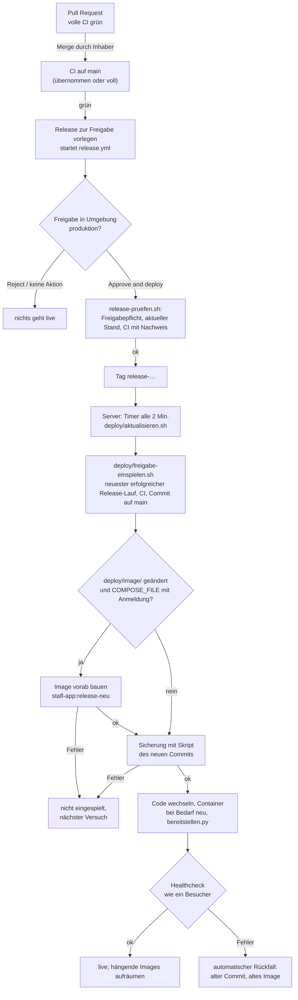

# 8 · CI, Release und Betrieb

Wie ein Stand vom Pull Request bis auf den Server kommt, was die CI prüft und wie der Server aufgebaut ist. Die
Ablaufbeschreibungen für den Inhaber stehen in [`docs/release-freigabe.md`](../release-freigabe.md),
[`docs/testumgebung.md`](../testumgebung.md), [`docs/datenbank.md`](../datenbank.md),
[`docs/plattform/inbetriebnahme-anmeldung.md`](../plattform/inbetriebnahme-anmeldung.md) und
[`deploy/anmeldung/LIESMICH.md`](../../deploy/anmeldung/LIESMICH.md). Wie man testet: [07 – Tests](07-tests.md).

## 8.1 Was nur mit Freigabe des Inhabers geschieht

Aus [`AGENTS.md`](../../AGENTS.md), Sicherheitsgrenzen – gilt für Menschen und Agenten gleichermaßen:

- **Nie direkt nach `main`.** Jede Änderung in einem eigenen Branch als Pull Request. Mergen und Releases freigeben
  ausschließlich der Inhaber (Konto `STAFLGUST`).
- **Produktion nur über Release.** Der Server spielt nur Commits ein, die in der GitHub-Umgebung `produktion` freigegeben
  wurden und eine grüne CI haben.
- **Nur mit ausdrücklicher Freigabe:** Änderungen an Server, Zugängen, Daten und Deploymentprozess; DNS;
  Datenbankmigrationen (z. B. `deploy/datenbank-umschalten.sh`); produktive Freigabe unfertiger Module.
- **Keine Geheimnisse und keine echten Daten** im Repository. Geheimnisse stehen nur in `.env` auf dem Server.

Alle Skripte in `deploy/` laufen **auf dem Server** und werden von Entwicklern und Agenten nicht ausgeführt, sondern
nur geändert (per PR) und mit `tests/deploy/` geprüft.

## 8.2 CI-Aufträge (`.github/workflows/ci.yml`)

Auslöser: jeder Pull Request, jeder Push auf `main`, von Hand (`workflow_dispatch`). Im Pull Request bricht ein neuer
Push den veralteten Lauf ab; auf `main` warten Läufe aufeinander (`concurrency`), damit kein Lauf abgebrochen wird, der
den Release vorlegt.

| Auftrag (Name in GitHub) | Inhalt | Läuft |
| --- | --- | --- |
| Schon im Pull Request geprüft? (`nachweis`) | hält den Git-Tree des Stands fest; auf `main` sucht `.github/scripts/ci_nachweis.py` einen vollständig grünen PR-Lauf mit genau diesem Tree (nur Hashes über die API) | immer |
| Statische Prüfungen (`statisch`) | siehe Liste unten | immer |
| Sicherheitsprüfungen (`sicherheit`) | gitleaks über den Verlauf bis `HEAD` (`.gitleaks.toml`, Version und Prüfsumme fest); Trivy: `tests/requirements.txt` (HIGH/CRITICAL blockiert), Images aus `docker-compose.yml` (nur Bericht) | immer |
| Anwendungs-Image prüfen (`image`) | `deploy/image/pruefen.sh` (Bau, Vergleich mit `php:8.3-apache`); `deploy/anmeldung/pruefen.sh` mit festen Keycloak-/PostgreSQL-Digests; Trivy auf `stafl-app:pruefung` (CRITICAL mit Korrektur blockiert, HIGH als Bericht) | nach `statisch`, außer übernommen |
| Sicherung und Release-Prozess (`betrieb`) | `tests/deploy/`: `test_datenbank.py`, `test_sqlite_http.sh`, `test_sichern.sh`, `test_freigabe.sh`, `test_testumgebung.sh`, `test_release_pruefen.sh`, `test_anmeldung_einrichten.sh`, `test_notzugang.sh`, `test_konten_pruefen.sh`, `test_speicher.sh`, `test_datenbank_umschalten.sh`, `test_altdateien.sh`, `test_karte_laden.sh`, `test_adressen_laden.sh` | nach `statisch`, außer übernommen |
| Ende-zu-Ende-Tests (*speicherart*, Teil *k*/3) (`e2e`) | Matrix `storage: [files, sqlite]` × `teil: [1, 2, 3]`; `.github/scripts/testumgebung.sh e2e`, dann `python tests/run_e2e.py` mit `WA_JOBS=4`; Artefakt bei Fehler | nach `statisch`, außer übernommen |
| Ende-zu-Ende-Tests (`e2e_required`) | fester Name für den Branchschutz; grün nur, wenn alle sechs Teile grün sind | nach `e2e` |
| Anmeldung über Keycloak (nur CI) (`oidc`) | `testumgebung.sh oidc`, `tests/oidc/umgebung.sh start`, `tests/oidc/test_oidc.py`, `stop`; Artefakt `oidc-ergebnisse` | nach `statisch`, außer übernommen |
| App prüfen (iOS, Android, Web) (`app`) | in `mobile/`: `npm ci`, `npm run typecheck`, `npm test -- --ci`, `npm run export:native` (Bundles iOS/Android), `npm run export:web`; danach `python tests/run_e2e.py app_web` in beiden Speicherarten; Artefakt `app-ergebnisse` | nach `statisch`, außer übernommen |
| Vollständig geprüft (Stand *Tree*) (`vollstaendig`) | nur wenn alle vorigen Aufträge grün sind; der Name trägt den geprüften Tree (Nachweis für `main` und für den Release) | am Ende |
| Prüfung aus Pull Request übernommen (`uebernommen`) | nur auf `main`, wenn `nachweis` einen passenden PR-Lauf gefunden hat; verlinkt ihn | nur `main` |
| Release zur Freigabe vorlegen (`release_vorlegen`) | startet `release.yml` mit Grund (PR-Nummer und Titel) und erwartetem Commit | nur nach Push auf `main` mit Nachweis |

**Statische Prüfungen** (Schritte in dieser Reihenfolge):

1. PHP-Syntax (`php -l` für `app/` und `deploy/`, ohne `app/api/geo/`)
2. JavaScript-Syntax (`node --check` für `app/assets/`, `app/assets/vendor/`, `dashboard/`, `tests/unit/`)
3. Shell-Skripte (`shellcheck --severity=warning` für `deploy/` und `tests/deploy/`)
4. Caddy-Konfiguration mit echtem Parser (`caddy validate` mit derselben Caddy-Fassung wie in `docker-compose.yml`, ohne Netz)
   und Container-Images fest über Digest (`tests/deploy/test_images.py`: alle fremden Images mit `@sha256`, gleiches PHP-Grundimage
   für Kundenseite, Anwendungs-Image und Testumgebung, CI lädt und scannt dieselben Fassungen)
5. Dashboard-Domains nur als geschützte Platzhalter (`tests/deploy/test_dashboard_domains.py`, GR-105; HSTS 1 Jahr je Host)
6. Python-Syntax (`py_compile` für Tests, Werkzeuge, `deploy/*.py`, `.github/scripts/*.py`)
7. Regelwerk und Modulgrenzen (`werkzeuge/regeln.py pruefen`, `tests/regeln/test_regeln.py`)
8. Entwickler-Dokumentation passt zum Code (`werkzeuge/doku.py pruefen`: Referenz in `docs/entwickler/referenz/`,
   Kopfkommentar je Code-Datei)
9. Versionsnummern der Skripte und Stylesheets (`werkzeuge/asset_versionen.py`: Einbindungen existieren, kein `?v=` im Repository)
10. Prüfliste der Dateiprüfung (`werkzeuge/integritaet.py`)
11. Tests ohne fest eingetragene Ports (`127.0.0.1:<Port>` in `tests/e2e/` nur in `umgebung.py`)
12. Unit-Tests: Bestands-Parser, Bestandswochen und Preisvergleich (PHP und JavaScript), gemeinsames Bearbeiten
13. Unit-Tests der CI-Werkzeuge (`test_run_e2e_teile.py`, `test_ci_nachweis.py`, `test_apt_vorrat.py`)
14. Workflows prüfen (`actionlint`, Version und Prüfsumme fest)

**Keine Doppelprüfung nach dem Merge:** Die PR-CI prüft den Stand nach dem Zusammenführen (`refs/pull/N/merge`). Ist der
Tree auf `main` derselbe, überspringt der `main`-Lauf Image, Betrieb, E2E und Keycloak; statische Prüfungen und
Sicherheitsprüfungen laufen trotzdem. Bei jedem Zweifel läuft die volle CI. Einzelheiten und Rückweg:
[`docs/release-freigabe.md`](../release-freigabe.md#keine-doppelprüfung-nach-dem-merge).

### Weitere Workflows

| Workflow | Datei | Auslöser | Zweck |
| --- | --- | --- | --- |
| Release | `.github/workflows/release.yml` | von Hand oder durch `release_vorlegen` | wartet auf Freigabe in `produktion`, prüft (`.github/scripts/release-pruefen.sh schutz`, `aktuell`, `ci`) und legt den Tag `release-<JJJJMMTT-HHMMSS>` mit Freigebendem und Grund an; nur vom Branch `main`; ein neuer Lauf beendet einen älteren wartenden |
| Zwischenspeicher | `.github/workflows/zwischenspeicher.yml` | Push auf `main`, montags (Zeitplan), von Hand, PR nur bei Änderungen am Ablauf | füllt Paketvorrat (`testumgebung.sh vorrat`) und Keycloak/Caddy-Downloads (`tests/oidc/umgebung.sh laden`) für E2E und Keycloak; übernommen werden Pakete nur mit passender Prüfsumme (`.github/scripts/apt_vorrat.py`) |
| CI-Nachweis (Trockenlauf) | `.github/workflows/ci-nachweis.yml` | von Hand | zeigt, ob ein `main`-Commit die PR-Prüfung übernehmen würde und warum (nicht); ändert nichts, zählt nicht als CI |

Die App `mobile/` prüft die CI im Auftrag „App prüfen (iOS, Android, Web)“ (Typprüfung, Unit-Tests, Bundles, `app_web`).

## 8.3 Release-Ablauf vom Merge bis zum Server



Schritte im Einzelnen:

1. **Merge** durch den Inhaber. Die CI auf `main` legt nach Erfolg den Release vor (Auftrag „Release zur Freigabe
   vorlegen“). Kam keine Freigabeanfrage: Actions → Release → Run workflow (Branch `main`).
2. **Freigabe** in GitHub: Lauf öffnen → Review deployments → `produktion` → Approve and deploy. Wer nichts tut, gibt
   nichts frei.
3. **Prüfungen nach der Freigabe** (`.github/scripts/release-pruefen.sh`): Umgebung verlangt Prüfer; `main` ist nicht
   weiter; CI für genau diesen Commit erfolgreich und mit Nachweis-Auftrag. Dann Tag `release-…`.
4. **Server:** `deploy/aktualisieren.sh` läuft per systemd-Timer `wochenangebot-update.timer` alle 2 Minuten
   (eingerichtet mit `deploy/einrichten.sh`). Es stellt zuerst die Bereitstellung des aktiven Stands sicher
   (`deploy/bereitstellen.py`) und ruft im Release-Modus (Datei `.release-modus`, eingerichtet mit
   `deploy/release-modus-einrichten.sh`) `deploy/freigabe-einspielen.sh` auf.
5. **`freigabe-einspielen.sh`** fragt die GitHub-API mit einem nur lesenden Token (`GITHUB_TOKEN_LESEN` in `.env`) nach
   dem neuesten erfolgreichen Release-Lauf auf `main`, prüft erneut die CI und dass der Commit auf `main` liegt. Ein
   abgelehnter oder zurückgenommener Commit steht in `.release-abgelehnt` und wird nicht erneut versucht.
6. **Image:** Ändert das Release `deploy/image/` und enthält `COMPOSE_FILE` die Ergänzungsdatei der Anmeldung, wird das
   Image vorab gebaut (`docker compose build --pull app` als `stafl-app:release-neu`). Fehler → nichts eingespielt.
7. **Sicherung** mit dem Sicherungsskript des neuen Commits (`deploy/.sichern-release.sh`). Ohne Sicherung kein Release.
8. **Code wechseln.** Ändern sich `Caddyfile`, `docker-compose.yml` oder die Ergänzungsdatei, werden alle Container
   neu erstellt; sonst bei Bedarf nur die App. Das bisherige Image bleibt als `stafl-app:release-vorher`. Danach
   `deploy/bereitstellen.py`: Versionsnummern `?v=…` und Prüfliste `app/api/lib/integritaet-liste.php` aus den
   Git-Objekten genau dieses Commits.
9. **Healthcheck** über Caddy wie ein Besucher: `status` (`"ok":true`), Angebots-API (200, 401 oder 503 im
   Wartungsmodus), Startseite mit `assets/frontend.js`, `/admin/` mit `assets/admin.js`; zwei Erfolge hintereinander,
   insgesamt bis etwa 40 s.
10. **Ergebnis:** Erfolg → `docker image prune -f` (nur hängende Images). Fehler → automatischer Rückfall auf den alten
    Commit und `stafl-app:release-vorher`. Status steht in `daten/deployment.php` und im Eingabebereich; optional
    Meldung an `HC_DEPLOY_URL`.

**Rückfall von Hand:** `sh /opt/wochenangebot/deploy/release-zurueck.sh` – zurück auf den Stand vor dem letzten
Release (`vorher` in `daten/deployment.php`), Daten bleiben unverändert, der zurückgenommene Stand kommt nicht automatisch
wieder. Gesperrt, solange SQLite aktiv ist und der Zielstand keine Speicherschicht hat (erst
`sh deploy/datenbank-umschalten.sh rollback`, [`docs/datenbank.md`](../datenbank.md)). Nie mit `git reset` umgehen.

Getestet ohne Docker und ohne Server: `tests/deploy/test_freigabe.sh`, `tests/deploy/test_release_pruefen.sh`.

## 8.4 Server-Aufbau

Ein VPS mit Docker Compose; Installationsordner `/opt/wochenangebot` (Git-Checkout des freigegebenen Stands, `.env`).

| Dienst | Herkunft | Aufgabe |
| --- | --- | --- |
| `caddy` | `docker-compose.yml`, Image `caddy:2`, Konfiguration `Caddyfile` | einziger öffentlicher Eingang (Ports 80/443), TLS-Zertifikate, Sicherheits-Header, Zwischenspeichern versionierter Dateien; leitet an `app`, `app-mitarbeiter`, `keycloak` bzw. `app-test` weiter; nicht freigegebene Dashboard-Hosts als 503-Platzhalter (GR-105) |
| `app` | `docker-compose.yml`; mit Ergänzungsdatei Image `stafl-app` aus `deploy/image/` (PHP 8.3, Apache, mod_auth_openidc) | die Anwendung; `app/` nur lesend, `daten/` als Datenordner; mit Ergänzungsdatei zusätzlich `dashboard/` und `apache-oidc.conf` (Keycloak-Hosts) und Netzwerkname `app-mitarbeiter` |
| `keycloak` | `deploy/anmeldung/docker-compose.anmeldung.yml` (Version und Digest fest) | Mitarbeiteranmeldung, Realm `mitarbeiter`; Verwaltung nur auf `127.0.0.1:8180`; öffentlich über Caddy nur `/realms/mitarbeiter/` und `/resources/` |
| `keycloak-db` | ebenda, PostgreSQL 17 (Digest fest) | Datenbank nur für Keycloak, internes Netz `anmeldung` |
| `app-test` | `deploy/testumgebung/docker-compose.yml` in `/opt/wochenangebot-test` | Testumgebung, nur im Netz `wochenangebot-edge` |

Die Ergänzungsdatei ist aktiv, wenn `.env` `COMPOSE_FILE=docker-compose.yml:deploy/anmeldung/docker-compose.anmeldung.yml`
enthält (Inbetriebnahme Schritt 5). Ohne sie antworten die Keycloak-Hosts mit 502, nie mit der Anwendung ohne Anmeldung.

**Datenorte auf dem Server** (alle nicht im Repository):

| Ort | Inhalt |
| --- | --- |
| `.env` | Domain, Mail-Zugang, Geheimnisse der Anmeldung, Token für den Release-Modus (nur root) |
| `.release-vorher`, `.release-abgelehnt` | Stand vor dem letzten Release (Notfall-Rückfall) bzw. abgelehnter Release (nur root) |
| `daten/` | Geschäftsdaten (Dateien oder `daten/.sqlite/store.sqlite`), Status von Sicherung und Deployment, `mail-schluessel.php` (nicht in Sicherungen) |
| `daten-anmeldung/` | Realm-Import, Tresor `vault/` (Postfach-Passwort für Keycloak, nicht gesichert), während der Einrichtung `einrichtung.env` |
| `daten-karte/` | Detailkarte `karte.pmtiles` (OpenStreetMap, Deutschland bis Zoomstufe 15, ca. 5–6 GB) und `stand.txt`, Adressverzeichnis `adressen.sqlite` (geschätzt um 1 GB) und `adressen-stand.txt`; im Anwendungs-Container nur lesend unter `/var/www/karte`, nicht gesichert (jederzeit neu ladbar) |
| `sicherungen/` | Datensicherungen und `anmeldung-<Zeit>.dump`, je 30 Stände, nur root |
| Volumes | `caddy_data`, `caddy_config` (Zertifikate), `keycloak_db` |

### Skripte in `deploy/`

| Skript | Zweck | Wer ruft es auf |
| --- | --- | --- |
| `einrichten.sh` | Timer `wochenangebot-update` (alle 2 Min.) einrichten | Inhaber, einmalig |
| `aktualisieren.sh` | Bereitstellung sicherstellen, im Release-Modus `freigabe-einspielen.sh` | systemd-Timer |
| `release-modus-einrichten.sh` | Release-Modus einschalten (`.release-modus`, Token prüfen) | Inhaber, einmalig |
| `freigabe-einspielen.sh` | freigegebenes Release einspielen, Healthcheck, automatischer Rückfall | `aktualisieren.sh` |
| `bereitstellen.py` | Versionsnummern und Prüfliste aus dem aktiven Commit; `--pruefen` nur prüfen; `--verzeichnis` für einen Programmordner | Einspiel- und Rückfallskripte, `testumgebung.sh` (Werkzeug des Echtbetriebs, als `www-data`), `run_e2e.py` |
| `release-zurueck.sh` | Notfall-Rückfall auf den Stand vor dem letzten Release | Inhaber |
| `sichern.sh` | Datensicherung mit Probeentpacken, inkl. Keycloak-Datenbank; `--jetzt` sofort | Timer `wochenangebot-sicherung` bzw. `aktualisieren.sh` (1×/Tag), Release |
| `sicherung-einrichten.sh` | eigener Sicherungs-Timer (täglich 02:30) | Inhaber, einmalig |
| `sicherung-pruefen.py`, `sicherung-pruefen.php` | entpackte Sicherung prüfen | `sichern.sh` |
| `datenbank.py` | SQLite: `check`, Migration/Rückkonvertierung (`--offline`), Sicherung, `altdateien` (Altdateien auflisten/archivieren) | `datenbank-umschalten.sh`, `sichern.sh`, `run_e2e.py` |
| `datenbank-umschalten.sh` | `migrate` / `rollback` zwischen Dateien und SQLite | Inhaber, nur mit Freigabe und Wartungsfenster |
| `altdateien.sh` | `zeigen` / `archivieren` der alten Datendateien nach der Umschaltung (nur bei aktivem SQLite, Archiv in `sicherungen/`) | Inhaber, nur mit Freigabe; Anwendung bleibt in Betrieb |
| `testumgebung.sh` | Testumgebung `test.<Domain>` (siehe unten) | Inhaber |
| `wartung-aus.sh` | Notfall: alle Wartungen beenden | Inhaber |
| `notzugang.sh` | Notfall: alten Eingabebereich mit eigener Anmeldung öffnen/schließen | Inhaber |
| `passwort-zuruecksetzen.sh` | Notfall: Passwort eines Nutzers zurücksetzen bzw. Administrator neu anlegen | Inhaber |
| `ip-freigabe-aus.sh` | Notfall: IP-Freigabe und Ländersperre ausschalten | Inhaber |
| `karte-laden.sh` | Detailkarte laden bzw. aktualisieren (`pruefen`: Stand und geschätzte Größe ohne Download; ohne Angabe: neuester Protomaps-Stand, Ausschnitt `deploy/karte/deutschland.geojson`, go-pmtiles fest über Digest, neue Datei neben der alten, geprüft, dann ausgetauscht; `entfernen`) – mindestens 14 GB frei | Inhaber, einmalig bzw. bei Bedarf |
| `adressen-laden.sh` | Adressverzeichnis der CRM-Karte laden bzw. aktualisieren (`pruefen`: Stand und Größe der Quelle ohne Download; ohne Angabe: Deutschland-Auszug von Geofabrik, geprüft über die veröffentlichte MD5-Prüfsumme – neben der Datei oder dem Ziel einer Weiterleitung – bzw. ohne sie über die angekündigte Größe, vorher Probe mit den Testdaten `tests/fixtures/karte/adressen.osm` (einzeln: `probe`), Umwandlung im Container `python:3.12-bookworm` – volles Image, das pyosmium-Paket braucht libexpat – mit pyosmium fest über Prüfsummen (`deploy/karte/requirements.txt`, `deploy/karte/adressen.py`), Prüfung von Format und Anzahl, dann Austausch; Quelle wird danach gelöscht; `entfernen`) – mindestens 12 GB frei | Inhaber, einmalig bzw. bei Bedarf |
| `speicher.sh` | Speicherbelegung anzeigen (nur lesend); `aufraeumen`: Docker-Bauzwischenspeicher und ungenutzte Images entfernen – nie Daten, Sicherungen, Volumes, Container oder `stafl-app:*` (Rückfall-Image) | Inhaber, bei Bedarf |
| `anmeldung/einrichten.sh` | Geheimnisse der Anmeldung in `.env` ergänzen, Realm-Import vorbereiten; `--pruefen` | Inhaber, Inbetriebnahme |
| `anmeldung/konten.sh` | Keycloak-Konten und Realm verwalten (siehe unten) | Inhaber |
| `anmeldung/ruecksicherung-probe.sh` | Rücksicherung der Keycloak-Datenbank in eine Probedatenbank üben | Inhaber |
| `anmeldung/pruefen.sh`, `image/pruefen.sh` | Betriebskonfiguration bzw. Image mit Docker prüfen | CI („Anwendungs-Image prüfen“) |

`daten/` ist im App-Container beschreibbar. Skripte, die als root laufen, schreiben dort deshalb nie direkt: Statusdateien
(`sicherung.php`, `deployment.php`) entstehen im Installationsordner und ersetzen den Eintrag nur per Umbenennen, `chown`
nur mit `-h` bzw. für echte Dateien (`find -type f`); Angaben, denen root folgt (vorheriger Stand für den Rückfall), stehen
in root-Dateien außerhalb (`.release-vorher`). Code eines Testzweigs läuft nie auf dem Server (`testumgebung.sh`).

Die PHP-Notfallwerkzeuge laufen im App-Container als `www-data` (`docker compose exec -T -u www-data app php …`), damit
Datenbank-Journal und Sperrdateien nicht root gehören.

### Keycloak-Verwaltung (`deploy/anmeldung/konten.sh`)

In der Serverkonsole im Installationsordner, Keycloak muss laufen. Ruft `kcadm.sh` im Container auf – ohne Browser,
ohne SSH-Tunnel. Benutzernamen wie im Eingabebereich.

| Befehl | Wirkung |
| --- | --- |
| `verwaltung` | einmalig: dauerhaftes Verwaltungskonto statt Start-Konto |
| `anlegen <name> <e-mail> <vorname> <nachname>` | Konto mit Startpasswort (einmal angezeigt) |
| `einladen <name> <e-mail> <vorname> <nachname>` / `einladen <name>` | Konto anlegen und Einladungsmail (Link 72 Std.) / erneut senden |
| `startpasswort <name>` | neues Startpasswort |
| `zuruecksetzen <name>` | zweiten Faktor (Einmalcode, Passkeys) löschen, überall abmelden, neues Startpasswort |
| `passkey <name>` | bei der nächsten Anmeldung Passkey einrichten |
| `sperren <name>` / `entsperren <name>` | deaktivieren und überall abmelden / Sperre (auch nach Fehlversuchen) aufheben |
| `pruefen <name>` | nur lesend: Ursachen von Anmeldeproblemen |
| `liste` | Konten anzeigen |
| `mail-einrichten [<adresse>]` | Mailversand von Keycloak über das Postfach der Anwendung, Testmail |
| `design-setzen [standard]` | Anmeldeseite im Plattform-Design bzw. Rückfall auf Standard |
| `realm-aktualisieren` | Realm auf den Stand von `realm-mitarbeiter.json` bringen (idempotent, neue Clients; Stand 8: Client `konten` für die Verwaltung; Stand 9: Client `sicherheit`; Stand 10: Client `controlling`) |

Neue Mitarbeiter brauchen beides: Mitarbeiterkonto im Eingabebereich (Rechte) und Keycloak-Konto (Identität). Seit Stand 8 legt der
Administrator das Keycloak-Konto auch direkt im Mitarbeiter an (Abschnitt „Zentrale Anmeldung“: anlegen, Passwort setzen,
entsperren, Link per Mail – `app/api/lib/anmeldekonten.php`); die Konsolenbefehle bleiben für Notfälle und den zweiten Faktor. Konten
nie löschen und neu anlegen – die Verknüpfung hängt an der Keycloak-Kennung. `realm-mitarbeiter.json` wird von
`werkzeuge/realm_produktion.py` erzeugt, nicht von Hand geändert. Neue Modul-Hosts brauchen außerdem DNS, Caddy-Eintrag
und Client – alles mit Freigabe ([Inbetriebnahme](../plattform/inbetriebnahme-anmeldung.md)).

### Testumgebung

Zweite, getrennte Instanz `test.<Domain>` auf demselben Server ([`docs/testumgebung.md`](../testumgebung.md)): eigener
Ordner `/opt/wochenangebot-test`, nur Testdaten, kein Mailversand (Testpostfach, `WA_TESTUMGEBUNG=1`), Passwortschutz
vor der ganzen Seite, nur im Netz `wochenangebot-edge`.

```sh
sh deploy/testumgebung.sh einspielen <zweig>      # Stand eines Zweigs des eigenen Repositorys
sh deploy/testumgebung.sh zuruecksetzen           # Testdaten neu
sh deploy/testumgebung.sh status | starten | stoppen
```

Ein manuelles `docker compose down` im Echtbetrieb scheitert, solange die Testumgebung läuft (vorher `stoppen`). Die
Keycloak-Anmeldung gibt es in der Testumgebung nicht; sie wird nur in der CI geprüft (GR-111).

### Speicherplatz

- Container-Protokolle sind in allen Compose-Dateien auf 3 × 10 MB je Dienst begrenzt (`logging`, Treiber `json-file`).
  Ohne Begrenzung wächst das Protokoll der App mit jedem Seitenaufruf (Apache schreibt jede Anfrage ins Docker-Log).
  Die Begrenzung gilt für Container, die nach der Änderung erstellt werden – also ab dem nächsten Release, das die
  Container neu erstellt; dabei verschwinden auch die alten, unbegrenzten Protokolle.
- Begrenzt im Code: `versionen/*` (`keep_versions`), `mailversand` (3000), `verkehr` (`FW_VERKEHR_MAX`),
  `crm-aktivitaeten`, `anmeldeorte` (90 Tage), Sitzungen (Ablauf), Sicherungen (je 30 Stände).
- Unbegrenzt, weil fachlich gewollt: `bestellungen` (Geschäftsvorgänge, Aufbewahrungspflicht), `historie/*`
  (Preisverlauf je Woche), `protokoll/<JJJJ-MM>` (Aktivitätsprotokoll je Monat – Aufbewahrungsdauer ist eine
  Entscheidung des Inhabers).
- Prüfen und Aufräumen: `cd /opt/wochenangebot && sh deploy/speicher.sh` (nur anzeigen), `sh deploy/speicher.sh
  aufraeumen` (Bauzwischenspeicher, alte Images z. B. nach einem Keycloak-Versionswechsel). Release-Läufe entfernen
  nur hängende Images (`docker image prune -f`).

### Sicherung

- `deploy/sichern.sh` sichert `daten/` täglich (eigener Timer oder über `aktualisieren.sh`) und vor jedem Release; jede
  Sicherung wird probeweise entpackt und geprüft. Bei SQLite über die Backup-API (konsistenter Snapshot).
- Läuft Keycloak, wird dessen Datenbank mitgesichert (`pg_dump`, Inhalt geprüft).
- Nicht gesichert: `mail-schluessel.php` und `daten-anmeldung/vault/`. Nach Wiederherstellung auf neuem Server das
  Postfach-Passwort neu eingeben bzw. `konten.sh mail-einrichten` erneut ausführen.
- Wiederherstellung: [`docs/datenbank.md`](../datenbank.md#sicherung-und-wiederherstellung), Keycloak:
  [Rücksicherung der Anmeldung](../plattform/inbetriebnahme-anmeldung.md#rücksicherung-der-anmeldung-keycloak).

### Notfälle

| Lage | Erster Schritt |
| --- | --- |
| Release defekt, automatischer Rückfall reichte nicht | `sh deploy/release-zurueck.sh` |
| Wartung blockiert die Arbeit | `sh deploy/wartung-aus.sh` (beendet alle Wartungen; macht kein Modul produktiv) |
| Keycloak nicht erreichbar | `docker compose ps -a`, `docker compose up -d`; hilft das nicht: `sh deploy/notzugang.sh an` (alter Eingabebereich mit eigener Anmeldung), danach `sh deploy/notzugang.sh aus` |
| Administrator-Passwort vergessen (alte Anmeldung) | `sh deploy/passwort-zuruecksetzen.sh <name>` (setzt auch Zwei-Faktor und Passkeys zurück); nach Datenverlust `… admin --neu` |
| Selbst ausgesperrt (IP-Freigabe, Ländersperre) – auch an der Anmeldeseite | `sh deploy/ip-freigabe-aus.sh` |
| Anmeldung bei Keycloak klappt nicht | `sh deploy/anmeldung/konten.sh pruefen <name>`, dann ggf. `entsperren` bzw. `zuruecksetzen` |

Alle Notfallwerkzeuge laufen nur auf dem Server und nur durch den Inhaber.

Stand: 2026-10-24

## Images aktualisieren

Alle fremden Container-Images sind über Version und Digest festgelegt (`tests/deploy/test_images.py` prüft das): ein Release holt
so nie unbemerkt eine andere Fassung, und die CI prüft genau das, was der Server später nutzt. Sicherheitsupdates kommen
deshalb nur über einen eigenen PR:

1. Aktuelle Fassung und Digest ermitteln, z. B. `docker buildx imagetools inspect caddy:2` (Zeile „Digest“, Version aus
   `CADDY_VERSION`) bzw. `docker buildx imagetools inspect php:8.3-apache`.
2. Eintragen: Caddy in `docker-compose.yml`; PHP an allen vier Stellen gleich (`deploy/image/Dockerfile`, `docker-compose.yml`,
   `deploy/testumgebung/docker-compose.yml`, `deploy/testumgebung.sh`); Keycloak/PostgreSQL in
   `deploy/anmeldung/docker-compose.anmeldung.yml` und den `docker pull`-Zeilen in `.github/workflows/ci.yml`.
3. PR mit grüner CI (Caddy-Prüfung, Anwendungs-Image, Trivy-Bericht); nach dem Release startet der betroffene Container einmal
   neu (Caddy: wenige Sekunden, Zertifikate bleiben im Volume).

