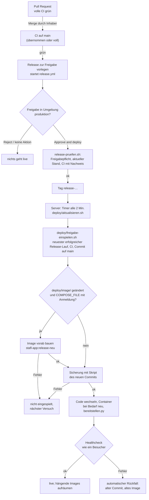

# 8 · CI, Release und Betrieb

Wie ein Stand vom Pull Request bis auf den Server kommt, was die CI prüft und wie der Server aufgebaut ist. Die
Ablaufbeschreibungen für den Inhaber stehen in [`docs/release-freigabe.md`](../release-freigabe.md), [`docs/datenbank.md`](../datenbank.md),
[`docs/plattform/inbetriebnahme-anmeldung.md`](../plattform/inbetriebnahme-anmeldung.md) und
[`deploy/anmeldung/LIESMICH.md`](../../deploy/anmeldung/LIESMICH.md). Wie man testet: [07 – Tests](07-tests.md).

## 8.1 Was nur mit Freigabe des Inhabers geschieht

Aus [`AGENTS.md`](../../AGENTS.md), Sicherheitsgrenzen – gilt für Menschen und Agenten gleichermaßen:

- **Nie direkt nach `main`.** Jede Änderung in einem eigenen Branch als Pull Request. Mergen und Releases freigeben
  ausschließlich der Inhaber (Konto `STAFLGUST`).
- **Produktion nur über Release.** Der Server spielt nur Commits ein, die in der GitHub-Umgebung `produktion` freigegeben
  wurden und eine grüne CI haben.
- **Nur mit ausdrücklicher Freigabe:** Änderungen an Server, Zugängen, Daten und Deploymentprozess; DNS;
  Datenbankmigrationen (z. B. `deploy/datenbank-umschalten.sh`); produktive Freigabe unfertiger Module.
- **Keine Geheimnisse und keine echten Daten** im Repository. Geheimnisse stehen nur in `.env` auf dem Server.

Alle Skripte in `deploy/` laufen **auf dem Server** und werden von Entwicklern und Agenten nicht ausgeführt, sondern
nur geändert (per PR) und mit `tests/deploy/` geprüft.

## 8.2 CI-Aufträge (`.github/workflows/ci.yml`)

Auslöser: jeder Pull Request, jeder Push auf `main`, von Hand (`workflow_dispatch`). Im Pull Request bricht ein neuer
Push den veralteten Lauf ab; auf `main` warten Läufe aufeinander (`concurrency`), damit kein Lauf abgebrochen wird, der
den Release vorlegt.

| Auftrag (Name in GitHub) | Inhalt | Läuft |
| --- | --- | --- |
| Schon im Pull Request geprüft? (`nachweis`) | hält den Git-Tree des Stands fest; auf `main` sucht `.github/scripts/ci_nachweis.py` einen vollständig grünen PR-Lauf mit genau diesem Tree (nur Hashes über die API) | immer |
| Statische Prüfungen (`statisch`) | siehe Liste unten | immer |
| Sicherheitsprüfungen (`sicherheit`) | gitleaks über den Verlauf bis `HEAD` (`.gitleaks.toml`, Version und Prüfsumme fest); Trivy: `tests/requirements.txt` (HIGH/CRITICAL blockiert), Images aus `docker-compose.yml` (nur Bericht) | immer |
| Anwendungs-Image prüfen (`image`) | `deploy/image/pruefen.sh` (Bau, Vergleich mit `php:8.3-apache`); `deploy/anmeldung/pruefen.sh` mit festen Keycloak-/PostgreSQL-Digests; Trivy auf `stafl-app:pruefung` (CRITICAL mit Korrektur blockiert, HIGH als Bericht) | nach `statisch`, außer übernommen |
| Sicherung und Release-Prozess (`betrieb`) | `tests/deploy/`: `test_datenbank.py`, `test_sqlite_http.sh`, `test_sichern.sh`, `test_freigabe.sh`, `test_release_pruefen.sh`, `test_anmeldung_einrichten.sh`, `test_notzugang.sh`, `test_cdn_netzsperre.py` (nftables in Netz-Namensräumen), `test_cdn_netzsperre.sh`, `test_konten_pruefen.sh`, `test_speicher.sh`, `test_sicherung_extern.sh` (echtes restic, lokal und über SFTP), `test_datenbank_umschalten.sh`, `test_altdateien.sh`, `test_karte_laden.sh`, `test_adressen_laden.sh` | nach `statisch`, außer übernommen |
| Ende-zu-Ende-Tests (*speicherart*, Teil *k*/3) (`e2e`) | Matrix `storage: [files, sqlite]` × `teil: [1, 2, 3]`, dazu über `include` „(sqlite, getrennt, Teil *k*/3)“ mit `WA_TEST_TRENNUNG=1` (Daten getrennt wie auf dem Server, ADR-007); `.github/scripts/testumgebung.sh e2e`, dann `python tests/run_e2e.py` mit `WA_JOBS=4`; Artefakt bei Fehler | nach `statisch`, außer übernommen |
| Ende-zu-Ende-Tests (`e2e_required`) | fester Name für den Branchschutz; grün nur, wenn alle neun Teile grün sind | nach `e2e` |
| Anmeldung über Keycloak (nur CI) (`oidc`) | `testumgebung.sh oidc`, `tests/oidc/umgebung.sh start`, `tests/oidc/test_oidc.py`, `stop`; Artefakt `oidc-ergebnisse` | nach `statisch`, außer übernommen |
| Vollständig geprüft (Stand *Tree*) (`vollstaendig`) | nur wenn alle vorigen Aufträge grün sind; der Name trägt den geprüften Tree (Nachweis für `main` und für den Release) | am Ende |
| Prüfung aus Pull Request übernommen (`uebernommen`) | nur auf `main`, wenn `nachweis` einen passenden PR-Lauf gefunden hat; verlinkt ihn | nur `main` |
| Release zur Freigabe vorlegen (`release_vorlegen`) | startet `release.yml` mit Grund (PR-Nummer und Titel) und erwartetem Commit | nur nach Push auf `main` mit Nachweis |

**Statische Prüfungen** (Schritte in dieser Reihenfolge):

1. PHP-Syntax (`php -l` für `app/` und `deploy/`, ohne `app/api/geo/`)
2. JavaScript-Syntax (`node --check` für `app/assets/`, `app/assets/vendor/`, `dashboard/`, `tests/unit/`)
3. Shell-Skripte (`shellcheck --severity=warning` für `deploy/` und `tests/deploy/`)
4. Caddy-Konfiguration mit echtem Parser (`caddy validate` mit derselben Caddy-Fassung wie in `docker-compose.yml`, ohne Netz)
   und Browser-Zwischenspeicher mit echtem Caddy (`tests/deploy/test_zwischenspeichern.py`: Abschnitt `zwischenspeichern`
   vor einer Nachbildung der Anwendung – Weiterleitung zur Anmeldung, 401 und 404 nie gespeichert)
   und Container-Images fest über Digest (`tests/deploy/test_images.py`: alle fremden Images mit `@sha256`, gleiches PHP-Grundimage
   für Kundenseite und Anwendungs-Image, CI lädt und scannt dieselben Fassungen)
5. Dashboard-Domains nur als geschützte Platzhalter (`tests/deploy/test_dashboard_domains.py`, GR-105; HSTS 1 Jahr je Host)
6. Python-Syntax (`py_compile` für Tests, Werkzeuge, `deploy/*.py`, `.github/scripts/*.py`)
7. Regelwerk und Modulgrenzen (`werkzeuge/regeln.py pruefen`, `tests/regeln/test_regeln.py`)
8. Entwickler-Dokumentation passt zum Code (`werkzeuge/doku.py pruefen`: Referenz in `docs/entwickler/referenz/`,
   Kopfkommentar je Code-Datei)
9. Versionsnummern der Skripte und Stylesheets (`werkzeuge/asset_versionen.py`: Einbindungen existieren, kein `?v=` im Repository)
10. Prüfliste der Dateiprüfung (`werkzeuge/integritaet.py`)
11. Tests ohne fest eingetragene Ports (`127.0.0.1:<Port>` in `tests/e2e/` nur in `umgebung.py`)
12. Unit-Tests: Bestands-Parser, Bestandswochen und Preisvergleich (PHP und JavaScript), gemeinsames Bearbeiten
13. Unit-Tests der CI-Werkzeuge (`test_run_e2e_teile.py`, `test_ci_nachweis.py`, `test_apt_vorrat.py`, `test_images_aktualisieren.py`)
14. Workflows prüfen (`actionlint`, Version und Prüfsumme fest)

**Keine Doppelprüfung nach dem Merge:** Die PR-CI prüft den Stand nach dem Zusammenführen (`refs/pull/N/merge`). Ist der
Tree auf `main` derselbe, überspringt der `main`-Lauf Image, Betrieb, E2E und Keycloak; statische Prüfungen und
Sicherheitsprüfungen laufen trotzdem. Bei jedem Zweifel läuft die volle CI. Einzelheiten und Rückweg:
[`docs/release-freigabe.md`](../release-freigabe.md#keine-doppelprüfung-nach-dem-merge).

### Weitere Workflows

| Workflow | Datei | Auslöser | Zweck |
| --- | --- | --- | --- |
| Release | `.github/workflows/release.yml` | von Hand oder durch `release_vorlegen` | wartet auf Freigabe in `produktion`, prüft (`.github/scripts/release-pruefen.sh schutz`, `aktuell`, `ci`) und legt den Tag `release-<JJJJMMTT-HHMMSS>` mit Freigebendem und Grund an; nur vom Branch `main`; ein neuer Lauf beendet einen älteren wartenden |
| Zwischenspeicher | `.github/workflows/zwischenspeicher.yml` | Push auf `main`, montags (Zeitplan), von Hand, PR nur bei Änderungen am Ablauf | füllt Paketvorrat (`testumgebung.sh vorrat`) und Keycloak/Caddy-Downloads (`tests/oidc/umgebung.sh laden`) für E2E und Keycloak; übernommen werden Pakete nur mit passender Prüfsumme (`.github/scripts/apt_vorrat.py`) |
| Sicherheitsupdates | `.github/workflows/sicherheitsupdates.yml` | montags 04:41 UTC, von Hand | `werkzeuge/images_aktualisieren.py`: neue Digests derselben Image-Fassungen (vom Herausgeber neu gebaut, meist Betriebssystem-Korrekturen) überall gleich eintragen – nur dort, wo die Registry den alten Digest für genau diese Fassung (`name:tag`) gemeldet hat; steht derselbe Digest im Repository unter mehreren Fassungen (auch in reiner Doku), wird nichts eingetragen und der Lauf meldet einen Fehler. Branch `plattform/sicherheitsupdates-…`, Pull Request (ersetzt einen älteren offenen); dessen CI hält GitHub an, bis der Inhaber „Approve workflows to run“ klickt (Bot als Erstbeitragender) – nur diese PR-Prüfung zählt für die Pflicht-Prüfungen, ein CI-Start für den Branch nicht (nur im Rückfall ohne Pull Request); neuere Fassungen nur als Hinweis. Merge/Release wie immer durch den Inhaber. Digests stehen deshalb nie in Workflow-Dateien (das GITHUB_TOKEN darf sie nicht ändern; `tests/deploy/test_images.py` prüft das) |
| CI-Nachweis (Trockenlauf) | `.github/workflows/ci-nachweis.yml` | von Hand | zeigt, ob ein `main`-Commit die PR-Prüfung übernehmen würde und warum (nicht); ändert nichts, zählt nicht als CI |

## 8.3 Release-Ablauf vom Merge bis zum Server

Schritte im Einzelnen:

1. **Merge** durch den Inhaber. Die CI auf `main` legt nach Erfolg den Release vor (Auftrag „Release zur Freigabe
   vorlegen“). Kam keine Freigabeanfrage: Actions → Release → Run workflow (Branch `main`).
2. **Freigabe** in GitHub: Lauf öffnen → Review deployments → `produktion` → Approve and deploy. Wer nichts tut, gibt
   nichts frei.
3. **Prüfungen nach der Freigabe** (`.github/scripts/release-pruefen.sh`): Umgebung verlangt Prüfer; `main` ist nicht
   weiter; CI für genau diesen Commit erfolgreich und mit Nachweis-Auftrag. Dann Tag `release-…`.
4. **Server:** `deploy/aktualisieren.sh` läuft per systemd-Timer `wochenangebot-update.timer` alle 2 Minuten
   (eingerichtet mit `deploy/einrichten.sh`). Es stellt zuerst die Bereitstellung des aktiven Stands sicher
   (`deploy/bereitstellen.py`) und ruft im Release-Modus (Datei `.release-modus`, eingerichtet mit
   `deploy/release-modus-einrichten.sh`) `deploy/freigabe-einspielen.sh` auf.
5. **`freigabe-einspielen.sh`** fragt die GitHub-API mit einem nur lesenden Token (`GITHUB_TOKEN_LESEN` in `.env`) nach
   dem neuesten erfolgreichen Release-Lauf auf `main` (selbst nach Startzeit ausgewählt, nicht der erste Eintrag der
   Antwort), prüft erneut die CI und dass der Commit auf `main` liegt. Ein abgelehnter oder zurückgenommener Commit steht in
   `.release-abgelehnt` und wird nicht erneut versucht (erneut versuchen und Verhalten beim Notfall-Rückfall:
   [`docs/release-freigabe.md`](../release-freigabe.md#notfall-rückfall-von-hand-deployrelease-zuruecksh)).
   Ein Release, der älter ist als der aktive Stand, wird nie automatisch eingespielt (nur Vermerk im Protokoll) – zurück geht
   es nur von Hand mit `deploy/release-zurueck.sh`.
   Anlass: Am 03.11.2026 lieferte GitHub einmalig einen vier Tage alten Lauf zuerst; der Server ging darauf zurück, und das
   alte Prüfskript (ohne bunny-Schlüssel) lehnte danach den richtigen Release ab.
6. **Image:** Ändert das Release `deploy/image/` und enthält `COMPOSE_FILE` die Ergänzungsdatei der Anmeldung, wird das
   Image vorab gebaut (`docker compose build --pull app` als `stafl-app:release-neu`). Fehler → nichts eingespielt.
7. **Sicherung** mit dem Sicherungsskript des neuen Commits (`deploy/.sichern-release.sh`). Ohne Sicherung kein Release.
8. **Code wechseln.** Ändern sich `Caddyfile`, `docker-compose.yml` oder die Ergänzungsdatei, werden alle Container
   neu erstellt; sonst bei neuem Image nur die Anwendungs-Container `app` und `app-mitarbeiter`, bei geänderter
   `apache-oidc.conf` nur `app-mitarbeiter` (ADR-007). Das bisherige Image bleibt als `stafl-app:release-vorher`. Danach
   `deploy/bereitstellen.py`: Versionsnummern `?v=…` und Prüfliste `app/api/lib/integritaet-liste.php` aus den
   Git-Objekten genau dieses Commits.
9. **Healthcheck** über Caddy wie ein Besucher: `status` (`"ok":true`), Angebots-API (200, 401 oder 503 im
   Wartungsmodus), Startseite mit `assets/frontend.js`, `/admin/` mit `assets/admin.js`; mit der Ergänzungsdatei der
   Anmeldung zusätzlich die Mitarbeiter-Hosts (`dashboard-stafl.de/api/?action=status` → 401, eigener Container
   `app-mitarbeiter`); zwei Erfolge hintereinander, insgesamt bis etwa 40 s.
10. **Ergebnis:** Erfolg → `docker image prune -f` (nur hängende Images). Fehler → automatischer Rückfall auf den alten
    Commit und `stafl-app:release-vorher`. Status steht in `daten/deployment.php` und im Eingabebereich; optional
    Meldung an `HC_DEPLOY_URL`.

**Rückfall von Hand:** `sh /opt/wochenangebot/deploy/release-zurueck.sh` – zurück auf den Stand vor dem letzten
Release (`vorher` in `daten/deployment.php`), Daten bleiben unverändert, der zurückgenommene Stand kommt nicht automatisch
wieder. Gesperrt, solange SQLite aktiv ist und der Zielstand keine Speicherschicht hat (erst
`sh deploy/datenbank-umschalten.sh rollback`, [`docs/datenbank.md`](../datenbank.md)). Nie mit `git reset` umgehen.

Getestet ohne Docker und ohne Server: `tests/deploy/test_freigabe.sh`, `tests/deploy/test_release_pruefen.sh`.

## 8.4 Server-Aufbau

Ein VPS mit Docker Compose; Installationsordner `/opt/wochenangebot` (Git-Checkout des freigegebenen Stands, `.env`).

| Dienst | Herkunft | Aufgabe |
| --- | --- | --- |
| `caddy` | `docker-compose.yml`, Image `caddy:2`, Konfiguration `Caddyfile` | einziger öffentlicher Eingang (Ports 80/443), TLS-Zertifikate, Sicherheits-Header, Browser-Zwischenspeicher (Abschnitt `zwischenspeichern`); leitet an `app`, `app-mitarbeiter` bzw. `keycloak` weiter; nicht freigegebene Dashboard-Hosts als 503-Platzhalter (GR-105) |
| `app` | `docker-compose.yml`; mit Ergänzungsdatei Image `stafl-app` aus `deploy/image/` (PHP 8.3, Apache, mod_auth_openidc nicht geladen) – baut dieses Image | die Anwendung; `app/` nur lesend, `daten/` als Datenordner. Mit Ergänzungsdatei **nur die Kundenseite** `angebot-stafl.de` (ADR-007): keine Anmelde-Geheimnisse; gehärtet: alle Prozesse als `www-data` ohne Linux-Sonderrechte, nur im Netz `kunde` mit Caddy (ohne Ausgang ins Internet; Datenleck-Prüfung über das Relais `caddy:8081`), Dateisystem nur lesbar (`/tmp`, `/run` im Speicher ohne Ausführung), `no-new-privileges`, PHP eingeschränkt (`deploy/anmeldung/kunde-php.ini`), Apache ohne Version (`kunde-apache.conf`), Grenzen `KUNDEN_CPUS`/`KUNDEN_SPEICHER` (Standard 3 CPU, 4 GB) |
| `app-mitarbeiter` | `deploy/anmeldung/docker-compose.anmeldung.yml`, dasselbe Image `stafl-app` (nie aus dem Netz geholt) | alle Mitarbeiter-Hosts und die Prüfung vor der Anmeldeseite: `app/` nur lesend, derselbe Datenordner, dazu `dashboard/`, `apache-oidc.conf` (Keycloak-Hosts), Detailkarte, alle Anmelde-Geheimnisse und das Dienstkonto `konten`; Netz `intern` mit Caddy und Keycloak. Neue Anmelde-Werte aus `.env`: `docker compose up -d app-mitarbeiter` |
| `postausgang` | `deploy/anmeldung/docker-compose.anmeldung.yml`, dasselbe Image `stafl-app` | verschickt die E-Mails, die die Kundenseite nur als Auftrag ablegt (ADR-007): alle 5 s `php api/postausgang.php` als `www-data`, Dateisystem nur lesbar, kein Port, eigenes Netz `postausgang` nur mit Ausgang zum Postfach; Postfach-Werte aus `.env` und `daten-geheim/` (nur lesend). Zustand: `docker compose ps postausgang` (Healthcheck = Lebenszeichen) |
| `keycloak` | `deploy/anmeldung/docker-compose.anmeldung.yml` (Version und Digest fest) | Mitarbeiteranmeldung, Realm `mitarbeiter`; Verwaltung nur auf `127.0.0.1:8180`; öffentlich über Caddy nur `/realms/mitarbeiter/` und `/resources/`; Netze `intern` (Caddy, app-mitarbeiter) und `anmeldung` – von der Kundenseite nicht erreichbar |
| `keycloak-db` | ebenda, PostgreSQL 17 (Digest fest) | Datenbank nur für Keycloak, internes Netz `anmeldung` |

Die Ergänzungsdatei ist aktiv, wenn `.env` `COMPOSE_FILE=docker-compose.yml:deploy/anmeldung/docker-compose.anmeldung.yml`
enthält (Inbetriebnahme Schritt 5). Ohne sie antworten die Keycloak-Hosts mit 502, nie mit der Anwendung ohne Anmeldung.

**Browser-Zwischenspeicher** (`Caddyfile`, Abschnitt `zwischenspeichern`, in jedem Block der Anwendung eingebunden):

| Datei | Speicherzeit im Browser |
| --- | --- |
| Skripte und Stylesheets mit `?v=…` (alle Seiten unter `app/` und `dashboard/`, Nummern von `deploy/bereitstellen.py`) | ein Jahr ohne Rückfrage (`immutable`); neue Fassung = neue Adresse |
| Schriften, Symbole, Logos (`/assets/fonts/`, `/assets/icons/`, `/assets/*.png`) | ein Tag ohne Rückfrage; ein neues Logo erscheint spätestens am nächsten Tag (sofort: neuer Dateiname) |
| Seiten, Schnittstelle, Bibliotheken unter `assets/vendor/`, Kartendaten | Rückfrage bei jedem Aufruf (`private, no-cache`, nie in fremden Zwischenspeichern) bzw. eigene Angabe der Anwendung |

Auf der Angebotsseite `public`, auf allen anderen Hosts `private` (nur der Browser des Nutzers, nie fremde
Zwischenspeicher). Gespeichert werden nur erfolgreiche Antworten (2xx, 304): eine Weiterleitung zur Anmeldung, „401“
oder „404“ nie – sonst bliebe eine Seite nach abgelaufener Sitzung ein Jahr kaputt. Geprüft mit echtem Caddy in der CI
(`tests/deploy/test_zwischenspeichern.py`).

**bunny.net (CDN) vor dem Server** (`Caddyfile`, Abschnitt `cdn`, in jedem Site-Block eingebunden; Einrichtung und Reihenfolge:
[docs/bunny-cdn.md](../bunny-cdn.md)): Mit `CDN_SCHLUESSEL` in `.env` gilt die Besucher-IP von bunny (`X-Real-IP`) nur bei
genau diesem Schlüssel im Kopf `X-Stafl-Cdn` und nur als einzelne IP-Adresse. Caddy gibt sie als `X-Forwarded-For` an
Anwendung und Keycloak weiter (`{besucher_ip}`), den Schlüssel nie. `CDN_PFLICHT=1` sperrt jeden Zugriff ohne Schlüssel (403),
auch vom Server selbst (Docker-Weiterleitung = private Adresse, wie Besucher über IPv6); ausgenommen ist nur der
Caddy-Container (127.0.0.1). Die Prüfung nach dem Einspielen schickt den Schlüssel aus `.env` mit.
Ohne gültigen Schlüssel wirkt nichts davon. Jede neue Weiterleitung (`reverse_proxy`, `forward_auth`) braucht
`header_up X-Forwarded-For {besucher_ip}` und `header_up -X-Stafl-Cdn`, jeder neue Site-Block `import cdn` – das prüft
`tests/deploy/test_cdn.py` mit echtem Caddy.

**Datenorte auf dem Server** (alle nicht im Repository):

| Ort | Inhalt |
| --- | --- |
| `.env` | Domain, Mail-Zugang, Geheimnisse der Anmeldung, Token für den Release-Modus, Schlüssel für bunny.net (`CDN_SCHLUESSEL`, `CDN_PFLICHT`), Ziel der externen Kopie (`SICHERUNG_EXTERN_ZIEL`) (nur root) |
| `.release-vorher`, `.release-abgelehnt` | Stand vor dem letzten Release (Notfall-Rückfall) bzw. abgelehnter Release (nur root) |
| `.cdn-netzsperre`, `.cdn-netzsperre-liste.json`, `.cdn-netzsperre-regeln` | Netzsperre für bunny.net: Modus, Liste der Edge-Server, Prüfsumme der gesetzten Regeln (nur root, `cdn-netzsperre.sh`) |
| `.sicherung-extern-schluessel` (+`.pub`), `.sicherung-extern-passwort`, `.sicherung-extern-hosts`, `.sicherung-extern-cache/` | Externe Kopie der Datensicherung: SSH-Schlüssel für die Storage Box, Passwort des restic-Repositorys (zusätzlich außerhalb des Servers aufbewahrt), gemerkter Schlüssel der Gegenstelle, Zwischenspeicher (nur root, `sicherung-extern.sh`; nie in `daten/`, nie in den Sicherungen) |
| `daten/` | Geschäftsdaten (Dateien oder `daten/.sqlite/store.sqlite`), Dateiablage `daten/dateien/` (hochgeladene Dateien, z. B. QM-Dokumente; gesichert als eigene Stände `sicherungen/dateien/<Zeit>/`; nach der Datentrennung in `daten-intern/dateien/`), Status von Sicherung, externer Kopie und Deployment, `mail-schluessel.php` bis zum Umzug nach `daten-geheim/` (nicht in Sicherungen), Versandaufträge der Kundenseite (`postausgang`) |
| `daten-intern/` | Interne Dokumente nach `deploy/daten-trennen.sh trennen` (ADR-007 Stufe 2a: Personal, Nutzer, CRM, Controlling, QS mit Dateiablage …; ab Trennstufe 2 auch Kundenstamm, Bestand, Stammdaten, Postfach-Zugänge, Empfänger der Bestellwünsche); nur in `app-mitarbeiter` und `postausgang` (`/var/www/daten-intern`), nie in der Kundenseite; gesichert als `intern-<Zeit>.tar.gz`; nur root/www-data |
| `daten-geheim/` | Schlüssel des im Eingabebereich hinterlegten Postfach-Passworts (`mail-schluessel.php`, nach `postfach-schluessel.sh umziehen`); nur in `app-mitarbeiter` und `postausgang`, nie in der Kundenseite, nicht gesichert, nur root/www-data |
| `daten-anmeldung/` | Realm-Import, Tresor `vault/` (Postfach-Passwort für Keycloak, nicht gesichert), während der Einrichtung `einrichtung.env` |
| `daten-karte/` | Detailkarte `karte.pmtiles` (OpenStreetMap, Deutschland bis Zoomstufe 15, ca. 5–6 GB) und `stand.txt`, Adressverzeichnis `adressen.sqlite` (geschätzt um 1 GB) und `adressen-stand.txt`; im Anwendungs-Container nur lesend unter `/var/www/karte`, nicht gesichert (jederzeit neu ladbar) |
| `sicherungen/` | Datensicherungen `daten-`/`intern-<Zeit>.tar.gz`, Keycloak `anmeldung-<Zeit>.dump`, Stände der Dateiablage `dateien/<Zeit>/`, Liste `.dateien-fehlend`, Sperre `.sperre`; Aufbewahrung siehe [Sicherung](#sicherung); nur root |
| Volumes | `caddy_data`, `caddy_config` (Zertifikate), `keycloak_db` |

### Skripte in `deploy/`

| Skript | Zweck | Wer ruft es auf |
| --- | --- | --- |
| `einrichten.sh` | Timer `wochenangebot-update` (alle 2 Min.) einrichten | Inhaber, einmalig |
| `aktualisieren.sh` | Bereitstellung sicherstellen, im Release-Modus `freigabe-einspielen.sh` | systemd-Timer |
| `release-modus-einrichten.sh` | Release-Modus einschalten (`.release-modus`, Token prüfen) | Inhaber, einmalig |
| `freigabe-einspielen.sh` | freigegebenes Release einspielen (Sicherung vorher mit `sichern.sh` und `dateien_sichern.py` des neuen Commits), Healthcheck, automatischer Rückfall | `aktualisieren.sh` |
| `bereitstellen.py` | Versionsnummern und Prüfliste aus dem aktiven Commit; `--pruefen` nur prüfen; `--verzeichnis` für einen Programmordner | Einspiel- und Rückfallskripte, `run_e2e.py`, `tests/deploy/test_freigabe.sh` |
| `release-zurueck.sh` | Notfall-Rückfall auf den Stand vor dem letzten Release | Inhaber |
| `sichern.sh` | Datensicherung mit Probeentpacken und Platzprüfung, inkl. Keycloak-Datenbank und Dateiablage; `--jetzt` sofort | Timer `wochenangebot-sicherung` bzw. `aktualisieren.sh` (1×/Tag), Release |
| `sicherung-einrichten.sh` | eigener Sicherungs-Timer (täglich 02:30) | Inhaber, einmalig |
| `sicherung-extern.sh` | Externe Kopie von `sicherungen/` auf eine Hetzner Storage Box (restic über SFTP, verschlüsselt, inkrementell): `einrichten` (Schlüssel, Passwort, Repository, Timer) / `jetzt` (kopieren, Aufbewahrung 30 Tage · 8 Wochen · 12 Monate) / `status` (nur lesend) / `pruefen` (`restic check`, Rücksicherungsprobe mit byteweisem Vergleich) / `passwort-neu` (Passwort des Repositorys wechseln, neues einmal anzeigen) / `passwort-pruefen` (aufbewahrte Kopie verdeckt eingeben und vergleichen) / `aus` (Timer entfernen); Anleitung `docs/plattform/inbetriebnahme-sicherung-extern.md` | Inhaber; Timer `wochenangebot-sicherung-extern` (täglich 03:30) |
| `sicherung-pruefen.py`, `sicherung-pruefen.php` | entpackte Sicherung prüfen | `sichern.sh` |
| `dateien_sichern.py` | Dateiablage: Stand mit festen Verweisen auf den vorigen, Platzbedarf, Prüfung gegen die Verweise der Daten; `fehlende` für den Betreiber | `sichern.sh`, Betreiber |
| `datenbank.py` | SQLite: `check`, Migration/Rückkonvertierung (`--offline`), Sicherung, `altdateien` (Altdateien auflisten/archivieren) | `datenbank-umschalten.sh`, `sichern.sh`, `run_e2e.py` |
| `datenbank-umschalten.sh` | `migrate` / `rollback` zwischen Dateien und SQLite | Inhaber, nur mit Freigabe und Wartungsfenster |
| `altdateien.sh` | `zeigen` / `archivieren` der alten Datendateien nach der Umschaltung (nur bei aktivem SQLite, Archiv in `sicherungen/`) | Inhaber, nur mit Freigabe; Anwendung bleibt in Betrieb |
| `wartung-aus.sh` | Notfall: alle Wartungen beenden | Inhaber |
| `notzugang.sh` | Notfall: alten Eingabebereich mit eigener Anmeldung öffnen/schließen – nur über einen SSH-Tunnel (`127.0.0.1:8190`); `.env` ändert sich erst nach erfolgreichem `docker compose up`, jeder Aufruf gleicht den Container ab, `status` fragt auch den laufenden Container | Inhaber |
| `cdn-netzsperre.sh`, `cdn_netzsperre.py` | Netzsperre: Port 80/443 nur für die Edge-Server von bunny.net (nftables, eigene Tabelle `inet stafl_netzsperre`): `status` / `beobachten` (nur zählen) / `an` (verwerfen, Probe über bunny, sonst zurück auf beobachten) / `aus` (Notfall, sofort) / `aktualisieren` (Liste höchstens alle 6 Stunden, Regeln setzen); Anleitung `docs/bunny-cdn.md`, Abschnitt 7 | Inhaber; Timer `wochenangebot-netzsperre` (alle 30 Min.) |
| `daten-trennen.sh` | `status` (Stufe und Plan) / `trennen` (auf die höchste Trennstufe des eingespielten Stands: Sicherung, Stopp, `daten_trennen.py`, Start – auch von Stufe 1 auf 2) / `zusammenfuehren` (zurück in einen Ordner, vor einem Rückfall auf ein Release mit niedrigerer Stufe; bricht es beim Aufräumen ab – Vermerk `daten-intern/.zusammengefuehrt`, alle Daten schon in `daten/` –, vollendet ein erneuter Aufruf es ohne neue Sicherung; `trennen` verweigert bis dahin. Trägt `daten/` das Kennzeichen noch (Abbruch vor dem Umschalten, die Anwendung lief getrennt weiter), sichert ein erneuter Aufruf neu und vergleicht wie beim ersten Mal – eine innen geänderte Datei bricht ab, statt beim Aufräumen gelöscht zu werden) | Inhaber, nur mit Freigabe und Wartungsfenster |
| `postfach-schluessel.sh` | `status` / `umziehen` (Schlüssel des Postfach-Passworts nach `daten-geheim/`, Passwörter an Server und Benutzer binden) / `zurueck` (vor einem Rückfall: zurück auf Format v1 und in den Datenordner) | Inhaber, einmalig nach dem Release mit dem Postausgang |
| `passwort-zuruecksetzen.sh` | Notfall: Passwort eines Nutzers zurücksetzen bzw. Administrator neu anlegen (`--neu`). Mitarbeiter „ohne Anmeldung“ (Feld `zugang` = `false`) werden abgelehnt – eine Anmeldung richtet man in der Verwaltung ein | Inhaber |
| `ip-freigabe-aus.sh` | Notfall: IP-Freigabe und Ländersperre ausschalten | Inhaber |
| `karte-laden.sh` | Detailkarte laden bzw. aktualisieren (`pruefen`: Stand und geschätzte Größe ohne Download; ohne Angabe: neuester Protomaps-Stand, Ausschnitt `deploy/karte/deutschland.geojson`, go-pmtiles fest über Digest, neue Datei neben der alten, geprüft, dann ausgetauscht; `entfernen`) – mindestens 14 GB frei. Zweite Karte als zweite Angabe: `pruefen herkunft` / `laden herkunft` / `entfernen herkunft` – Südamerika und Neuseeland (`deploy/karte/herkunft.geojson`) bis Zoomstufe 14 (rund 4,6 GB; `KARTE_HERKUNFT_ZOOM`, 5–15) nach `daten-karte/herkunft.pmtiles` für die Herkunftsbetriebe im Container-Import. Die geladene Stufe steht in `daten-karte/herkunft-zoom.txt`: Aufrufe ohne Angabe bleiben dabei, eine geänderte Stufe lädt auch bei gleichem Kartenstand neu; der Probelauf nennt die Größe (Platzgrenze 30 GB, `KARTE_PLATZ_GB`). Ausgeliefert wird sie nur auf dem Host des Container-Imports (Alias `/karte/herkunft.pmtiles`) | Inhaber, einmalig bzw. bei Bedarf |
| `adressen-laden.sh` | Adressverzeichnis der CRM-Karte laden bzw. aktualisieren (`pruefen`: Stand und Größe der Quelle ohne Download; ohne Angabe: Deutschland-Auszug von Geofabrik, geprüft über die veröffentlichte MD5-Prüfsumme – neben der Datei oder dem Ziel einer Weiterleitung – bzw. ohne sie über die angekündigte Größe, vorher Probe mit den Testdaten `tests/fixtures/karte/adressen.osm` (einzeln: `probe`), Umwandlung im Container `python:3.12-bookworm` – volles Image, das pyosmium-Paket braucht libexpat – mit pyosmium fest über Prüfsummen (`deploy/karte/requirements.txt`, `deploy/karte/adressen.py`), Prüfung von Format und Anzahl, dann Austausch; Quelle wird danach gelöscht; `entfernen`) – mindestens 12 GB frei | Inhaber, einmalig bzw. bei Bedarf |
| `speicher.sh` | Speicherbelegung anzeigen (nur lesend); `aufraeumen`: Docker-Bauzwischenspeicher und ungenutzte Images entfernen – nie Daten, Sicherungen, Volumes, Container oder `stafl-app:*` (Rückfall-Image) | Inhaber, bei Bedarf |
| `anmeldung/einrichten.sh` | Geheimnisse der Anmeldung in `.env` ergänzen, Realm-Import vorbereiten; `--pruefen` | Inhaber, Inbetriebnahme |
| `anmeldung/konten.sh` | Keycloak-Konten und Realm verwalten (siehe unten) | Inhaber |
| `anmeldung/ruecksicherung-probe.sh` | Rücksicherung der Keycloak-Datenbank in eine Probedatenbank üben | Inhaber |
| `anmeldung/pruefen.sh`, `image/pruefen.sh` | Betriebskonfiguration bzw. Image mit Docker prüfen | CI („Anwendungs-Image prüfen“) |

`daten/` ist im App-Container beschreibbar. Skripte, die als root laufen, schreiben dort deshalb nie direkt: Statusdateien
(`sicherung.php`, `sicherung-extern.php`, `deployment.php`) entstehen im Installationsordner und ersetzen den Eintrag nur per Umbenennen, `chown`
nur mit `-h` bzw. für echte Dateien (`find -type f`); Angaben, denen root folgt (vorheriger Stand für den Rückfall), stehen
in root-Dateien außerhalb (`.release-vorher`). Auch gelesen wird dort nur, was eine echte Datei ist: der SQLite-Abzug der
Sicherung (`datenbank.py snapshot`) überspringt Verweise unter `index.php`, `deployment.php`, `.daten-getrennt` und `.daten-intern`
und kopiert ohne ihnen zu folgen; die Sperrdatei `.storage.lock` öffnen `datenbank.py` und `daten_trennen.py` ohne einem Verweis zu
folgen (nur eine echte Datei), die Datenbank `.sqlite/store.sqlite` nie über einen Verweis. Code eines Testzweigs läuft nie auf dem Server.

Dieselbe Regel gilt für **Ordnernamen** und für jeden Ordner, in den ein weniger vertrauter Prozess schreiben darf:
`daten_trennen.py` legt Zielordner Schritt für Schritt an und bricht ab, sobald eine Komponente ein Verweis ist
(`ordner_nofollow`, beide Richtungen); `karte-laden.sh` und `adressen-laden.sh` prüfen jedes Ergebnis des Lade-Containers in
`daten-karte/` auf eine echte Datei (`echt`, auch die Probedatei), lesen Stand-Vermerke nur aus echten Dateien (`vermerk_lesen`,
sonst „keiner“), tauschen nur mit `mv -fT` aus (folgt keinem Verweis, ersetzt ihn), erzeugen die
Stand-Vermerke im Installationsordner und setzen sie nur per Umbenennen ein (`vermerken`), machen den Namen der Quelldatei
unmittelbar vor dem Download frei (der Probelauf des Containers lief vorher) und übernehmen aus der Kopfzeile `last-modified`
nur harmlose Zeichen; `bereitstellen.py` schreibt nur innerhalb des übergebenen Programmordners (`schreibpfad`, beide
Schreibwege) und legt seine Zwischendatei nie über einen Verweis an. Geprüft wird das in `tests/deploy/test_sichern.sh`, `test_sicherung_extern.sh`,
`test_postfach_schluessel.sh`, `test_datenbank_umschalten.sh`, `test_daten_trennen.py`, `test_karte_laden.sh`,
`test_adressen_laden.sh` und `test_freigabe.sh`.

Die PHP-Notfallwerkzeuge laufen im App-Container als `www-data` (`docker compose exec -T -u www-data app php …`), damit
Datenbank-Journal und Sperrdateien nicht root gehören.

### Keycloak-Verwaltung (`deploy/anmeldung/konten.sh`)

In der Serverkonsole im Installationsordner, Keycloak muss laufen. Ruft `kcadm.sh` im Container auf – ohne Browser,
ohne SSH-Tunnel. Benutzernamen wie im Eingabebereich.

| Befehl | Wirkung |
| --- | --- |
| `verwaltung` | einmalig: dauerhaftes Verwaltungskonto statt Start-Konto |
| `anlegen <name> <e-mail> <vorname> <nachname>` | Konto mit Startpasswort (einmal angezeigt) |
| `einladen <name> <e-mail> <vorname> <nachname>` / `einladen <name>` | Konto anlegen und Einladungsmail (Link 72 Std.) / erneut senden |
| `startpasswort <name>` | neues Startpasswort |
| `zuruecksetzen <name>` | zweiten Faktor (Einmalcode, Passkeys) löschen, überall abmelden, neues Startpasswort |
| `passkey <name>` | bei der nächsten Anmeldung Passkey einrichten |
| `sperren <name>` / `entsperren <name>` | deaktivieren und überall abmelden / Sperre (auch nach Fehlversuchen) aufheben |
| `pruefen <name>` | nur lesend: Ursachen von Anmeldeproblemen |
| `liste` | Konten anzeigen |
| `mail-einrichten [<adresse>]` | Mailversand von Keycloak über das Postfach der Anwendung (Vorrang: Postfach für interne E-Mails), Testmail |
| `design-setzen [standard]` | Anmeldeseite im Plattform-Design bzw. Rückfall auf Standard |
| `passwort-vergessen an\|aus\|status` | „Passwort vergessen?“ auf der Anmeldeseite (Link per Mail, 15 Min.; eigener Ablauf: zweiter Faktor bleibt Pflicht, wenn eingerichtet) |
| `realm-aktualisieren` | Realm auf den Stand von `realm-mitarbeiter.json` bringen (idempotent, neue Clients; Stand 8: Client `konten` für die Verwaltung; Stand 9: Client `sicherheit`; Stand 10: Client `controlling`; Stand 11: Client `leergut`; Stand 12: Client `rewe`; Stand 13: Client `qs`; Stand 18: Client `versand` – Ablauf am Release-Tag: [inbetriebnahme-versand.md](../plattform/inbetriebnahme-versand.md); Stand 19: Client `containerimport` – [inbetriebnahme-containerimport.md](../plattform/inbetriebnahme-containerimport.md)) |

Neue Mitarbeiter brauchen beides: Mitarbeiterkonto im Eingabebereich (Rechte) und Keycloak-Konto (Identität). Seit Stand 8 legt der
Administrator das Keycloak-Konto auch direkt im Mitarbeiter an (Abschnitt „Zentrale Anmeldung“: anlegen, Passwort setzen,
entsperren, Link per Mail – `app/api/lib/anmeldekonten.php`); die Konsolenbefehle bleiben für Notfälle und den zweiten Faktor. Konten
nie löschen und neu anlegen – die Verknüpfung hängt an der Keycloak-Kennung. `realm-mitarbeiter.json` wird von
`werkzeuge/realm_produktion.py` erzeugt, nicht von Hand geändert. Neue Modul-Hosts brauchen außerdem DNS, Caddy-Eintrag
und Client – alles mit Freigabe ([Inbetriebnahme](../plattform/inbetriebnahme-anmeldung.md)).

### Keine Testinstanz auf dem Server

Es gibt keine Testinstanz unter `test.<Domain>` mehr (aus dem Repository entfernt am 15.11.2026, GR-111; Container und
Ordner `/opt/wochenangebot-test` auf dem Server gelöscht am 17.11.2026 – offen sind noch der DNS-Eintrag `test` und der
Hostname der Testadresse in der bunny-Zone der Kundenseite). Neue Stände werden lokal
(`tests/run_e2e.py`) und in der CI geprüft; auf dem Server läuft nur freigegebener Code. Der Umgebungsschalter
`WA_TESTUMGEBUNG=1` (Kennzeichen, kein Mailversand, Testpostfach) bleibt und wird in der CI geprüft
(`tests/e2e/test_testumgebung.py`).

### Speicherplatz

- Container-Protokolle sind in allen Compose-Dateien auf 3 × 10 MB je Dienst begrenzt (`logging`, Treiber `json-file`).
  Ohne Begrenzung wächst das Protokoll der App mit jedem Seitenaufruf (Apache schreibt jede Anfrage ins Docker-Log).
  Die Begrenzung gilt für Container, die nach der Änderung erstellt werden – also ab dem nächsten Release, das die
  Container neu erstellt; dabei verschwinden auch die alten, unbegrenzten Protokolle.
- Begrenzt im Code: `versionen/*` (`keep_versions`), `mailversand` (3000), `verkehr` (`FW_VERKEHR_MAX`),
  `crm-aktivitaeten`, `anmeldeorte` (90 Tage), Sitzungen (Ablauf), Sicherungen (je 30 Stände).
- Unbegrenzt, weil fachlich gewollt: `bestellungen` (Geschäftsvorgänge, Aufbewahrungspflicht), `historie/*`
  (Preisverlauf je Woche), `protokoll/<JJJJ-MM>` (Aktivitätsprotokoll je Monat – Aufbewahrungsdauer ist eine
  Entscheidung des Inhabers).
- Prüfen und Aufräumen: `cd /opt/wochenangebot && sh deploy/speicher.sh` (nur anzeigen), `sh deploy/speicher.sh
  aufraeumen` (Bauzwischenspeicher, alte Images z. B. nach einem Keycloak-Versionswechsel). Release-Läufe entfernen
  nur hängende Images (`docker image prune -f`).

### Sicherung

- `deploy/sichern.sh` sichert `daten/` (nach der Trennung auch `daten-intern/`) täglich (eigener Timer oder über
  `aktualisieren.sh`) und vor jedem Release; jede Sicherung wird probeweise entpackt und geprüft. Bei SQLite über die
  Backup-API (konsistenter Snapshot). Die Anwendung läuft dabei weiter: ersetzt oder legt sie während des Archivs Dokumente
  an, endet GNU tar mit Code 1 („file changed as we read it“) – das gilt als Erfolg; abgeschnitten Gelesenes verwirft die
  Prüfung jeder Datendatei, fehlende Dateien die Zählung vor und nach dem Archiv.
- Läuft Keycloak, wird dessen Datenbank mitgesichert (`pg_dump`, Inhalt geprüft).
- **Erst prüfen, dann festschreiben.** Archive und Stand der Dateiablage entstehen als `.tmp`. Erst wenn alle Prüfungen
  bestehen, werden sie gemeinsam umbenannt, danach greift die Aufbewahrung. Ein Fehler entfernt alles dieses Laufs; ältere
  Sicherungen bleiben, auch wenn das Release es alle 2 Minuten erneut versucht. Abgebrochen wird nur bei Störungen der
  Sicherung selbst (Archiv, Abzug der Datenbank, Prüfung des Archivs, Ein-/Ausgabe, Platz), nie wegen einzelner Dateien.
- **Sperre** (`sicherungen/.sperre`): Mit `--jetzt` (Timer, Release, von Hand) wartet ein zweiter Lauf bis 10 Minuten, ohne
  (`aktualisieren.sh`) endet er sofort mit Fehler; der Grund steht auf stderr. Jeder Aufruf in den Keycloak-Container ist auf
  300 s begrenzt (`KC_FRIST`; der Abzug dauert Sekunden), damit ein hängender Container die Sperre nicht hält. Der Timer
  beendet einen Lauf nach 2 Stunden (`TimeoutStartSec`; dafür `deploy/sicherung-einrichten.sh` einmal erneut ausführen);
  `sichern.sh` räumt dabei auf und meldet den Abbruch im Status. Ist die Zeitmarke eines Laufs schon vergeben (zwei Läufe in
  derselben Sekunde, zurückgestellte Uhr), nimmt er eine Sekunde später oder bricht ab; überschrieben wird nie.
- **Aufbewahrung** (gemeinsam für `daten-`, `intern-`, `anmeldung-` und `dateien/` derselben Zeit, Tage in UTC): die Läufe
  der letzten 7 Tage, je Tag die 24 neuesten, dazu der letzte Lauf jedes Tages der letzten 30 Tage, immer mindestens die
  30 neuesten Läufe (eine verstellte Uhr löscht so nie alles). Liegt ein Lauf mehr als 2 Tage nach dem bisher neuesten
  (vorgestellte Uhr oder langer Ausfall), räumt er nicht auf und warnt „Uhrzeit prüfen“. Ein Stand mit späterer Zeit als der
  laufende dient nie als Vorlage für feste Verweise.
- **Dateiablage** (`dateien/`): nicht im Archiv, sondern je Lauf ein Stand `sicherungen/dateien/<Zeit>/` mit der Zeit der
  Archive. Unveränderte Dateien (gleiche Größe und Änderungszeit) sind feste Verweise (Hardlinks) auf den vorigen Stand,
  auch über die Datentrennung hinweg (`daten_trennen.py` erhält Größe und Zeit). Beim Release nutzt die Sicherung das
  Werkzeug des neuen Commits (`deploy/.dateien_sichern-release.py`). Jede Datei, auf die ein gesichertes Dokument verweist
  (Vertrag: [05-daten.md](05-daten.md#51-speicherarten)), kommt in den Stand. Fehlt sie in der Ablage, trägt jeder Stand sie
  aus dem vorigen weiter (fester Verweis), solange ein Dokument auf sie verweist; die Aufbewahrung verliert sie so nie. Alle
  Befunde sind Warnungen, Sicherung und Release laufen weiter:

  | Befund | Folge |
  | --- | --- |
  | Datei im Stand, Größe wie im Dokument | in Ordnung |
  | fehlt in der Ablage, liegt im vorigen Stand | übernommen; Warnung „… fehlen in der Ablage, in der Sicherung erhalten (Stand …), zurückholen: …“, in `sicherungen/.dateien-fehlend` je Datei das Ziel in der Ablage |
  | fehlt in der Ablage und im vorigen Stand | Warnung „… fehlen in Ablage und Sicherung“ mit den ersten drei Kennungen, in der Liste „fehlt in Ablage und Sicherung“ |
  | in der Ablage mit anderer Größe als im Dokument | die passende Fassung des vorigen Stands, sonst die der Ablage; Warnung |
  | Kopie im Stand beschädigt (SHA-256), Datei in der Ablage richtig | im neuen Stand frisch kopiert statt verlinkt, Warnung |
  | Kopie und Datei in der Ablage beschädigt | vorhandene Fassung bleibt, Warnung |
  | Datei verschwindet während des Kopierens (Entwurf gelöscht) | übersprungen, danach wie oben eingeteilt |
  | Dokument nicht lesbar (z. B. Verweis statt Datei, Name mit Steuer- oder Shell-Zeichen) | Warnung mit Dateinamen (Sonderzeichen maskiert), seine Verweise ungeprüft |

  Zustand der Ablage im Status (`ablage.zustand`): `kritisch`, wenn mehr als 10 oder mehr als 1 % der verwiesenen Dateien in
  der Ablage fehlen (Karte „Datensicherung“ rot: „Dateien aus der Sicherung zurückholen“), `warnung` bei jeder anderen
  Warnung (gelb „mit Warnung“), sonst `ok`. Die SHA-256-Stichprobe prüft je Lauf 20 zufällige Dateien und alle, deren
  Kennung (CRC32) modulo 30 zum Tag passt; so ist jede Datei innerhalb von 30 Tagen einmal geprüft. Mehrkosten bei 12 GB
  Ablage: ein Dreißigstel, rund 400 MB lesen und hashen je Lauf (Messung im PR #378).

- **Ausweg für den Betreiber.** `sicherungen/.dateien-fehlend` (nach jedem Lauf neu) nennt je Datei Kennung, Dokument und
  Ziel in der Ablage (bzw. „fehlt in Ablage und Sicherung“); sie enthält keine Befehle. Zurückholen, als root im
  Programmordner: `python3 deploy/dateien_sichern.py zurueckholen sicherungen/dateien`. Jede Datei der Liste kommt aus dem
  neuesten Stand als eigene Kopie (nie ein fester Verweis in die Sicherung) mit Größe, Rechten und Zeit der Sicherung zurück;
  vorhandene Dateien bleiben. Die Ablage ist im Container beschreibbar, deshalb liest root nur die Sicherung und
  geschrieben wird als Webserver (uid/gid 33): Ein Verweis am Ziel wird ersetzt, ein Verweis als Ordner abgelehnt, nichts
  außerhalb der Ablage geändert. Nie Zeilen der Liste an eine Shell geben. Gründe für nicht zurückgeholte Dateien stehen auf
  stderr, Rückgabe dann 1. Danach ist die Karte beim nächsten Lauf wieder grün. `python3 deploy/dateien_sichern.py fehlende daten-intern/dateien daten
  daten-intern` (vor der Datentrennung `fehlende daten/dateien daten`) listet jederzeit jeden Verweis ohne passende Datei in
  der Ablage mit Dokument und Befund; nur lesend. Hält ein Fehler das Release auf, stoppt `.release-abgelehnt` die
  Wiederholung ([Release-Freigabe](../release-freigabe.md)).
- **Platz.** Vor jedem Lauf müssen frei sein: neue Dateien der Ablage + 3 × übrige Daten (Abzug der Datenbank, Archiv,
  Probe-Entpacken; gezählt ohne das, was nicht ins Archiv kommt, also ohne `dateien/` und `geo/`) + 5 GB Reserve (die
  Warnschwelle „Speicherplatz“ im Reiter System). Sonst bricht die Sicherung vorher mit Meldung im Status ab. Auf Dauer
  belegt: die Ablage einmal, dazu ihre Änderungen der letzten 30 Tage, und je Lauf Archive, Keycloak-Sicherung und rund
  1 MB Ordner des Stands (gemessen bei 15.000 Dateien). Mit höchstens 24 Läufen je Tag in den letzten 7 Tagen (das Fenster
  berührt 8 UTC-Tage) und einem je Tag davor sind das höchstens 8 × 24 + 23 = 215 Läufe. Beispiel 12 GB Ablage und 10 MB
  Archive je Lauf: 12 GB + Änderungen + 215 × 11 MB ≈ 14,4 GB; bei 50 MB je Lauf ≈ 23 GB. Größe der heutigen Archive auf
  dem Server: `ls -la sicherungen`.
- Die Sicherungen von `sichern.sh` liegen auf demselben Datenträger wie die Daten. Die VPS-Sicherungen bei Hostinger
  (Stand 16.11.2026: vier) stellen nur den ganzen Server zurück, und wir steuern sie nicht.
- **Externe Kopie** (`deploy/sicherung-extern.sh`, ab 17.11.2026; wirksam erst nach der Einrichtung auf dem Server,
  [Anleitung](../plattform/inbetriebnahme-sicherung-extern.md)): Der Ordner `sicherungen/` geht täglich um 03:30 Uhr mit
  restic über SFTP (Port 23, eigener SSH-Schlüssel) auf eine Hetzner Storage Box – verschlüsselt mit einem Passwort, das
  nur auf dem Server und beim Inhaber liegt, inkrementell und ohne Vervielfachung (feste Verweise der Dateiablage
  bleiben einer). Ohne `.sperre` und `*.tmp`.
  - **Entkoppelt von `sichern.sh`:** eigener Timer, eigene Sperre. Die Kopie wartet bis zu 10 Minuten auf die Sperre der
    Sicherung, hält sie aber nicht – eine lange erste Übertragung blockiert so kein Release (dessen Sicherung wartet nur
    10 Minuten). Räumt `sichern.sh` während der Übertragung auf, meldet restic unlesbare Dateien: der Stand entsteht
    trotzdem, der Status trägt eine Warnung.
  - **Aufbewahrung:** je Tag ein Stand für 30 Tage, je Woche einer für 8 Wochen, je Monat einer für 12 Monate
    (`restic forget --prune`). Jeder Stand enthält den ganzen Ordner, also schon bis zu 30 Tage lokale Sicherungen: die
    Tagesstände schützen vor einem geleerten oder verschlüsselten Ordner `sicherungen/`, die Monatsstände reichen rund
    13 Monate zurück. Die Zahl richtet sich nach Ständen, nicht nach der Uhr – eine verstellte Uhr löscht nichts.
  - **Status:** `daten/sicherung-extern.php` (Dokument `sicherung-extern`, wie `sicherung` eine Datei neben der
    Datenbank; nur Zeit, Ergebnis, Meldung, Zahl und Größe der Stände – nie Ziel, Ausgabe von restic oder Geheimnisse).
    `sicherung_extern_stand()` in `lib/diagnose.php` macht daraus die Karte „Externe Kopie“ (Sicherheit → System) und den
    Punkt „Externe Datensicherung“ der Konfigurationsprüfung: Warnung, solange nicht eingerichtet, fehlgeschlagen, der
    letzte erfolgreiche Lauf älter als 36 Stunden ist oder seine Zeit mehr als eine Stunde in der Zukunft liegt
    (vorgestellte Uhr). `letzter` ist die Zeit des eigenen Laufs, nicht die des neuesten Stands im Repository – ein Stand
    aus der Zukunft bliebe sonst für immer der neueste. Nur `jetzt` schreibt „in Ordnung“; ein erfolgreiches `pruefen`
    lässt den Status stehen (ein Fehler von `jetzt` bleibt sichtbar), ein gescheitertes schreibt seinen Fehler. Die
    Kundenseite liefert den Status nicht aus. Im Dateibetrieb liegt die Statusdatei im Archiv der Sicherung und zählt
    dort als ein Datensatz; das Skript ersetzt sie deshalb nur unter der Sperre von `sichern.sh` (wartet bis zu
    60 Sekunden, schreibt danach trotzdem).
  - **Die Karte ist ein Hinweis, kein Beleg:** `daten/` ist in den Containern beschreibbar (nach der Datentrennung auch
    im Container der Kundenseite), wer dort als Benutzer der Anwendung schreibt, kann „aktuell“ fälschen. Der Beleg ist
    `sicherung-extern.sh status` (liest nur das Repository, nie die Statusdatei) bzw. `pruefen` als root auf dem Server.
  - **Passwort wechseln** (`passwort-neu`, unter derselben Sperre wie ein Lauf; ändert den Status nicht): neuer
    Schlüssel ins Repository (`restic key add`), Probe mit dem neuen Passwort, Passwortdatei per Umbenennen ersetzt,
    erst dann alle anderen Schlüssel entfernt (`restic key remove`). In dieser Reihenfolge öffnet die Passwortdatei das
    Repository zu jedem Zeitpunkt, auch nach einem Abbruch; `restic key passwd` entfernt den alten Schlüssel dagegen,
    bevor die Datei ersetzt werden kann. Angezeigt wird das neue Passwort erst, wenn das bisherige nicht mehr gilt – ein
    abgebrochener Wechsel zeigt nichts, ein erneuter Aufruf bringt ihn zu Ende. Der Hauptschlüssel bleibt derselbe:
    ältere Snapshots der Storage Box lassen sich weiter mit dem alten Passwort öffnen (Anleitung, Abschnitt 4).
  - **Grenze:** Wer den Server übernimmt, hat Schlüssel und Passwort und kann die Kopie löschen. Dagegen stehen die
    automatischen Snapshots der Storage Box und das Unterkonto (Anleitung, Abschnitt 2) – nicht das Skript.
  - **Geprüft** mit restic 0.12.1, 0.16.4 und 0.18.1 (`tests/deploy/test_sicherung_extern.sh`); nicht geprüft: echte
    Storage Box, Server, systemd.
- Nicht gesichert: `mail-schluessel.php` und `daten-anmeldung/vault/`. Nach Wiederherstellung auf neuem Server das
  Postfach-Passwort neu eingeben bzw. `konten.sh mail-einrichten` erneut ausführen.
- Wiederherstellung: [`docs/datenbank.md`](../datenbank.md#sicherung-und-wiederherstellung), Keycloak:
  [Rücksicherung der Anmeldung](../plattform/inbetriebnahme-anmeldung.md#rücksicherung-der-anmeldung-keycloak).

### Notfälle

| Lage | Erster Schritt |
| --- | --- |
| Release defekt, automatischer Rückfall reichte nicht | `sh deploy/release-zurueck.sh` |
| Wartung blockiert die Arbeit | `sh deploy/wartung-aus.sh` (beendet alle Wartungen; macht kein Modul produktiv) |
| Keycloak nicht erreichbar | `docker compose ps -a`, `docker compose up -d`; hilft das nicht: `sh deploy/notzugang.sh an` (alter Eingabebereich mit eigener Anmeldung, über `ssh -L 8190:127.0.0.1:8190 …` und `http://localhost:8190/admin/`), danach `sh deploy/notzugang.sh aus` |
| Administrator-Passwort vergessen (alte Anmeldung) | `sh deploy/passwort-zuruecksetzen.sh <name>` (setzt auch Zwei-Faktor und Passkeys zurück); nach Datenverlust `… admin --neu` |
| Selbst ausgesperrt (IP-Freigabe, Ländersperre) – auch an der Anmeldeseite | `sh deploy/ip-freigabe-aus.sh` |
| Anmeldung bei Keycloak klappt nicht | `sh deploy/anmeldung/konten.sh pruefen <name>`, dann ggf. `entsperren` bzw. `zuruecksetzen` |

Alle Notfallwerkzeuge laufen nur auf dem Server und nur durch den Inhaber.

Stand: 2026-10-24

## Images aktualisieren

Alle fremden Container-Images sind über Version und Digest festgelegt (`tests/deploy/test_images.py` prüft das): ein Release holt
so nie unbemerkt eine andere Fassung, und die CI prüft genau das, was der Server später nutzt. Sicherheitsupdates kommen
deshalb nur über einen eigenen PR:

1. Aktuelle Fassung und Digest ermitteln, z. B. `docker buildx imagetools inspect caddy:2` (Zeile „Digest“, Version aus
   `CADDY_VERSION`) bzw. `docker buildx imagetools inspect php:8.3-apache`.
2. Eintragen: Caddy in `docker-compose.yml`; PHP an beiden Stellen gleich (`deploy/image/Dockerfile`,
   `docker-compose.yml`); Keycloak/PostgreSQL in
   `deploy/anmeldung/docker-compose.anmeldung.yml` und den `docker pull`-Zeilen in `.github/workflows/ci.yml`.
3. PR mit grüner CI (Caddy-Prüfung, Anwendungs-Image, Trivy-Bericht); nach dem Release startet der betroffene Container einmal
   neu (Caddy: wenige Sekunden, Zertifikate bleiben im Volume).

