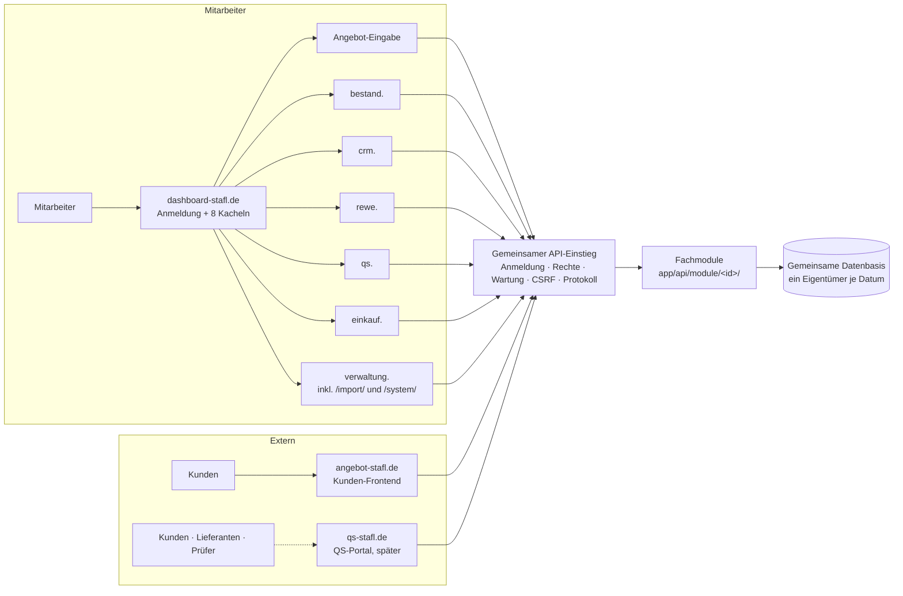

# STAFL-Plattform – Überblick

Ziel: aus dem Wochenangebotssystem schrittweise eine zentrale Mitarbeiterplattform machen – **fachlich unabhängige
Module auf gemeinsamer technischer Grundlage**, ohne Big-Bang-Umbau und ohne den Echtbetrieb von `angebot-stafl.de`
zu gefährden.

| Dokument | Inhalt |
| --- | --- |
| [bestandsaufnahme.md](bestandsaufnahme.md) | Geprüfter Ist-Zustand (Phase 0) |
| [zielarchitektur.md](zielarchitektur.md) | Module, Domains und Routing, Code-Struktur, Datenarchitektur und Datenbankstrategie, Anmeldung/SSO, Wartungskonzept, API-Konzept, Sicherheit, Entscheidungen (ADR) |
| [multi-agent.md](multi-agent.md) | Entwicklungsmodell mit parallelen KI-Agenten, Regelwerk und Werkzeug, Test- und CI-Konzept |
| [roadmap.md](roadmap.md) | Priorisierte Schritte als Pull Requests, offene Entscheidungen |
| [adr-003-domains-anmeldung.md](adr-003-domains-anmeldung.md) | Sicherheitsbewertung Unterverzeichnisse vs. Subdomains, Anmeldung (OIDC), Testdomain – Entscheidungsvorlage |

Maschinenlesbare Quelle aller Festlegungen ist `regeln/` (von der CI geprüft). Diese Dokumente erklären und
begründen – sie wiederholen keine Listen aus `regeln/`, damit nichts auseinanderläuft.

## Systemübersicht (Ziel)

Ein Docker-Container für die Anwendung (modularer Monolith), Caddy davor verteilt nach Host. Kein Microservice je Modul,
keine Datenbank je Modul.

## Stand (21.10.2026)

| Baustein | Status |
| --- | --- |
| DNS + Caddy-Platzhalter (503) für dashboard-stafl.de und 7 Subdomains | **produktiv ausgerollt** (PR #62, live geprüft) |
| Regelwerk `regeln/`, Modulregister, Prüfwerkzeug `werkzeuge/regeln.py`, CI-Schritt | **gemergt** (PR #63); ohne Wirkung auf den Echtbetrieb |
| Architektur, Datenbankstrategie, Wartungskonzept, Multi-Agent-Modell | **dokumentiert** (PR #63) |
| Domain- und Anmeldestruktur (ADR-003) | **Entscheidungsvorlage**, nicht umgesetzt |
| Dashboard, Modulverwaltung, Wartung je Oberfläche, zentrale Anmeldung, `/eingabe/` | **geplant** ([roadmap.md](roadmap.md)) |
| Fachmodule Bestand, CRM, REWE, Einkauf; QS-Fachlogik | **geplant** (QS als separates Großprojekt) |
