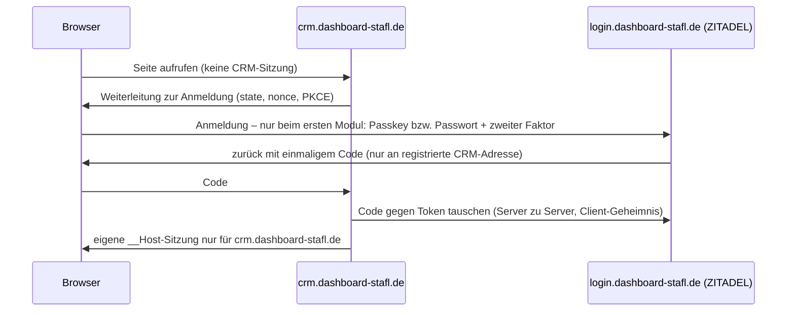

# ADR-003: Domainstruktur und Mitarbeiteranmeldung – Sicherheitsempfehlung

**Status:** Entscheidungsvorlage (nichts davon ist umgesetzt) · **Stand:** 21.10.2026
**Vorgaben des Betreibers:** IT-Sicherheit hat Vorrang vor Aufwand; ein Login; keine ungeschützten Cookies für alle
Subdomains; hostgebundene Sitzungen je Anwendung; etablierte Standards (OpenID Connect); serverseitige Prüfung jeder
Aktion; MFA/Passkeys; Trennung Kunden/Mitarbeiter/QS-extern; eine kompromittierte Anwendung darf nicht automatisch
andere Fachbereiche öffnen; Testumgebung vollständig getrennt; keine unnötig komplexe Infrastruktur.

## Empfehlung in Kürze

1. **Getrennte Subdomains** (Variante 2) – mit vier Bedingungen, ohne die der Vorteil verloren geht:
   `__Host-`-Cookies, eigene Sitzung je Host, Fetch-Metadata-Prüfung gegen „same-site“-Anfragen, Bindung jeder Aktion
   an ihren Host.
2. **Anmeldung über OpenID Connect mit ZITADEL** als Identitätsanbieter, auf eigenem Host `login.dashboard-stafl.de`.
   Jede Anwendung ist ein eigener OIDC-Client und hält nur ihre eigene, hostgebundene Sitzung. Rechte prüft weiterhin
   unser Server je Aktion.
3. **Eigene Testdomain** (eigene registrierbare Domain, z. B. `stafl-test.de`) und mittelfristig ein eigener kleiner
   Test-Server. `test.dashboard-stafl.de` wird nicht als Testumgebung genutzt.
4. Subdomains schützen im **Browser**. Gegen eine Kompromittierung **auf dem Server** helfen sie nicht – dafür getrennte
   Container je Vertrauenszone und Datenbankrollen je Modul (siehe „Grenzen“).

Die frühere Variante „ein Cookie für `dashboard-stafl.de` und alle Subdomains“ (Zielarchitektur, ADR-3 Variante A)
ziehe ich zurück: Sie widerspricht der Vorgabe hostgebundener Sitzungen und würde den Isolationsgewinn der Subdomains
aufheben.

## 1. Sicherheitsmodell der beiden URL-Varianten

Grundlage ist die Same-Origin-Policy des Browsers: Ein *Origin* ist Schema + Host + Port. `dashboard-stafl.de/crm` und
`dashboard-stafl.de/qs` sind **ein** Origin, `crm.dashboard-stafl.de` und `qs.dashboard-stafl.de` sind **zwei**.
Alle `*.dashboard-stafl.de` sind aber **eine Site** (gleiche registrierbare Domain) – das ist der wichtigste Haken
bei Subdomains: `SameSite`-Cookies schützen zwischen ihnen nicht.

| Bedrohung | Unterverzeichnisse (ein Origin) | Getrennte Subdomains (mit Bedingungen unten) |
| --- | --- | --- |
| **Gespeichertes XSS in einem Modul** (z. B. präparierte Kundennotiz im CRM) | Skript läuft im gemeinsamen Origin: liest alle Seiten, CSRF-Tokens und API-Antworten aller Module mit den Rechten des Opfers (Einkaufspreise, QS-Dokumente). `Path` von Cookies ist laut Cookie-Standard ausdrücklich keine Sicherheitsgrenze | Skript bleibt im CRM-Origin. Antworten anderer Hosts sind nicht lesbar (kein CORS). Anfragen an andere Hosts tragen zwar deren Cookies mit (same-site!), werden aber durch CSRF-Token **und** `Sec-Fetch-Site: same-origin`-Pflicht abgewiesen. Schaden: CRM-Daten mit CRM-Rechten |
| **Manipulierte Bibliothek / Skript in einer Oberfläche** | wie XSS: alle Module | wie XSS: ein Modul |
| **Gestohlene Sitzung** (z. B. Cookie aus einem Fehlerprotokoll) | eine Sitzung öffnet alles | Sitzung gilt nur auf ihrem Host; der Server lehnt sie auf anderen Hosts ab |
| **Service Worker** eines kompromittierten Moduls | kann je nach Pfad alle Module abfangen | je Origin getrennt |
| **CSRF von fremden Seiten** | SameSite + Token | SameSite + Token (gleichwertig) |
| **Cookie-Tossing / Sitzungsfixierung von einer Nachbar-Subdomain** (kompromittiertes Modul, Testumgebung) | zwischen Modulen nicht möglich (ein Host); von Nachbarn der Domain aber schon | möglich, solange Cookies ohne Präfix genutzt werden → `__Host-`-Präfix (Browser nimmt sie nur vom eigenen Host an), neue Sitzungskennung nach jeder Anmeldung, OIDC mit `state`, `nonce`, PKCE |
| **Clickjacking** | `frame-ancestors 'none'` | gleich |
| **Server-Kompromittierung** (RCE, SQL-Injection in einem Modul) | alles betroffen | **ebenfalls alles betroffen**, solange ein Container und eine Datenbankrolle (siehe Grenzen) |
| **Fehlkonfiguration** | wenig bewegliche Teile | mehr Teile (Clients, Weiterleitungsadressen, Zertifikate) → aus dem Modulregister erzeugen, in der CI prüfen |
| **Abmelden / Sperren** | eine Sitzung beenden | alle Modul-Sitzungen beenden → OIDC Back-Channel-Logout plus zentrales Sitzungsregister |

**Ergebnis:** Für die Daten, die künftig verarbeitet werden, ist die Begrenzung von XSS- und Sitzungsdiebstahl-Folgen
auf ein Modul der entscheidende Gewinn. Unterverzeichnisse halte ich trotz geringeren Aufwands **nicht** für geeigneter:
Es gibt keinen Browser-Mechanismus, der Pfade desselben Origins voneinander trennt. Sie wären nur vorzuziehen, wenn
der Mehraufwand der Subdomains zu Fehlkonfigurationen führte – dem begegnen wir mit erzeugter Konfiguration und Tests.

### Pflichtbedingungen für die Subdomain-Variante

1. **Cookies:** nur `__Host-`-Cookies (Secure, Path=/, ohne Domain), HttpOnly, `SameSite=Strict`; nie ein Cookie mit
   `Domain=dashboard-stafl.de`. Der Server liest ausschließlich die präfixierten Namen.
2. **Eigene Sitzung je Host:** jedes Modul hat seine eigene Sitzung, die an Host und Modul gebunden ist. Eine
   CRM-Sitzung berechtigt nur zu CRM-Aktionen – auch wenn alle Module im selben Server-Code laufen.
3. **Aktion ↔ Host:** jede API-Aktion gehört genau einer Oberfläche (Roadmap PR 2); auf einem fremden Host wird sie
   abgewiesen, unabhängig von der Sitzung.
4. **Fetch Metadata + Origin:** Schreibende und datenliefernde API-Anfragen nur mit `Sec-Fetch-Site: same-origin`
   (oder `none` bei direkter Navigation) und passendem `Origin`; zusätzlich CSRF-Token je Sitzung. Keine
   `Access-Control-Allow-*`-Kopfzeilen (keine CORS-Freigaben zwischen Modulen).
5. **Kopfzeilen je Host:** strikte CSP (`script-src 'self'`, ohne `unsafe-inline` bei neuen Oberflächen),
   `frame-ancestors 'none'`, `Cross-Origin-Opener-Policy: same-origin`, `Cross-Origin-Resource-Policy: same-origin`,
   `Origin-Agent-Cluster: ?1`, `Referrer-Policy: no-referrer`, `Cache-Control: no-store` für API-Antworten,
   HSTS mit `includeSubDomains` und später Preload.

## 2. Anmeldung: OpenID Connect

- **Ein Login:** Die Anmeldesitzung liegt nur beim Identitätsanbieter. Ruft der Mitarbeiter danach ein anderes Modul auf,
  läuft derselbe Ablauf ohne Eingabe durch – jedes Modul erhält **eigene** Token und eine **eigene** Sitzung.
- **Kein Token im Browser:** Token bleiben auf dem Server („Backend for Frontend“); der Browser hat nur das
  hostgebundene Sitzungs-Cookie. Zielgruppe (`aud`) je Client – ein CRM-Token gilt nicht für Einkauf.
- **Eigener Host für die Anmeldung:** `login.dashboard-stafl.de` statt `dashboard-stafl.de`. Das Dashboard zeigt
  Inhalte (Modulstatus, Hinweise) und ist damit selbst eine Anwendung; ein Fehler dort darf nicht im Origin der
  Anmeldung laufen. Für Mitarbeiter bleibt `dashboard-stafl.de` der Einstieg – die Anmeldeseite erscheint automatisch.
- **Rechte bleiben bei uns:** Der Anbieter beantwortet „wer ist das, wie stark angemeldet“ (Passkey/zweiter Faktor,
  Anmeldezeit). Welche Module und Funktionen jemand nutzen darf, prüft unser Server bei jeder Aktion aus der
  Verwaltung – ein entzogenes Recht wirkt bei der nächsten Anfrage, nicht erst nach Ablauf eines Tokens.
- **Sensible Aktionen:** erneute Anmeldung beim Anbieter mit `max_age=0` (Passkey) statt eigener Passwortabfrage.
- **Abmelden:** Abmelden im Dashboard beendet die Anmeldesitzung; der Anbieter benachrichtigt jedes Modul über
  OIDC Back-Channel-Logout (Server zu Server). Zusätzlich kurze Modul-Sitzungen (z. B. 30 Min. Leerlauf, 10 Std. höchstens),
  damit eine verpasste Benachrichtigung begrenzt bleibt. Sperren eines Mitarbeiters beendet alle Sitzungen sofort.
- **Getrennte Zugänge:**
  - Mitarbeiter: Organisation „Mitarbeiter“ im Anbieter, Pflicht zu Passkey oder zweitem Faktor.
  - Kunden: unverändert in `angebot-stafl.de` (bestehende Zugänge bleiben). Sobald die Mitarbeiter-Eingabe von der
    Kundendomain weg ist, liegt dort **keine Mitarbeitersitzung mehr** – heute teilen sich beide dieselbe Sitzung.
  - QS-Portal (später): eigene Organisation mit eigener Richtlinie oder eigene Instanz; jede Mitarbeiter-Anwendung
    akzeptiert nur Token der Organisation „Mitarbeiter“ (serverseitig geprüft).
- **App:** Mitarbeiter-Anmeldung in der App wechselt später auf den OIDC-Ablauf für Apps (PKCE, Systembrowser).
  Kunden in der App unverändert.

### Auswahl des Identitätsanbieters

| Lösung | Stärken | Schwächen für uns | Ressourcen (Herstellerangaben) |
| --- | --- | --- | --- |
| **ZITADEL (empfohlen)** | OIDC, Passkeys und MFA eingebaut, Organisationen (Mitarbeiter / QS-extern), Back-Channel-Logout, lückenloses Ereignisprotokoll, Verwaltungsoberfläche und API | nur PostgreSQL; schneller Release-Takt (Minor alle 2 Wochen, Major alle 3 Monate) → Updates einplanen; AGPL-3.0 (unverändert intern genutzt unkritisch, vor Einsatz kurz bestätigen) | ein Go-Dienst, < 1 CPU-Kern, ~512 MB RAM; dazu PostgreSQL |
| Keycloak | am weitesten verbreitet, sehr ausgereift | Java, schwer, komplexe Verwaltung | ~1–1,5 GB RAM je Instanz |
| authentik | flexible Abläufe, gute Oberfläche | Python/Django mit Server- und Worker-Dienst, mehr bewegliche Teile | braucht seit 2025.10 nur noch PostgreSQL (kein Redis mehr) |
| Authelia | sehr klein, OpenID-zertifiziert, Passkeys | Nutzer in Datei oder LDAP, keine Verwaltungsoberfläche → Mitarbeiterverwaltung umständlich oder zusätzlicher LDAP-Dienst | < 30 MB RAM |
| Ory Hydra (+ eigene Anmeldung) | sehr klein, reiner OIDC-Anbieter | Passwort-, MFA- und Passkey-Prüfung bliebe Eigenbau (heute eigene WebAuthn-Prüfung) – widerspricht „bewährte Standards“ | klein; PostgreSQL |
| Kanidm | klein, Passkey-zentriert | kleinere Verbreitung, Verwaltung überwiegend Kommandozeile | klein |

**Warum ZITADEL:** bestes Verhältnis aus Sicherheit (Passkeys, MFA-Pflicht, Organisationstrennung, Protokoll – alles
ohne Eigenbau), Wartbarkeit (ein Dienst, Oberfläche für die Verwaltung) und Ressourcen (deutlich leichter als
Keycloak/authentik). Zusätzliche Dienste insgesamt: **zwei** (ZITADEL, PostgreSQL). PostgreSQL ist ohnehin für die
gemeinsamen Plattformdaten vorgesehen; der Anbieter erhält eine eigene Datenbank und Rolle, auf die die Anwendung keinen
Zugriff hat. Ein vorhandener Eigenbau entfällt dafür: die eigene Passkey-Prüfung wird für Mitarbeiter nicht mehr gebraucht.

Auf PHP-Seite braucht es einen geprüften OIDC-Client (erste Server-Bibliothek von außen, fest versioniert, im
Trivy-Scan). Die Auswahl erfolgt im Umsetzungs-PR.

## 3. Testumgebung

Heute läuft `test.angebot-stafl.de` auf dem Produktivserver mit beliebigen, auch ungeprüften Branches. Als
Nachbar-Subdomain ist sie **dieselbe Site** wie die Kundenseite: Code dort kann Cookies für `angebot-stafl.de` setzen
(Cookie-Tossing), und Anfragen von dort an die Produktion gelten als „same-site“. Bei Agenten, die laufend Code erzeugen,
ist das ein realistischer Weg.

**Empfehlung:**
- **Eigene registrierbare Domain** für Tests (z. B. `stafl-test.de`, Name frei wählbar): eigene Site → keine
  gemeinsamen Cookies, kein Cookie-Tossing, kein Same-Site-Vorteil. Darunter `dashboard.`, `angebot.`, `login.` usw. als
  Spiegel der Produktion. Kosten: eine Domain.
- **Eigene Anmelde-Instanz** für Tests (eigene Schlüssel, nur Testnutzer) – nie Verbindung zur produktiven.
- **Mittelfristig eigener kleiner Test-Server:** Docker trennt Prozesse, ist aber keine harte Sicherheitsgrenze;
  ungeprüfter Code gehört nicht auf den Server mit Echtdaten. Kosten: ein kleiner VPS.
- `test.dashboard-stafl.de` nicht als Testumgebung nutzen (aus dem Platzhalter entfernen, sobald die Testdomain steht).

## 4. Grenzen: was Subdomains nicht leisten

Alle Module laufen im selben PHP-Container mit denselben Zugangsdaten. Wer dort Code ausführen kann, hat alle Daten –
unabhängig von der URL-Struktur. Deshalb zusätzlich, abgestuft nach Aufwand:

1. **Vertrauenszonen statt Container je Modul:** ein Container für die öffentliche Kundenseite, einer für die internen
   Module, einer für die Anmeldung, später einer für das QS-Portal. Gleiches Image, eigene Zugangsdaten.
2. **Datenbankrollen je Zone/Modul** (mit PostgreSQL): die Kundenseite liest nur veröffentlichte Angebote und schreibt
   nur Bestellwünsche; Einkaufspreise und QS-Daten sind für sie technisch unerreichbar.
3. Bestehendes beibehalten: Programmcode nur lesend eingebunden, Dateiprüfung, Firewall, keine Geheimnisse im Code.

## 5. Befunde im heutigen Stand (nicht geändert, brauchen Freigabe)

| Nr. | Befund | Risiko | Vorschlag |
| --- | --- | --- | --- |
| B-1 | Sitzungs-Cookie `WA_ADMIN` ohne `__Host-`-Präfix; Mitarbeiter und Kunden teilen eine PHP-Sitzung auf dem Origin der öffentlichen Seite | Cookie-Tossing von `test.angebot-stafl.de`; abgemildert durch `SameSite=Strict`, HttpOnly, strikten Sitzungsmodus, neue Kennung nach Anmeldung, CSRF-Token und CSP | Präfix `__Host-` (kleine Änderung an der Anmeldung, alle Sitzungen enden einmalig); dauerhaft: Mitarbeiter-Eingabe von der Kundendomain lösen |
| B-2 | Testumgebung mit ungeprüften Branches auf dem Produktivserver und unter der Produktivdomain | siehe Abschnitt 3 | eigene Testdomain, später eigener Server |
| B-3 | Eigene WebAuthn-Prüfung für Passkeys | Eigenbau sicherheitskritischer Prüfungen | für Mitarbeiter durch den Anbieter ersetzen |

## 6. Umsetzungsweg (jeder Schritt einzeln freigegeben)

| Schritt | Inhalt | Produktivwirkung |
| --- | --- | --- |
| 0 | Entscheidung festhalten; Modulregister: `angebot.eingabe` → `angebot.dashboard-stafl.de`, Host `login.` ergänzen, CI-Prüfungen der Bedingungen 1–5 vorbereiten | keine |
| 1 | DNS `login.` und `angebot.` (dashboard-stafl.de); Testdomain registrieren | **DNS – Ihre Freigabe** |
| 2 | ZITADEL + PostgreSQL nur in CI und auf der Testdomain; OIDC-Client und hostgebundene Sitzungen im Plattformkern; Fetch-Metadata-Prüfung; Tests für jede Bedrohung aus Abschnitt 1 | keine |
| 3 | Aktion ↔ Host (Roadmap PR 2) | keine |
| 4 | Produktiv: ZITADEL-Dienst, Dashboard und Angebot-Eingabe unter neuen Hosts; Mitarbeiter richten Passkeys ein; `/admin/` bleibt für eine Übergangszeit parallel, danach Weiterleitung | **Server, Anmeldung – Ihre Freigabe** |
| 5 | B-1 auf der Kundendomain: nur noch Kundensitzung mit `__Host-`-Präfix | Kunden einmalig neu anmelden – Freigabe |
| 6 | Vertrauenszonen und Datenbankrollen (mit der PostgreSQL-Migration) | Freigabe |

Kundenzugänge bleiben in allen Schritten erhalten.

## Offene Punkte für die Entscheidung

1. Subdomain-Variante mit eigenem Anmelde-Host `login.dashboard-stafl.de` – einverstanden?
2. ZITADEL als Anbieter (Alternative bei Wunsch nach maximaler Verbreitung: Keycloak, rund doppelter Speicherbedarf)?
3. Eigene Testdomain jetzt, eigener Test-Server mittelfristig?
4. Größe des VPS (RAM/CPU): ZITADEL + PostgreSQL brauchen grob 1 GB zusätzlich.

## Quellen

- ZITADEL Ressourcen: https://help.zitadel.com/what-are-zitadel-minimum-self-hosted-specs
- ZITADEL Back-Channel-Logout: https://zitadel.com/docs/guides/integrate/back-channel-logout
- ZITADEL v3 (AGPL, nur PostgreSQL, Release-Takt): https://zitadel.com/blog/zitadel-v3-announcement, https://help.zitadel.com/zitadel-licensing-faqs
- authentik ohne Redis: https://goauthentik.io/blog/2025-11-13-we-removed-redis/
- Keycloak Größenordnung: https://skycloak.io/blog/keycloak-production-sizing-ram-cpu-requirements/
- Authelia: https://www.authelia.com/
- Cookie-Tossing zwischen Subdomains: https://labs.snyk.io/resources/hijacking-oauth-flows-via-cookie-tossing/
