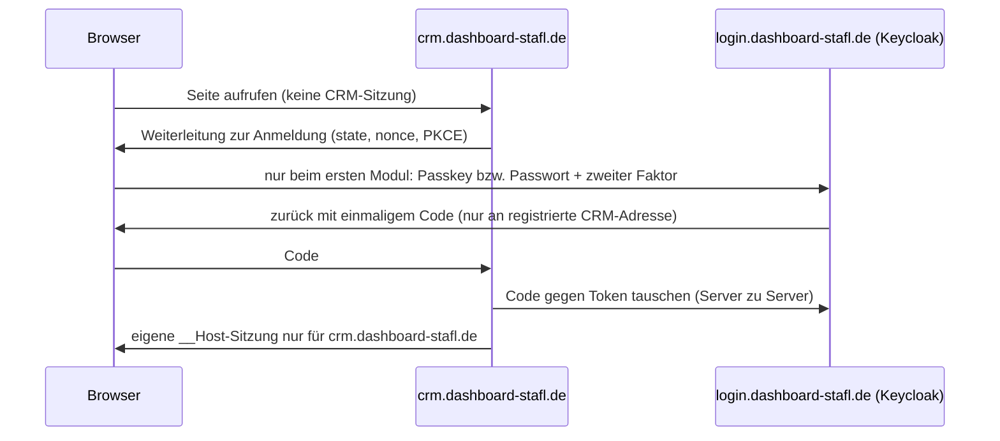

# ADR-003: Domainstruktur und Mitarbeiteranmeldung

**Status:** angenommen am 21.10.2026 (Betreiber) – **noch nicht umgesetzt**. Umsetzung nur schrittweise mit Freigabe (§6).
**Vorgaben des Betreibers:** IT-Sicherheit hat Vorrang vor Aufwand; ein Login; keine ungeschützten Cookies für alle
Subdomains; hostgebundene Sitzungen je Anwendung; etablierte Standards (OpenID Connect); serverseitige Prüfung jeder
Aktion; MFA/Passkeys; Trennung Kunden/Mitarbeiter/QS-extern; eine kompromittierte Anwendung darf nicht automatisch
andere Fachbereiche öffnen; Testumgebung vollständig getrennt; keine unnötig komplexe Infrastruktur.

## Entscheidungen

| Nr. | Entscheidung |
| --- | --- |
| 1 | **Getrennte Subdomains** je Anwendung; Anmeldung auf eigenem Host `login.dashboard-stafl.de`; Mitarbeiter-Eingabe des Angebots unter `angebot.dashboard-stafl.de`. Unterverzeichnisse verworfen (§1) |
| 2 | **OpenID Connect mit Keycloak** als Identitätsanbieter (§2). Ursprünglich vorgeschlagenes ZITADEL nach Prüfung der Sicherheitshistorie verworfen |
| 3 | **Eigene Testdomain mittelfristig**, derzeit nicht. Bis dahin Übergangsregeln (§3) |
| 4 | **Server:** Hostinger KVM 2 (2 vCPU, 8 GB RAM) genügt voraussichtlich; Upgrade auf KVM 4 nur, wenn Messungen es zeigen |

Die frühere Variante „ein Cookie für `dashboard-stafl.de` und alle Subdomains“ ist zurückgezogen.
Verbindliche Kurzregeln: GR-108 bis GR-111 in `regeln/katalog.toml`.

## 1. Sicherheitsmodell der beiden URL-Varianten

Ein *Origin* ist Schema + Host + Port. `dashboard-stafl.de/crm` und `dashboard-stafl.de/qs` sind **ein** Origin,
`crm.dashboard-stafl.de` und `qs.dashboard-stafl.de` sind **zwei**. Alle `*.dashboard-stafl.de` sind aber **eine Site**
(gleiche registrierbare Domain) – deshalb schützt `SameSite` zwischen Subdomains nicht.

| Bedrohung | Unterverzeichnisse (ein Origin) | Subdomains (mit Bedingungen unten) |
| --- | --- | --- |
| **Gespeichertes XSS in einem Modul** (z. B. präparierte Kundennotiz im CRM) | Skript liest Seiten, CSRF-Tokens und API-Antworten **aller** Module mit den Rechten des Opfers. `Path` von Cookies ist keine Sicherheitsgrenze | Skript bleibt im CRM-Origin. Antworten anderer Hosts nicht lesbar (kein CORS); Anfragen an andere Hosts werden durch CSRF-Token und `Sec-Fetch-Site`-Pflicht abgewiesen |
| **Manipulierte Bibliothek in einer Oberfläche** | alle Module | ein Modul |
| **Gestohlene Sitzung** | öffnet alles | gilt nur auf ihrem Host |
| **Service Worker eines kompromittierten Moduls** | kann je nach Pfad alle Module abfangen | je Origin getrennt |
| **CSRF von fremden Seiten** | SameSite + Token | SameSite + Token |
| **Cookie-Tossing von einer Nachbar-Subdomain** | zwischen Modulen nicht möglich, von Nachbarn der Domain schon | ohne Gegenmaßnahme möglich → `__Host-`-Präfix, neue Sitzungskennung nach Anmeldung, OIDC mit `state`, `nonce`, PKCE |
| **Clickjacking** | `frame-ancestors 'none'` | gleich |
| **Server-Kompromittierung** (RCE, SQL-Injection) | alles | **ebenfalls alles**, solange ein Container und eine Datenbankrolle (§4) |
| **Fehlkonfiguration** | wenig Teile | mehr Teile → aus dem Modulregister erzeugen, in der CI prüfen |
| **Abmelden / Sperren** | eine Sitzung | alle Modul-Sitzungen → Back-Channel-Logout + zentrales Sitzungsregister |

Unterverzeichnisse wären nur bei deutlich geringerem Fehlkonfigurationsrisiko vorzuziehen; es gibt aber keinen
Browser-Mechanismus, der Pfade desselben Origins trennt.

**Pflichtbedingungen** (ohne sie geht der Vorteil verloren):
1. Nur `__Host-`-Cookies (Secure, Path=/, ohne Domain), HttpOnly, `SameSite=Strict`; nie `Domain=dashboard-stafl.de` (GR-108).
2. Eigene Sitzung je Host; eine CRM-Sitzung berechtigt nur zu CRM-Aktionen (GR-108).
3. Jede API-Aktion gehört genau einer Oberfläche und wird auf fremden Hosts abgewiesen (GR-109, Roadmap PR 2).
4. API nur mit `Sec-Fetch-Site: same-origin` (bzw. `none` bei Navigation) und passendem `Origin`, dazu CSRF-Token;
   keine `Access-Control-Allow-*`-Kopfzeilen (GR-109).
5. Je Host: strikte CSP (`script-src 'self'`, bei neuen Oberflächen ohne `unsafe-inline`), `frame-ancestors 'none'`,
   `Cross-Origin-Opener-Policy: same-origin`, `Cross-Origin-Resource-Policy: same-origin`, `Origin-Agent-Cluster: ?1`,
   `Referrer-Policy: no-referrer`, `Cache-Control: no-store` für API-Antworten, HSTS mit `includeSubDomains`, später Preload.

## 2. Anmeldung mit OpenID Connect und Keycloak

- **Ein Login, getrennte Sitzungen:** Die Anmeldesitzung liegt nur bei Keycloak; jedes weitere Modul erhält ohne erneute
  Eingabe **eigene** Token und eine **eigene** hostgebundene Sitzung. Token bleiben auf dem Server; Zielgruppe je Client.
- **Rechte bleiben bei uns:** Keycloak beantwortet „wer, wie stark angemeldet“. Modul- und Funktionsrechte prüft unser
  Server bei jeder Aktion (GR-103) – ein entzogenes Recht wirkt sofort.
- **Sensible Aktionen:** erneute Anmeldung mit Passkey (`max_age=0`) statt eigener Passwortabfrage.
- **Abmelden/Sperren:** OIDC Back-Channel-Logout an alle Module, kurze Modul-Sitzungen (z. B. 30 Min. Leerlauf,
  10 Std. höchstens); Sperren eines Mitarbeiters beendet alle Sitzungen.
- **Getrennte Zugänge:** Realm `mitarbeiter` mit Pflicht zu Passkey oder zweitem Faktor. Kunden bleiben unverändert in
  `angebot-stafl.de`. QS-Portal später als **eigener Realm** (eigene Schlüssel, Nutzer, Richtlinien); Mitarbeiter-Anwendungen
  akzeptieren nur Token des Realms `mitarbeiter` (GR-104, GR-110).
- **Kundendomain:** Nach dem Umzug der Mitarbeiter-Eingabe liegt auf `angebot-stafl.de` keine Mitarbeitersitzung mehr.
- **App:** Mitarbeiter-Anmeldung in der App wechselt später auf den OIDC-Ablauf für Apps (PKCE, Systembrowser).

### Warum Keycloak statt ZITADEL

Ausschlaggebend ist die Sicherheitshistorie in genau den Funktionen, die wir nutzen würden:

| | ZITADEL | Keycloak |
| --- | --- | --- |
| Veröffentlichte Lücken 2025–2026 (kritisch/hoch) | 18 in 2025 (5 kritisch), weitere 9 in 2026 (1 kritisch) – u. a. Umgehung des zweiten Faktors, Durchprobieren von Codes, SSRF ohne Anmeldung, Kontoübernahmen über Kopfzeilen und XSS in der Anmeldung | 2026 überwiegend „hoch“, keine „kritisch“ in den Herstellerhinweisen; viele betreffen Zusatzfunktionen (SAML, dynamische Client-Registrierung, LDAP, Token-Austausch, feingranulare Admin-Rechte), die wir abschalten |
| Reife, Prüfung durch Dritte | jünger, kleinere Nutzerbasis; viele brechende Änderungen (Login V2 als eigener Dienst) | sehr verbreitet, langjährig, großes Sicherheitsteam (Red Hat) |
| Passkeys / MFA / Back-Channel-Logout | ja / ja / ja | ja (Passkeys offiziell seit 26.4) / ja / ja |
| Trennung extern/intern | Organisationen in einer Instanz | eigene Realms (stärkere Trennung) |
| Ressourcen | ~512 MB + PostgreSQL | ~1–1,5 GB + PostgreSQL |
| Wartung | Minor alle 2 Wochen, Major alle 3 Monate | regelmäßige Releases; Sicherheitskorrekturen in der aktuellen Linie |

Viele Lücken beider Produkte waren nur unter bestimmten Konfigurationen ausnutzbar. Entscheidend ist deshalb auch die
Härtung (unten). Keycloak ist schwerer, passt aber auf den KVM 2. Authelia (keine Nutzerverwaltung), authentik (mehr
bewegliche Teile) und Ory Hydra (Anmeldung und Passkey-Prüfung blieben Eigenbau) bleiben verworfen.

**Härtung von Keycloak (Teil der Umsetzung, in Tests geprüft):**
- Nur OIDC; SAML, dynamische Client-Registrierung, Token-Austausch, LDAP und Selbstregistrierung aus.
- Verwaltungsoberfläche auf eigenem Host (`hostname-admin`) **nicht öffentlich** (nur über SSH-Tunnel oder freigegebene IP);
  Caddy liefert auf `login.dashboard-stafl.de` nur `/realms/…` und `/resources/…` aus, `/admin` nie.
- Weitergeleitete Kopfzeilen (`X-Forwarded-*`) setzt nur Caddy; Keycloak vertraut nur dem Proxy.
- Clients: vertraulich, PKCE Pflicht, exakte Weiterleitungsadressen, keine Wildcards, kurze Token-Laufzeiten.
- Brute-Force-Schutz an, Passwort-Hash nach aktueller Empfehlung, Passkey oder zweiter Faktor Pflicht.
- Updates: Image fest auf Version und Prüfsumme; Sicherheitshinweise abonnieren; kritische Lücken innerhalb von 72 Std.,
  hohe innerhalb von 7 Tagen über den normalen Release-Prozess einspielen; vor jedem Update CI-Tests gegen die neue Version.
- Eigene Datenbank und Datenbankrolle für Keycloak, getrennt von den Geschäftsdaten.

Auf PHP-Seite braucht es einen geprüften OIDC-Client (erste Server-Bibliothek von außen, fest versioniert, im
Trivy-Scan); Auswahl im Umsetzungs-PR.

## 3. Testumgebung

Heute läuft `test.angebot-stafl.de` auf dem Produktivserver mit beliebigen Branches. Als Nachbar-Subdomain ist sie
**dieselbe Site** wie die Kundenseite: Code dort kann Cookies für `angebot-stafl.de` setzen, und Anfragen von dort gelten
als „same-site“.

**Mittelfristig (Entscheidung 3):** eigene registrierbare Testdomain (z. B. `stafl-test.de`) mit eigener Keycloak-Instanz
und eigenem kleinen Server.

**Bis dahin gilt (GR-111):**
- Keycloak und die neue Anmeldung laufen **nur in der CI** (kurzlebige Container, Testschlüssel, Testnutzer) – keine
  Test-Instanz von Keycloak unter `dashboard-stafl.de` oder `angebot-stafl.de`.
- `test.dashboard-stafl.de` bleibt 503-Platzhalter und wird nicht als Testumgebung genutzt.
- `test.angebot-stafl.de` bleibt wie heute (nur Testdaten, eigener Passwortschutz, kein E-Mail-Versand); keine
  Produktiv-Zugangsdaten oder -Geheimnisse dort.
- Befund B-1 (unten) zuerst beheben – er verringert genau das Risiko aus der gemeinsamen Site.

## 4. Grenzen: was Subdomains nicht leisten

Alle Module laufen im selben PHP-Container mit denselben Zugangsdaten. Gegen Code-Ausführung auf dem Server helfen
Subdomains nicht. Deshalb, abgestuft:
1. **Vertrauenszonen:** Container für die öffentliche Kundenseite, für die internen Module, für Keycloak, später für das
   QS-Portal – gleiches Image, eigene Zugangsdaten.
2. **Datenbankrollen je Zone/Modul** (mit PostgreSQL): die Kundenseite liest nur veröffentlichte Angebote und schreibt nur
   Bestellwünsche; Einkaufspreise und QS-Daten sind für sie unerreichbar.
3. Bestehendes beibehalten: Programmcode nur lesend, Dateiprüfung, Firewall, keine Geheimnisse im Code.

## 5. Befunde im heutigen Stand (nicht geändert, brauchen Freigabe)

| Nr. | Befund | Risiko | Vorschlag |
| --- | --- | --- | --- |
| B-1 | Sitzungs-Cookie `WA_ADMIN` ohne `__Host-`-Präfix; Mitarbeiter und Kunden teilen eine PHP-Sitzung auf der Kundendomain | Cookie-Tossing von `test.angebot-stafl.de`; abgemildert durch `SameSite=Strict`, HttpOnly, strikten Sitzungsmodus, neue Kennung nach Anmeldung, CSRF-Token, CSP | Präfix `__Host-` (kleiner PR; alle Sitzungen enden einmalig, Kunden und Mitarbeiter melden sich neu an; App nicht betroffen) |
| B-2 | Testumgebung mit beliebigen Branches auf Produktivserver und -domain | §3 | Testdomain und eigener Server mittelfristig |
| B-3 | Eigene WebAuthn-Prüfung für Passkeys | Eigenbau sicherheitskritischer Prüfungen | für Mitarbeiter durch Keycloak ersetzen |

## 6. Umsetzungsweg (jeder Schritt einzeln freigegeben)

| Schritt | Inhalt | Produktivwirkung |
| --- | --- | --- |
| 0 | Entscheidung festhalten, Modulregister und Regeln GR-108–GR-111 (dieser PR) | keine |
| 1 | B-1: `__Host-`-Präfix für die heutige Sitzung | einmalig neu anmelden – **Freigabe** |
| 2 | Aktion ↔ Host (Roadmap PR 2) | keine |
| 3 | Keycloak + PostgreSQL in der CI; OIDC-Client, hostgebundene Sitzungen, Fetch-Metadata-Prüfung im Plattformkern; Tests für jede Bedrohung aus §1 | keine |
| 4 | DNS `login.` und `angebot.` unter `dashboard-stafl.de` | **DNS – Freigabe** |
| 5 | Produktiv: Keycloak-Dienst, Dashboard und Angebot-Eingabe unter neuen Hosts; Passkeys einrichten; `/admin/` übergangsweise parallel, danach Weiterleitung | **Server, Anmeldung – Freigabe** |
| 6 | Vertrauenszonen und Datenbankrollen (mit der PostgreSQL-Migration) | **Freigabe** |
| 7 | Testdomain mit eigenem Server und eigener Keycloak-Instanz | mittelfristig, **Freigabe** |

Kundenzugänge bleiben in allen Schritten erhalten.

## Quellen

- ZITADEL-Sicherheitshinweise: https://advisories.gitlab.com/pkg/golang/github.com/zitadel/zitadel/ ,
  https://github.com/zitadel/zitadel/security/advisories/GHSA-cfjq-28r2-4jv5 , https://releasealert.dev/cve/CVE-2025-67494
- Keycloak-Sicherheitshinweise: https://github.com/keycloak/keycloak/security/advisories ,
  https://skycloak.io/blog/keycloak-26-7-3-security-fixes-patch-checklist/
- Keycloak Passkeys: https://www.keycloak.org/2025/09/passkeys-support-26-4 · Admin-Host: https://www.keycloak.org/nightly/server/hostname
- Keycloak Größenordnung: https://skycloak.io/blog/keycloak-production-sizing-ram-cpu-requirements/
- Hostinger KVM 2: https://www.vpsbenchmarks.com/hosters/hostinger/plans/kvm-2
- ZITADEL Ressourcen/Lizenz: https://help.zitadel.com/what-are-zitadel-minimum-self-hosted-specs , https://zitadel.com/blog/zitadel-v3-announcement
- Cookie-Tossing zwischen Subdomains: https://labs.snyk.io/resources/hijacking-oauth-flows-via-cookie-tossing/
